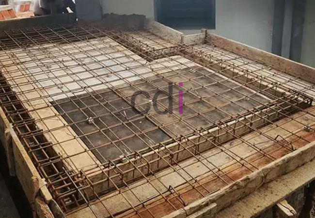

**Apa Itu Dak Dalam Bangunan?** - Hai Mitra CDI! Pernahkah Anda membayangkan memiliki area tambahan di atas rumah untuk bersantai atau berkebun? Nah, kemungkinan besar yang Anda butuhkan adalah dak bangunan! Banyak yang bertanya-tanya, sebenarnya apa sih dak itu, apa saja jenisnya, dan berapa biaya yang dibutuhkan untuk pemasangannya? Artikel ini akan mengupas tuntas semua itu, memberikan pemahaman mendalam tentang dak bangunan, mulai dari fungsi hingga perkiraan biayanya di tahun 2026. Yuk, kita simak bersama!

## Mengapa Dak Bangunan Sangat Penting? Memahami Fungsinya

Dak bangunan bukan sekadar penutup atas. Lebih dari itu, dak memiliki peran vital dalam sebuah konstruksi. Fungsi utamanya tentu saja melindungi bangunan dari paparan cuaca ekstrem – hujan lebat, sengatan matahari, hingga terjangan angin kencang. Dengan demikian, dak menjadi kunci dalam menciptakan lingkungan internal yang nyaman dan terlindungi. Selain perlindungan, dak juga berfungsi sebagai struktur penahan beban, menopang aktivitas di atasnya, baik beban mati bangunan itu sendiri maupun beban hidup manusia dan perabot.

Namun, manfaat dak tidak berhenti di situ. Area dak bisa dimaksimalkan sebagai ruang tambahan yang sangat berguna. Bayangkan punya taman atap yang asri, area jemur pakaian yang lega, atau bahkan tempat berkumpul bersama keluarga! Pemanfaatan ini menjadikan dak sebagai investasi cerdas. Pemilihan material dak yang tepat, dengan mempertimbangkan kekuatan dan daya tahannya, sangat penting demi keamanan dan fungsionalitas ruang tersebut. Jangan lupa, pemasangan juga harus sesuai standar keselamatan yang berlaku.

## Mengenal Berbagai Jenis Dak Bangunan: Mana yang Tepat untuk Anda?

Ada beberapa jenis dak bangunan yang bisa dipilih, masing-masing dengan kelebihan dan kekurangannya. Dua yang paling sering digunakan adalah dak beton dan dak baja ringan.

**Dak Beton:** Pilihan yang paling banyak dikenal dan terpercaya! Dak beton dikenal dengan kekuatannya yang luar biasa dan ketahanannya terhadap api. Proses pemasangannya melibatkan pengecoran beton bertulang di atas rangka baja atau langsung di atas struktur bangunan. Biasanya, ketebalan dak beton berkisar antara 10 cm hingga 15 cm, disesuaikan dengan beban yang akan ditanggung. Mutu beton yang digunakan umumnya berkisar antara K250 hingga K300, sesuai standar SNI.

**Dak Baja Ringan:** Semakin populer karena keunggulannya yang ringan, cepat dipasang, dan ekonomis. Rangka dak baja ringan dirakit dari komponen baja ringan yang dilapisi dengan material penutup seperti seng, spandek, atau asbes. Meskipun ringan, dak baja ringan tetap mampu menahan beban dengan baik.

Selain dua jenis utama tersebut, ada pula dak kayu yang sering dijumpai pada bangunan-bangunan tradisional atau rumah kayu. Memilih jenis dak yang paling sesuai membutuhkan pertimbangan matang, meliputi anggaran, beban yang akan ditanggung, kondisi iklim, dan tentu saja, preferensi estetika Anda.

## Standar dan Regulasi: Fondasi Keamanan Pemasangan Dak

Pemasangan dak bangunan harus selalu mengacu pada standar dan peraturan yang berlaku. Hal ini penting untuk menjamin keamanan, kualitas, dan keberlanjutan struktur bangunan. Di Indonesia, kita memiliki standar seperti SNI 03-6989-2002 (Persyaratan Umum Bahan Bangunan Baja Ringan) dan SNI 03-3976-2002 (Persyaratan Beton Struktural untuk Bangunan Gedung). Standar ini mencakup ketentuan mengenai mutu material, perhitungan struktur, dan metode pelaksanaan yang tepat.

Perlu diingat juga, peraturan daerah (Perda) setempat mungkin memiliki persyaratan tambahan terkait pemasangan dak. Pastikan Anda memahami dan memenuhi semua persyaratan tersebut sebelum memulai pekerjaan. Mengurus perizinan juga krusial untuk menghindari masalah hukum di masa depan.

## Perkiraan Biaya Pemasangan Dak Bangunan di (not detected) Tahun 2026

Biaya pemasangan dak bangunan di (not detected) sangat bervariasi, tergantung pada beberapa faktor: jenis dak yang dipilih, luas area yang akan dipasang, tingkat kesulitan pekerjaan, dan harga material setempat. Sebagai gambaran, biaya pemasangan dak beton biasanya berkisar antara Rp 400.000 hingga Rp 700.000 per meter persegi, sudah termasuk material (beton, besi tulangan, bekisting), tenaga kerja, dan biaya transportasi. 

Sementara itu, dak baja ringan cenderung lebih ekonomis, dengan biaya pemasangan sekitar Rp 250.000 hingga Rp 450.000 per meter persegi, mencakup material (rangka baja ringan, penutup dak), tenaga kerja, dan biaya transportasi. Perlu diingat bahwa angka ini hanyalah estimasi — untuk mendapatkan penawaran harga yang paling akurat dan sesuai dengan kebutuhan proyek Anda di (not detected), hubungi Kami segera! Sebagai ilustrasi, biaya total pemasangan dak baja ringan seluas 50 meter persegi mungkin berkisar antara Rp 12.500.000 hingga Rp 22.500.000.

Butuh solusi dak bangunan yang tepat untuk proyek Anda di (not detected)? Jangan ragu untuk berkonsultasi dengan tim ahli Kami! Klik tombol **WhatsApp** atau **Telepon** di bawah untuk mendapatkan panduan dan penawaran terbaik. Kami siap membantu Anda mewujudkan dak bangunan impian Anda!