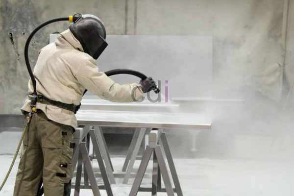

**Apa yang dimaksud dengan Sand Blasting?** - Hai Mitra CDI! Pernahkah Anda mendengar istilah *sand blasting*? Proses ini adalah cara efektif untuk membersihkan dan mempersiapkan permukaan material. Sederhananya, *sand blasting* melibatkan penembakan partikel abrasif – seperti pasir – ke permukaan dengan tekanan tinggi. Hasilnya? Permukaan yang bersih, sekaligus memiliki tekstur kasar yang ideal untuk lapisan berikutnya. Nah, pilihan partikel abrasifnya beragam, lho! Mulai dari baking soda, alox, glass bead, garnet, silica, hingga steel grit.

*Contoh penerapan sand blasting untuk membersihkan dinding berlumut*

## Mengapa Sand Blasting Jadi Pilihan?

Banyak yang memilih teknik *sand blasting* karena kepraktisannya. Prosesnya tergolong cepat dan efisien untuk menghilangkan berbagai macam kotoran yang menempel pada permukaan material. Mulai dari karat membandel, cat lama yang mengelupas, hingga debu dan garam. Bahkan, permukaan yang telah di-*sand blasting* akan menjadi lebih kasar, sehingga cat baru dapat menempel dengan lebih kuat. Ini dia keuntungan-keuntungan lainnya yang bisa Anda dapatkan:

- Membersihkan material besi dari kotoran, termasuk karat, cat lama, tanah, garam, dan kontaminan lainnya.
- Mengupas cat lama yang sudah pudar atau rusak secara efektif.
- Menciptakan profil permukaan metal yang lebih kasar, membantu cat melekat lebih baik.

Penting untuk diingat, petugas yang melakukan *sand blasting* harus dilengkapi dengan perlengkapan keselamatan yang memadai. Ini termasuk masker atau respirator, pelindung mata, pakaian pelindung, dan pasokan udara bersih melalui selang. Penerapan *sand blasting* seringkali ditemukan pada pekerjaan seperti perbaikan pompa PAM, pembuatan tangki air, atau dalam industri pembuatan kapal.

## Bagaimana Proses Sand Blasting Bekerja?

Proses pembersihan ini dilakukan dengan cara menembakkan partikel pasir silica menggunakan tekanan udara tinggi dari kompresor. Partikel-partikel tersebut akan menyembur ke permukaan material, menimbulkan tumbukan yang membersihkannya dan membuatnya kasar – mirip tekstur kulit jeruk. Tingkat kekasaran yang dihasilkan tergantung pada tekanan udara dan ukuran partikel pasir yang digunakan. 

Dengan tekanan udara tinggi, pasir yang disemburkan melalui nozel kompresor mampu menghilangkan karat yang membandel pada pelat besi. Namun, proses ini juga menghasilkan debu halus, karat, dan partikel lainnya yang beterbangan. Oleh karena itu, petugas harus dilengkapi dengan helm, pelindung wajah, pakaian pelindung, serta masker. Area sekitar juga perlu ditutup dengan terpal untuk mencegah penyebaran debu.

Sebelum memulai *sand blasting*, pastikan untuk membersihkan minyak dan grease terlebih dahulu menggunakan tiner. Untuk proyek *blasting* pada dok kapal, penggunaan *water jet* untuk membersihkan garam adalah hal yang penting. Setelah proses *blasting* selesai, bersihkan permukaan besi dari sisa pasir dan debu dengan menyemprotkan udara dari kompresor. Di (not detected), kami siap membantu Anda dalam proses sand blasting untuk berbagai kebutuhan. Hubungi kami untuk informasi lebih lanjut! Jangan ragu untuk bertanya tentang aplikasi sand blasting untuk proyek Anda di (not detected) dan area sekitarnya. Selain itu, Anda bisa menjelajahi solusi material bangunan lainnya di (not detected) melalui .

[Persiapan Sebelum Mengerjakan Sand Blasting](/blog/persiapan-mengerjakan-sand-blasting/)