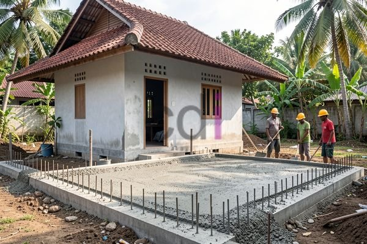

**Apakah Bagian Dasar dari Rumah yang Perlu Dipahami? Panduan Lengkap** - Hai Mitra CDI! Pernahkah terlintas di benak Mitra, seberapa penting bagian dasar rumah yang seringkali tak terlihat itu?

Kita cenderung lebih fokus pada tampilan luar dan interior rumah, ya? Memilih warna cat, menentukan desain dapur, atau mencari furnitur yang sesuai selera. Padahal, kekuatan dan keawetan sebuah rumah justru dimulai dari pondasi hingga struktur dasarnya. Memahami komponen-komponen ini sangat penting, tidak hanya saat membangun, tapi juga untuk perawatan rumah di masa depan. Yuk, kita bahas lebih rinci mengenai bagian-bagian dasar rumah yang wajib Mitra ketahui!

## Pondasi: Fondasi Utama Keamanan Bangunan

Pondasi merupakan elemen pertama dan terpenting dalam konstruksi. Ibaratnya tulangnya bangunan, pondasi bertugas menerima dan mendistribusikan seluruh beban struktur rumah ke lapisan tanah yang lebih stabil. Dengan pondasi yang kokoh, rumah jadi lebih tahan terhadap gempa, pergeseran tanah, dan risiko kerusakan lainnya.

Ada beberapa jenis pondasi yang populer digunakan, antara lain pondasi batu kali, pondasi beton bertulang, dan pondasi tiang pancang. Penentuan jenisnya bergantung pada kondisi tanah di lokasi Mitra, beban bangunan, dan juga anggaran yang tersedia. Misalnya, untuk tanah yang kurang padat, pondasi tiang pancang bisa jadi pilihan paling tepat. Sementara pondasi beton bertulang, dengan mutu minimal K-250, sering menjadi favorit karena kekuatannya yang teruji. Jangan lupa, kedalaman pondasi harus disesuaikan dengan kedalaman lapisan tanah keras di area (not detected).

## Sloof: Penghubung Fondasi dengan Struktur Bangunan

Setelah pondasi, ada elemen bernama sloof. Sloof ini berfungsi sebagai penghubung antara pondasi dan kolom bangunan. Bayangkan sloof sebagai jembatan yang mendistribusikan beban dari kolom ke pondasi secara merata, sehingga mencegah tekanan berlebihan pada satu titik. Dengan begitu, struktur bangunan jadi lebih stabil.

Ukuran sloof biasanya disesuaikan dengan beban yang akan ditanggung dan jenis tanah. Misalnya, untuk rumah dua lantai dengan beban per meter persegi sekitar 200 kg, ukuran sloof yang umum adalah 20cm x 30cm dengan tulangan besi diameter 10mm. Material yang digunakan umumnya beton bertulang dengan mutu minimal K-250 – sama seperti pondasi.

## Kolom: Tiang Penyokong Utama Bangunan

Kolom berperan sebagai tiang penyokong vertikal utama bangunan. Kolom menerima beban dari atap, lantai, dan dinding, lalu menyalurkannya ke sloof dan pondasi. Material yang paling sering digunakan untuk kolom adalah beton bertulang.

Desain kolom harus memperhitungkan berbagai faktor, termasuk beban yang akan ditanggung, tinggi bangunan, dan jenis tanah. Diameter kolom juga bervariasi, tergantung pada beban dan tinggi bangunan. Untuk rumah dua lantai, umumnya diameter kolom berkisar antara 25cm hingga 40cm dengan tulangan besi yang memadai. Pastikan kolom terhubung dengan kuat ke sloof dan balok lantai agar bangunan stabil dan aman.

## Balok: Penghubung Horizontal dan Distributor Beban

Balok adalah elemen horizontal yang menghubungkan kolom-kolom bangunan. Fungsi utamanya adalah menerima beban dari lantai dan dinding, kemudian mendistribusikannya ke kolom-kolom. Dengan adanya balok, tekanan pada kolom berkurang dan stabilitas struktur bangunan meningkat.

Ukuran balok pun bervariasi, tergantung pada bentang (jarak antar kolom) dan beban yang ditanggung. Balok beton bertulang dengan mutu minimal K-250 dan tulangan besi yang memadai adalah pilihan yang banyak direkomendasikan. Informasi lebih lanjut mengenai perkiraan biaya, atau jika Mitra memerlukan bantuan perhitungan struktur, Kami siap membantu! 

Investasi pada bagian dasar rumah yang berkualitas adalah langkah bijak untuk jangka panjang. Gunakan material berkualitas tinggi, lakukan perhitungan struktur secara akurat, dan pastikan ada pengawasan ketat dari tenaga ahli. Dengan begitu, Mitra CDI akan mendapatkan bangunan yang kokoh, aman, dan nyaman untuk dihuni. Kami dari Creative Design Interior siap menjadi mitra Mitra dalam mewujudkan rumah impian yang tidak hanya indah secara tampilan, tetapi juga kokoh secara struktural di (not detected).

Butuh bantuan lebih lanjut untuk proyek di (not detected)? Jangan ragu untuk menghubungi Kami! Klik tombol **WhatsApp** atau **Telepon** di bawah untuk berkonsultasi lebih lanjut.

[Balok Gantung Rumah: Solusi Desain Modern dan Pemasangan yang Tepat](/blog/balok-gantung-rumah/)
Ringkasan isi: Mitra CDI dimana saja berada, apakah Anda sedang mencari cara untuk menciptakan tampilan rumah yang lebih modern dan unik? Balok gantung rumah dapat m

<table class="table">
  <caption>Spesifikasi Material Sloof</caption>
  <thead>
    <tr><th>Material</th><th>Ukuran</th><th>Mutu Beton</th><th>Tulangan</th></tr>
  </thead>
  <tbody>
    <tr><td>Beton Bertulang</td><td>20cm x 30cm</td><td>K-250</td><td>Diameter 10mm</td></tr>
  </tbody>
</table>
