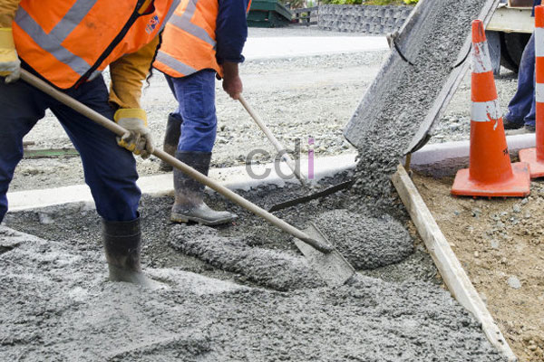

**Apakah Sebenarnya Cor Beton Itu ?** - Hai Mitra CDI! Pernahkah Anda bertanya-tanya, apa sih sebenarnya cor beton itu? Istilah ini sering kita dengar, tapi pemahaman mendalam tentang material ini mungkin belum dimiliki semua orang. Bahkan, terkadang tenaga pengecoran pun belum sepenuhnya paham tentang sifat dan proses pembuatannya. Nah, kami akan mengupas tuntas cor beton agar Anda lebih paham, khususnya jika Anda sedang berencana membangun di (not detected). Artikel ini akan memberikan gambaran jelas, sehingga Anda tak ragu lagi soal fondasi atau struktur bangunan.

*Cor Beton: Pondasi Kekuatan Bangunan Anda*

## Memahami Definisi Cor Beton yang Benar

Beton itu sendiri merupakan material konstruksi yang komposisinya sudah terstandarisasi dengan baik. Bahan utamanya adalah agregat kasar (split), agregat halus (pasir), semen (sebagai bahan aditif), dan air. Perpaduan keempat elemen ini bertujuan menghasilkan kekuatan yang tahan lama sesuai rencana. Penting diingat, ketiga bahan tersebut harus bebas dari lumpur atau tanah. Agregat kasar berfungsi menopang kekuatan beton, sementara agregat halus bertugas mengikat partikel-partikel agregat kasar. Semen kemudian berperan sebagai perekat sekaligus pengeras keseluruhan komponen.

Penggabungan keempat material ini dengan proporsi yang tepat akan menghasilkan mutu beton berkualitas. Proses pencampuran akan memicu reaksi kimia antara semen dan air, membentuk massa yang mengeras dan kokoh. Inilah inti dari pembuatan cor beton. 

Beton sendiri memiliki beragam jenis, seperti beton normal, ringan, berat, kedap air, massa, serat, dan mutu tinggi. Pemilihan jenis beton disesuaikan dengan kebutuhan proyek konstruksi Anda. Untungnya, saat ini mendapatkan beton cor siap pakai sangat mudah, berkat banyaknya penyedia jasa pengecoran *ready mix*. Di (not detected), **CDI** hadir sebagai **Supplier Ready mix concrete** terpercaya. Dengan pengalaman lebih dari sepuluh tahun, _Creative Design Interior_ siap memberikan solusi pengecoran yang cepat, tepat, dan efisien. 

Yuk, hubungi kami sekarang untuk informasi lebih lanjut! Konsultasikan kebutuhan Anda melalui layanan email dan telepon yang tersedia. Jangan ragu untuk bertanya – tim ahli kami siap membantu!