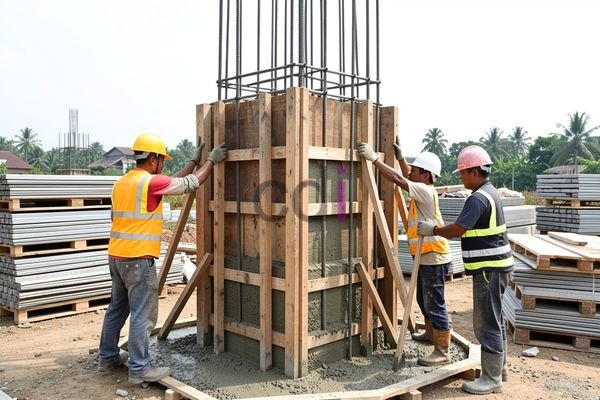

**Arti Bekisting dalam Konstruksi: Panduan Lengkap untuk Mitra CDI** - Hai Mitra CDI! Pernahkah Anda memikirkan bagaimana sebuah bangunan berdiri kokoh? Seringkali, ada satu elemen krusial yang terlupakan: bekisting. Lebih dari sekadar cetakan, bekisting adalah kunci utama dalam proses pengecoran beton. Artikel ini akan mengupas tuntas mengenai bekisting, mulai dari fungsi pentingnya, jenis-jenis yang tersedia, hingga standar yang harus diperhatikan – khususnya untuk proyek-proyek di (not detected).

### Peran Vital Bekisting dalam Pengecoran Beton

Bekisting memegang peran sentral dalam pengecoran beton, jauh melampaui fungsi sekadar wadah. Ia berfungsi sebagai penahan sementara campuran beton cair, memastikan bentuk dan dimensi akhir sesuai rancangan saat beton mengeras. Lebih dari itu, bekisting mendistribusikan beban beton secara merata, mencegah retak akibat penyusutan, dan menghasilkan permukaan beton yang halus dan presisi. Bayangkan, tanpa bekisting yang andal, kualitas dan kekuatan struktur beton akan sangat diragukan.

Mitra CDI, pemilihan bekisting yang tepat bukan hanya soal convenience, tapi menyangkut integritas dan keselamatan bangunan. Pertimbangkan teliti kebutuhan proyek, material yang digunakan, serta akurasi pemasangan. Hasilnya? Beton berkualitas tinggi yang akan bertahan lama.

### Mengulas Jenis-Jenis Bekisting yang Sering Digunakan

Beragamnya proyek konstruksi membutuhkan beragam pilihan bekisting. Masing-masing memiliki keunggulan dan kekurangan, dan pilihan terbaik akan bergantung pada kompleksitas desain, anggaran yang tersedia, dan kecepatan yang diinginkan dalam penyelesaian proyek. Berikut beberapa jenis bekisting yang umum digunakan:

*   **Bekisting Kayu:** Pilihan tradisional yang ekonomis dan mudah dimodifikasi. Namun, kekuatannya terbatas dan kurang tahan lama, sehingga ideal untuk proyek kecil dengan desain sederhana di (not detected). Pemasangan juga cenderung memakan lebih banyak waktu dan tenaga kerja.
*   **Bekisting Baja:** Pilihan yang lebih kokoh dan awet, sangat cocok untuk proyek besar dengan desain kompleks yang membutuhkan penggunaan berulang. Walaupun investasi awal lebih tinggi, bekisting baja menawarkan penghematan jangka panjang.
*   **Bekisting Plastik (Polypropylene):** Semakin diminati karena ringan, mudah dipasang, dan tahan terhadap air serta bahan kimia. Cocok untuk proyek perumahan atau komersial dengan desain yang repetitif di (not detected).
*   **Bekisting *One-Side* (Satu Sisi):** Solusi praktis untuk elemen vertikal seperti dinding atau kolom yang hanya membutuhkan penopang dari satu arah. Sering digunakan di lokasi dengan akses terbatas atau desain unik.

### Material Bekisting dan Evaluasi Biaya

Pemilihan material bekisting akan berdampak signifikan pada biaya dan kualitas keseluruhan proyek. Selain kayu, baja, dan plastik, material lain seperti *plywood*, multipleks, atau material komposit juga menjadi pilihan. Harga bekisting bervariasi tergantung pada jenis material, ukuran, dan kompleksitas desain.

Untuk memberikan gambaran, biaya bekisting kayu per meter persegi berkisar antara Rp 80.000 hingga Rp 150.000. Sementara itu, bekisting baja bisa mencapai Rp 200.000 hingga Rp 400.000 atau lebih, tergantung pada sistem dan ketebalan baja. Bekisting plastik biasanya berada di antara kedua harga tersebut.

Ketahui bahwa harga bersifat fluktuatif — untuk mendapatkan penawaran paling terkini dan akurat sesuai kebutuhan proyek Anda di (not detected), silakan hubungi Kami. Selain harga material, jangan lupakan biaya tenaga kerja untuk pemasangan dan pembongkaran.

### Memastikan Kepatuhan terhadap Standar dan Regulasi

Kepatuhan terhadap standar dan regulasi merupakan aspek krusial dalam konstruksi beton. Di Indonesia, penggunaan bekisting harus merujuk pada SNI terkait konstruksi beton, termasuk SNI 03-3976-2005 tentang Spesifikasi Beton Struktural untuk Bangunan Gedung dan SNI 2874-2015 tentang Tata Cara Perencanaan dan Pelaksanaan Struktur Beton Bertulang untuk Bangunan Gedung.

Standar-standar ini menetapkan persyaratan teknis mengenai kekuatan, stabilitas, dan keamanan bekisting, termasuk metode pengujian yang diperlukan. Jangan lupa juga untuk mempelajari regulasi lokal terkait Izin Mendirikan Bangunan (IMB) dan persyaratan teknis lainnya yang berlaku di (not detected).

Kami selalu siap membantu Mitra CDI mewujudkan proyek yang aman dan berkualitas. Jangan ragu untuk menghubungi Kami melalui tombol **Telepon** atau **WhatsApp** di bawah ini. [Memahami Arti Beton: Komposisi, Fungsi, dan Jenisnya untuk Proyek Konstruksi Mitra CDI](/blog/arti-beton/) – artikel ini juga bisa jadi referensi tambahan dalam perencanaan konstruksi Anda! [Berapa Lama Cor Lantai 2 Kering? Panduan Lengkap untuk Mitra CDI](/blog/berapa-lama-cor-lantai-2-kering/) akan membantu Anda memahami tahapan penting setelah pengecoran selesai.