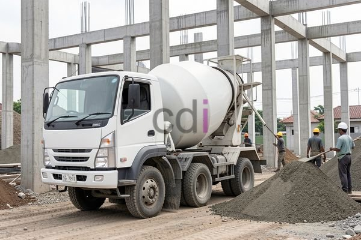

**Arti Beton** - Hai Mitra CDI! Pernahkah Anda perhatikan bangunan-bangunan kokoh di sekitar kita? Dari fondasi rumah hingga jembatan megah, ada satu material yang seringkali menjadi tulang punggungnya: beton. Meski begitu, apa sebenarnya beton itu? Artikel ini akan mengupas tuntas tentang beton – mulai dari komposisinya, fungsi vitalnya dalam konstruksi, hingga beragam jenis beton yang bisa Anda gunakan untuk proyek-proyek di (not detected). Yuk, kita mulai!

## Komposisi dan Proses Pembentukan Beton

Beton bukanlah bahan baku tunggal yang langsung jadi. Ia adalah hasil racikan dari beberapa komponen kunci yang bekerja bersama. Secara umum, beton terdiri dari semen, agregat (pasir dan kerikil), air, dan bahan tambahan (*admixture*). Semen bertugas sebagai perekat yang mengikat semua komponen menjadi satu. Agregat memberikan kekuatan dan volume pada beton, sedangkan air memicu reaksi kimia bernama hidrasi – proses yang membuat beton mengeras dan kuat. *Admixture* berfungsi untuk memodifikasi sifat-sifat beton, sesuai dengan kebutuhan spesifik proyek.

Mendapatkan campuran yang tepat sangatlah penting. Perbandingan yang ideal antara semen, agregat, air, dan *admixture* akan menghasilkan beton dengan kualitas terbaik. Contohnya, untuk beton K-25 (yang sering digunakan dalam konstruksi), rasio campuran umumnya sekitar 1:2:3 (semen:pasir:kerikil) dengan faktor air semen 0,4–0,5. Namun perlu diingat, angka ini bersifat indikatif saja. Jenis semen, agregat, dan *admixture* yang berbeda dapat memengaruhi rasio idealnya. Jangan ragu untuk berkonsultasi dengan ahli beton agar mendapatkan campuran yang paling sesuai dengan kebutuhan proyek Anda di (not detected).

## Fungsi Utama Beton dalam Konstruksi

Beton punya peran krusial dalam berbagai elemen bangunan. Ia berfungsi sebagai material struktural yang mampu menahan beban, baik beban mati (berat bangunan itu sendiri) maupun beban hidup (beban akibat aktivitas manusia dan perabot). Kemampuan beton menahan tekanan sangat tinggi, menjadikannya pilihan ideal untuk komponen vertikal seperti kolom dan dinding.

Tak hanya kuat, beton juga tahan terhadap api dan kondisi cuaca yang ekstrem. Ini menjadi keunggulan tersendiri bagi bangunan yang membutuhkan perlindungan ekstra. Selain itu, beton sangat fleksibel dan mudah dibentuk menjadi berbagai desain, sehingga memberikan kebebasan bagi arsitek dan desainer interior.

## Ragam Jenis Beton dan Aplikasinya

Ada beragam jenis beton yang dapat dipilih, masing-masing dengan karakteristik dan kegunaan tersendiri. Beberapa jenis beton yang paling umum digunakan antara lain:

*   **Beton Bertulang:** Jenis beton ini paling sering digunakan dalam konstruksi. Kekuatannya ditingkatkan dengan menambahkan tulangan baja di dalamnya. Tulangan ini berfungsi menahan gaya tarik, yang merupakan kelemahan utama beton. Aplikasi beton bertulang sangat beragam, mulai dari fondasi, kolom, balok, hingga lantai.
*   **Beton Ringan (Lightweight Concrete):** Beton ringan memiliki berat yang lebih rendah dibandingkan beton biasa, karena menggunakan agregat ringan seperti *expanded clay* atau *aerated concrete*. Ini menjadikannya pilihan tepat untuk mengurangi beban struktur bangunan dan meningkatkan efisiensi energi.
*   **Beton Self-Compacting Concrete (SCC):** Beton SCC punya kemampuan unik untuk mengalir sendiri dan mengisi cetakan secara sempurna tanpa perlu digetarkan. Ini sangat membantu dalam pengerjaan struktur yang kompleks atau area yang sulit dijangkau.
*   **Beton Fiber Reinforced Concrete (FRC):** Beton ini diperkuat dengan serat (fiber) dari berbagai material seperti baja, polipropilen, atau karbon. Penambahan serat membuat beton lebih kuat secara lentur, lebih tahan terhadap retak, dan lebih awet.

## Estimasi Biaya dan Pertimbangan Penting

Biaya beton bisa bervariasi, bergantung pada jenis beton, mutu beton, serta lokasi proyek Anda. Untuk gambaran, harga beton siap pakai (ready mix) di wilayah Jabodetabek pada tahun 2026 berkisar antara Rp 800.000 hingga Rp 1.200.000 per meter kubik. Angka ini hanyalah perkiraan dan bisa berubah sewaktu-waktu — hubungi Kami untuk mendapatkan penawaran harga terbaru dan paling akurat yang sesuai dengan kebutuhan proyek Anda.

Selain harga material, Anda juga perlu memperhitungkan biaya tenaga kerja, biaya transportasi, dan biaya cetakan. Pastikan juga beton yang Anda gunakan memenuhi standar mutu yang berlaku (misalnya SNI) dan aplikator memiliki keahlian yang memadai. Memilih kontraktor yang berpengalaman dan terpercaya akan sangat membantu memastikan kualitas dan keamanan bangunan Anda.

Butuh bantuan lebih lanjut untuk proyek konstruksi Anda di (not detected)? Jangan sungkan untuk menghubungi Kami! Klik tombol **WhatsApp** atau **Telepon** di bawah ini untuk konsultasi gratis dengan tim ahli Kami. Kami siap membantu!

 Apakah Mitra CDI tertarik untuk mengetahui lebih dalam tentang [Alas Cor Beton: Panduan Lengkap Jenis, Fungsi, dan Pemasangannya](/blog/alas-cor-beton/) untuk memastikan fondasi bangunan Anda kokoh? Atau mungkin Anda ingin mempelajari [Analisa Beton K 250 Ready Mix: Panduan Lengkap untuk Proyek Konstruksi Anda](/blog/analisa-beton-k-250-ready-mix/) agar mendapatkan mutu terjamin?