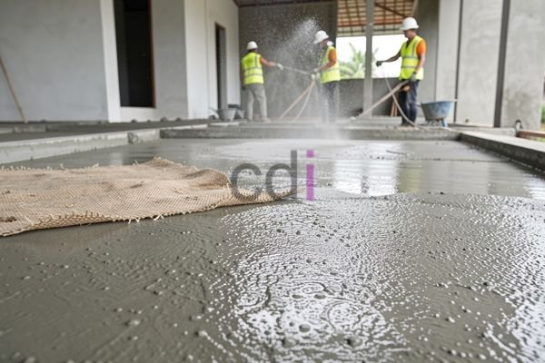

**Arti Curing Beton: Panduan Lengkap untuk Hasil Kuat dan Tahan Lama** - Hai Mitra CDI! Pernahkah Anda bertanya-tanya bagaimana caranya agar struktur beton yang dibangun terasa kokoh dan awet bertahun-tahun? Kuncinya ada pada proses *curing* beton! Proses ini, seringkali terlewatkan, sebenarnya sangat menentukan kualitas akhir beton. Yuk, kita bahas tuntas apa itu curing beton, kenapa penting, dan bagaimana melakukannya dengan benar.

## Mengapa Curing Beton Begitu Krusial?

Bayangkan mitra, beton itu seperti tanaman yang baru ditanam. Ia membutuhkan kelembaban yang cukup agar bisa berkembang dengan baik. Nah, proses hidrasi semen dalam beton itu mirip seperti pertumbuhan tanaman. Reaksi kimia antara semen dan air ini menghasilkan kekuatan beton. Jika kelembaban berkurang terlalu cepat, reaksi ini terhenti, dan beton menjadi rapuh.

Singkatnya, curing memastikan air tetap tersedia agar proses hidrasi berlangsung sempurna. Tanpa curing yang tepat, potensi keretakan, abrasi, dan bahkan kegagalan struktur konstruksi meningkat drastis. Percayalah, mengabaikan curing akan menimbulkan masalah yang jauh lebih mahal di kemudian hari! Kami berpengalaman membantu klien di (not detected) memastikan tahapan ini terlaksana dengan baik.

## Metode Curing Beton yang Bisa Anda Terapkan

Ada banyak cara untuk melakukan curing beton, mitra. Pilihan metode tergantung pada kondisi lokasi proyek di (not detected), jenis struktur, dan tentu saja, anggaran yang tersedia. Berikut beberapa metode yang umum digunakan:

*   **Pemberian Air:** Ini cara paling sederhana dan hemat biaya. Siram permukaan beton secara berkala, terutama saat cuaca panas dan kering.
*   **Perendaman:** Cocok untuk elemen beton berukuran kecil yang mudah direndam dalam air.
*   **Penutupan dengan Karung Basah:** Tutup permukaan beton dengan karung goni atau burlap yang terus dibasahi air. Ini membantu menjaga kelembaban dan memperlambat penguapan.
*   **Penggunaan Membran Curing:** Aplikasikan senyawa kimia khusus yang akan membentuk lapisan kedap air di permukaan beton, mencegah penguapan. Ideal untuk area luas yang sulit dijangkau.
*   **Penyemprotan Curing Compound:** Mirip dengan membran curing, hanya saja diaplikasikan dengan cara disemprot.

## Berapa Lama Waktu Curing Beton yang Ideal?

Nah, soal durasi curing, ini juga penting, mitra. Secara umum, curing minimal harus dilakukan selama 7 hari agar beton mencapai kekuatan tekan yang optimal. Tapi, perlu diingat, jenis semen, suhu lingkungan, dan kekuatan beton yang diinginkan juga berpengaruh. Kita sering menemui proyek konstruksi di (not detected) yang membutuhkan curing lebih lama, bahkan hingga 28 hari, terutama untuk beton mutu tinggi.

Sebagai ilustrasi, beton mutu K-300 untuk lantai rumah biasanya cukup dengan curing 7 hari. Sementara beton mutu K-500 untuk fondasi bangunan tinggi, sebaiknya di-curing selama 28 hari. Suhu juga perlu diperhatikan. Semakin panas, semakin cepat proses hidrasi, tetapi semakin besar risiko terjadinya keretakan.

## Estimasi Biaya Curing Beton dan Faktor yang Mempengaruhi

Biaya curing beton bervariasi, mitra. Tergantung metode yang dipilih, luas area, dan lamanya curing. Sebagai perkiraan, metode pemberian air bisa menghabiskan biaya sekitar Rp 5.000 – Rp 15.000 per meter persegi. Sementara penggunaan membran curing compound bisa mencapai Rp 20.000 – Rp 40.000 per meter persegi. Harga-harga ini bisa berubah sewaktu-waktu, jadi untuk informasi harga terkini, jangan ragu menghubungi Kami.

Beberapa faktor yang memengaruhi biaya curing antara lain: harga material (air, karung, membran), biaya tenaga kerja, dan biaya peralatan. Sebagai penyedia solusi konstruksi terpercaya di (not detected), Kami berkomitmen memberikan solusi curing yang efisien dan hemat biaya tanpa mengorbankan kualitas.

Butuh bantuan untuk proyek Anda? Jangan sungkan untuk menghubungi tim Kami melalui tombol **Telepon** atau **WhatsApp** di bawah ini. Kami siap berkonsultasi dan memberikan penawaran terbaik!