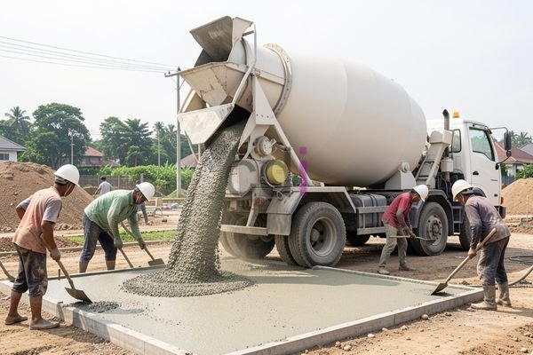

**Memahami Arti Molen: Fungsi, Jenis, dan Perawatan untuk Hasil Beton Berkualitas** - Hai Mitra CDI! Pernahkah Anda bertanya-tanya, apa sih sebenarnya molen itu, dan kenapa begitu penting dalam membangun struktur yang kokoh?  Banyak yang berpikir molen hanyalah alat pencampur semen biasa. Padahal, peranannya jauh lebih strategis. Molen memastikan kualitas beton terjaga, yang pada akhirnya berpengaruh pada kekuatan dan umur bangunan Anda di (not detected). 

### Mengapa Molen Begitu Krusial dalam Konstruksi?

Molen, atau *concrete mixer*, adalah mesin yang dirancang khusus untuk menggabungkan semua komponen penting pembentuk beton, seperti semen, pasir, kerikil, dan air. Proses pencampuran yang presisi ini menjamin distribusi material yang merata.  Hasilnya?  Sebuah campuran beton yang solid dan konsisten.  Tanpa molen, pencampuran manual berisiko menghasilkan beton yang kurang berkualitas, dengan potensi titik lemah yang bisa membahayakan integritas bangunan.  

Penting bagi Mitra CDI untuk menyadari bahwa molen bukan hanya tentang menghemat waktu. Ini tentang menciptakan kualitas.  Beton tercampur sempurna akan lebih mudah dipadatkan, mengurangi risiko rongga udara yang bisa mengancam kekuatan struktur.  Selain itu, molen mempermudah penambahan *admixture* dengan akurat, sehingga sifat beton dapat disesuaikan dengan kebutuhan proyek di (not detected).

### Mengenal Berbagai Jenis Molen

Ada berbagai jenis molen yang tersedia di pasaran.  Memilih yang tepat bergantung pada kebutuhan spesifik proyek Anda, anggaran yang tersedia, dan skala pekerjaan.  Berikut beberapa tipe yang sering kami rekomendasikan:

*   **Molen Portable (Manual):** Pilihan ekonomis dan mudah dipindahkan. Ideal untuk proyek kecil seperti pembangunan rumah tinggal atau perbaikan area terbatas. Namun, molen ini membutuhkan tenaga manusia untuk mengoperasikannya.
*   **Molen Elektrik:** Mengandalkan motor listrik, molen elektrik lebih efisien daripada yang manual. Ini memerlukan akses ke sumber listrik, tetapi tersedia dalam berbagai kapasitas (0,5 hingga 1 meter kubik).
*   **Molen Diesel:** Cocok untuk lokasi tanpa listrik karena menggunakan mesin diesel.  Walau investasi awalnya lebih tinggi, fleksibilitas yang ditawarkannya sangat berharga.
*   **Molen *Self-Loading*:** Dilengkapi dengan *loader* otomatis untuk memasukkan material, menjadikannya pilihan yang sangat efisien untuk proyek besar yang membutuhkan volume beton tinggi.

### Tips Jitu Merawat Molen Agar Tahan Lama

Agar molen tetap berkinerja prima dan awet, perawatan rutin sangatlah penting.  Berikut adalah beberapa tips yang bisa diterapkan oleh Mitra CDI:

*   **Pembersihan Rutin:** Setelah setiap penggunaan, bersihkan bagian dalam drum molen dari sisa-sisa beton yang mengeras. Hal ini penting untuk menjaga efisiensi pencampuran.
*   **Pelumasan Teratur:** Lumasi semua bagian yang bergerak – terutama *bearing* dan rantai – secara berkala dengan pelumas yang direkomendasikan pabrikan.
*   **Inspeksi Rutin:** Periksa kondisi motor, kabel, dan komponen elektrik lainnya (untuk molen elektrik). Pastikan tidak ada kerusakan atau kebocoran.
*   **Simpan dengan Benar:** Simpan molen di tempat yang kering dan terlindung dari cuaca ekstrem. Gunakan terpal atau penutup untuk mencegah karat akibat paparan matahari.
*   **Perhatikan Kapasitas:** Jangan membebani molen melebihi batas maksimal yang ditentukan. Beban berlebih bisa merusak motor dan komponen internal lainnya.

### Mempertimbangkan Biaya: Pembelian, Sewa, dan Operasional

Selain harga pembelian, Mitra CDI juga perlu memperhitungkan biaya operasional dan perawatan molen. Biaya operasional mencakup konsumsi bahan bakar (untuk molen diesel) atau listrik (untuk molen elektrik). Sementara biaya perawatan meliputi penggantian suku cadang yang aus atau rusak. 

Sebagai gambaran, biaya sewa molen elektrik berkapasitas 0,5 meter kubik di (not detected) berkisar antara Rp 300.000 hingga Rp 500.000 per hari.  Biaya ini bisa berbeda tergantung lokasi dan penyedia jasa.  Faktor lain yang perlu dipertimbangkan adalah biaya transportasi. Keputusan untuk membeli atau menyewa molen bergantung pada frekuensi penggunaan dan skala proyek. Jika proyek Anda bersifat tidak rutin, menyewa mungkin lebih hemat. Sebaliknya, jika proyek berlangsung berkelanjutan, investasi dalam molen sendiri bisa jadi lebih menguntungkan. [Artikel terkait mengenai biaya material bangunan](/blog/arti-beton/) bisa jadi referensi tambahan.

Butuh bantuan menentukan jenis molen yang tepat untuk proyek Anda di (not detected)?  Jangan sungkan menghubungi Kami melalui tombol **WhatsApp** atau **Telepon** di halaman ini. Kami siap membantu!