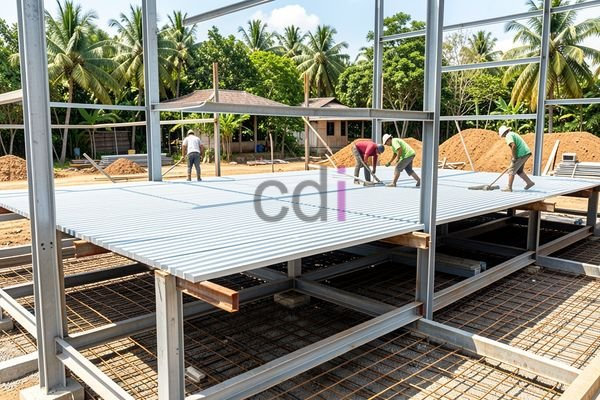

**Atap Bondek Cor: Panduan Lengkap Kekuatan, Pemasangan, dan Estimasi Biaya 2026** - Halo Mitra CDI! Apakah Anda sedang merencanakan pembangunan atau renovasi di (not detected) dan mencari solusi atap yang andal? Kebocoran dan atap yang kurang kuat seringkali menjadi momok bagi pemilik bangunan. Nah, atap bondek cor hadir sebagai jawaban cerdas! Material inovatif ini menawarkan perpaduan sempurna antara kekuatan beton dan efisiensi pemasangan, menjadikannya pilihan populer di (not detected) dan sekitarnya.

### Mengapa Memilih Atap Bondek Cor? Keunggulan yang Perlu Anda Tahu

Atap bondek cor adalah sistem atap modern yang menggunakan pelat baja ringan bergelombang (bondek) sebagai cetakan permanen saat pengecoran beton. Bondek ini bukan sekadar cetakan sementara, lho! Ia menjadi satu kesatuan dengan struktur atap yang sudah jadi, berbeda dengan penggunaan bekisting kayu atau baja konvensional yang harus dibongkar setelah beton mengeras.

Lalu, apa saja keunggulan yang ditawarkannya? Pertama, kekuatan luar biasa. Kombinasi baja dan beton memberikan perlindungan optimal terhadap berbagai beban, baik beban hidup (aktivitas manusia, perabot) maupun beban mati (berat atap itu sendiri). Kedua, pemasangan yang gesit. Prosesnya jauh lebih cepat dibandingkan pemasangan bekisting tradisional, mempercepat penyelesaian proyek Anda di (not detected). Ketiga, perawatan minimal. Material ini tahan terhadap cuaca ekstrem sehingga Anda tidak perlu repot dengan perawatan intensif. Keempat, fleksibilitas desain. Bondek tersedia dalam berbagai profil dan ketebalan, memungkinkan penyesuaian dengan gaya arsitektur bangunan Anda.

### Langkah Demi Langkah: Proses Pemasangan Atap Bondek Cor yang Tepat

Mitra CDI, pemasangan atap bondek cor memerlukan ketelitian dan keahlian. Berikut adalah tahapan-tahapan penting yang perlu diperhatikan:

1.  **Fondasi yang Kokoh:** Pastikan struktur penyangga (kuda-kuda baja atau beton) terpasang dengan presisi dan sesuai dengan desain yang telah disetujui.
2.  **Pemasangan Bondek:** Bondek dipasang secara bertahap, mulai dari salah satu ujung atap. Pastikan tumpang tindih (overlap) antar lembaran bondek sesuai dengan rekomendasi pabrikan — biasanya sekitar 10-20 cm — untuk mencegah potensi kebocoran.
3.  **Penempatan Tulangan:** Pemasangan tulangan baja (rebar) dilakukan di atas bondek, mengikuti detail gambar rencana. Jarak dan diameter tulangan sangat krusial untuk menjamin kekuatan atap.
4.  **Pengecoran Beton:** Setelah tulangan terpasang dengan benar, pengecoran beton dilakukan di atas bondek. Gunakan campuran beton dengan mutu yang sesuai dengan kebutuhan struktur (umumnya K-250 atau K-300). Pastikan beton terdistribusi merata dan bebas rongga.
5.  **Perawatan Beton (Curing):** Setelah pengecoran selesai, lakukan proses curing dengan menyiram air secara berkala selama 7-14 hari. Hal ini penting untuk memastikan kekuatan beton mencapai optimal.

### Standar Kualitas dan Pilihan Ketebalan Bondek yang Sesuai

Kualitas adalah prioritas utama Kami. Mitra CDI, pastikan material atap bondek cor yang Anda gunakan memenuhi standar mutu yang berlaku di Indonesia. SNI 03-6888-2002 tentang Baja Lembaran Canai Panas untuk Struktur Bangunan adalah acuan penting untuk memastikan kualitas baja yang digunakan sebagai bahan baku bondek.

Pertimbangan berikutnya adalah ketebalan bondek. Pilihan umum meliputi 0.75 mm, 0.80 mm, dan 1.00 mm. Ketebalan yang tepat bergantung pada rentang bentang atap dan beban yang akan ditanggung. Untuk bentang pendek (di bawah 6 meter), bondek 0.75 mm mungkin sudah memadai. Namun, untuk bentang lebih panjang, Kami sarankan menggunakan bondek 0.80 mm atau 1.00 mm untuk memastikan kekuatan dan kekakuan atap. Konsultasikan dengan ahli struktur untuk mendapatkan rekomendasi terbaik untuk proyek Anda di (not detected).

### Perkiraan Biaya Atap Bondek Cor di (not detected) untuk Tahun 2026

Biaya pemasangan atap bondek cor dipengaruhi oleh beragam faktor, termasuk luas atap, kompleksitas desain, lokasi proyek di (not detected), dan harga material terkini. Secara umum, perkiraan biaya per meter persegi berkisar antara Rp 350.000 hingga Rp 600.000 di tahun 2026. Harga tersebut mencakup biaya material (bondek, beton, tulangan), biaya pemasangan, dan biaya transportasi.

Mari kita ilustrasikan dengan contoh. Jika luas atap bangunan Anda adalah 100 meter persegi, dengan harga rata-rata Rp 450.000 per meter persegi, maka total biaya pemasangan adalah 100 m² x Rp 450.000 = Rp 45.000.000. Penting untuk diingat bahwa angka ini hanyalah estimasi. Untuk mendapatkan penawaran yang lebih akurat dan disesuaikan dengan detail proyek Anda di (not detected), hubungi Kami untuk konsultasi gratis! Biaya tambahan mungkin diperlukan jika ada pekerjaan persiapan struktur atau desain atap yang rumit.

Apakah Anda memiliki pertanyaan lebih lanjut? Jangan ragu untuk menghubungi Kami melalui tombol **WhatsApp** atau **Telepon** yang tersedia di halaman ini. Tim Kami siap membantu Anda menemukan solusi atap terbaik untuk bangunan Anda di (not detected).