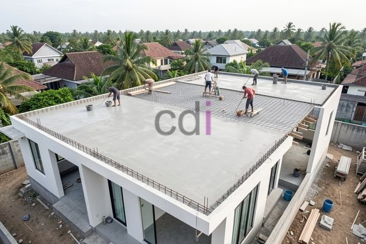

**Atap Dak: Panduan Lengkap Material, Biaya, dan Pemasangan di Jabodetabek** - Hai Mitra CDI! Sedang mempertimbangkan solusi atap datar untuk bangunan Anda di Jabodetabek? Atap dak bisa jadi pilihan tepat! Selain kesan modern minimalis, sistem ini menawarkan kemudahan perawatan dan efisiensi biaya jangka panjang. Yuk, simak panduan lengkap ini mengenai material, perkiraan biaya, dan hal penting lain yang perlu Anda ketahui sebelum memutuskan.

## Pilihan Material Atap Dak: Mana yang Paling Cocok?

Tidak ada satu jenis material atap dak yang paling unggul. Setiap material punya karakteristik unik, kelebihan, dan kekurangannya masing-masing. Pemilihan yang tepat bergantung pada kebutuhan spesifik proyek Anda. Berikut beberapa opsi populer:

*   **Beton Bertulang:** Pilihan paling umum karena kekuatannya yang teruji dan daya tahannya yang luar biasa. Beton juga memiliki insulasi termal yang baik, membantu menjaga suhu ruangan. Namun, perlu diingat bobotnya cukup berat sehingga struktur bangunan harus mampu menopangnya. Minimal mutu beton K-250 sangat Kami rekomendasikan.
*   **Keramik:** Selain kuat, keramik menawarkan tampilan estetis yang menarik. Pemasangannya membutuhkan lapisan kedap air yang cermat untuk mencegah rembesan. Pilihan tepat untuk Anda yang mengutamakan keindahan!
*   **Sprei PVC (Polyvinyl Chloride):** Membran fleksibel yang tahan cuaca ekstrem dan 100% kedap air. Sprei PVC ringan, mudah dipasang, dan relatif terjangkau. Tapi hati-hati, kualitas produk di pasaran bervariasi. Pilih yang terbaik agar awet!
*   **Bitumen:** Lapisan aspal yang diaplikasikan di atas lapisan dasar. Tahan air, tapi perlu perawatan berkala agar tidak retak atau rusak akibat paparan sinar matahari langsung.

Keputusan akhir sebaiknya didasarkan pada pertimbangan iklim Jabodetabek, anggaran, dan desain arsitektur bangunan Anda. Jangan ragu berkonsultasi dengan ahli konstruksi Kami untuk mendapatkan solusi terbaik!

## Perkiraan Biaya Pemasangan Atap Dak di Jabodetabek: Apa Saja yang Mempengaruhi?

Biaya pemasangan atap dak bisa jadi pertanyaan utama. Nah, harga yang Anda dapatkan akan sangat dipengaruhi oleh beberapa faktor:

*   **Luas area atap:** Semakin luas atap, semakin besar biayanya.
*   **Jenis material:** Beton bertulang umumnya lebih mahal daripada PVC atau bitumen.
*   **Tingkat kesulitan pemasangan:** Bentuk atap yang kompleks akan memerlukan tenaga kerja dan waktu lebih lama.
*   **Tarif tenaga kerja:** Harga tenaga kerja bervariasi antar wilayah di Jabodetabek.

Berikut kisaran harga yang perlu Anda siapkan:

*   **Beton Bertulang:** Rp 400.000 - Rp 700.000 per meter persegi (termasuk material, tenaga kerja, dan transportasi).
*   **Keramik:** Rp 300.000 - Rp 500.000 per meter persegi (termasuk keramik, semen, pasir, tenaga kerja, dan lapisan kedap air).
*   **Sprei PVC:** Rp 150.000 - Rp 300.000 per meter persegi (termasuk membran PVC, perekat, dan tenaga kerja).
*   **Bitumen:** Rp 200.000 - Rp 400.000 per meter persegi (termasuk material bitumen, lapisan dasar, dan tenaga kerja).

Ingin tahu estimasi harga yang lebih tepat untuk proyek Anda? Hubungi Kami sekarang juga melalui tombol Telepon/WhatsApp yang tersedia. Kami akan dengan senang hati memberikan penawaran khusus!

## Langkah-Langkah Pemasangan Atap Dak yang Benar: Kualitas Terjamin!

Pemasangan yang benar adalah kunci utama atap dak yang awet dan berfungsi optimal. Berikut tahapan yang harus diperhatikan:

1.  **Persiapan Struktur:** Pastikan struktur bangunan kuat menopang beban atap dak. Periksa kondisi pondasi, kolom, dan balok secara menyeluruh.
2.  **Pemasangan Rangka:** Pasang rangka bekisting (untuk beton) atau rangka pendukung sesuai petunjuk pabrikan (untuk material lain). Pastikan presisinya!
3.  **Pengecoran (untuk beton):** Lakukan pengecoran secara bertahap, gunakan campuran beton berkualitas, dan vibrator untuk memadatkan beton.
4.  **Pemasangan Lapisan Kedap Air:** Aplikasikan lapisan kedap air secara merata, terutama pada sambungan dan area rawan kebocoran.
5.  **Finishing:** Tambahkan lapisan pelindung (seperti cat anti-UV) untuk memperpanjang umur atap dak Anda.

## Tips Cerdas Memilih Kontraktor Atap Dak Terbaik di Jabodetabek

Jangan sembarangan memilih kontraktor, ya! Berikut beberapa tips yang bisa Anda terapkan:

*   **Cari tahu Reputasi:** Minta rekomendasi, baca ulasan online, dan periksa portofolio proyek yang sudah diselesaikan.
*   **Perhatikan Pengalaman:** Pilih kontraktor yang sudah berpengalaman memasang atap dak.
*   **Pastikan Legalitas:** Periksa lisensi dan asuransi kontraktor untuk keamanan proyek Anda.
*   **Bandingkan Penawaran Harga:** Dapatkan beberapa penawaran, jangan hanya terpaku pada harga termurah.
*   **Periksa Kontrak Kerja:** Pastikan kontrak kerja rinci, mencakup semua detail penting (ruang lingkup pekerjaan, jadwal, biaya, garansi).

Butuh konsultasi lebih lanjut atau ingin bertanya-tanya? Jangan sungkan menghubungi Kami melalui tombol **Telepon** atau **WhatsApp** di bawah ini! Kami siap membantu Anda mewujudkan atap dak impian di Jabodetabek. [Baca juga tips mengatasi dak bocor di artikel ini!](https://www.cdidesigninterior.com/blog/bahan-untuk-mengatasi-dak-bocor/) [Atau pelajari lebih lanjut tentang atap bondek cor di sini.](https://www.cdidesigninterior.com/blog/atap-bondek-cor/)