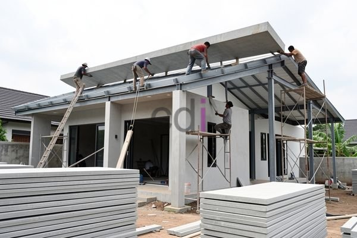

**Atap Plat Beton: Panduan Lengkap Kekuatan, Pemasangan, dan Estimasi Biaya** - Hai Mitra CDI! Pernahkah Anda membayangkan sebuah atap yang kokoh, tahan lama, dan memberikan ketenangan pikiran? Atap plat beton bisa jadi jawabannya. Namun, seringkali kita melihat hasil pemasangan yang kurang optimal, bahkan memicu masalah seperti kebocoran atau kerusakan struktur. Nah, di artikel ini, Kami akan membahas tuntas segala hal tentang atap plat beton, mulai dari keunggulan, proses pemasangan yang benar, hingga perkiraan biayanya di (not detected). Yuk, simak bersama!

### Mengapa Atap Plat Beton Jadi Pilihan? Keunggulan dan Aplikasinya

Apa sih yang membuat atap plat beton begitu digemari? Banyak alasannya, lho. Keunggulan utamanya terletak pada kekuatan dan daya tahannya. Material ini ampuh menghadapi cuaca ekstrem, tahan api, serta minim perawatan. Dibanding material atap lain, atap plat beton juga lebih baik dalam meredam suara, menciptakan suasana lebih nyaman di dalam bangunan.

Atap ini sangat serbaguna, cocok untuk berbagai jenis konstruksi – mulai dari rumah pribadi, ruko, hingga gedung komersial. Desainnya pun fleksibel, bisa disesuaikan dengan gaya arsitektur yang Anda inginkan. Bahkan, atap plat beton membantu meningkatkan efisiensi energi bangunan karena kemampuannya menahan panas.

### Langkah Demi Langkah: Proses Pemasangan Atap Plat Beton yang Tepat

Pemasangan atap plat beton bukan sekadar menuang beton, tapi memerlukan perencanaan matang dan eksekusi presisi. Hal pertama yang krusial adalah perhitungan beban. Ini mencakup berat atap itu sendiri, beban saat perawatan, tekanan angin, dan potensi gempa bumi di wilayah (not detected). Selalu gunakan standar SNI 03-1729-2002 sebagai panduan utama!

Kemudian, bekisting harus dibuat dengan akurat untuk memastikan dimensi dan bentuk atap sesuai desain. Pastikan bekisting cukup kuat menahan beban beton selama proses pengecoran. Setelah bekisting siap, pasang tulangan baja sesuai perencanaan. Tulangan berfungsi menarik beban, membuat atap lebih kuat dan tahan lama. Proses pengecoran sebaiknya ditangani oleh ahli berpengalaman, untuk memastikan campuran beton homogen dan pemadatan sempurna. Setelah beton mengeras, bekisting bisa dilepas dan finishing bisa dimulai.

### Perawatan Rutin: Kunci Umur Panjang Atap Plat Beton

Agar atap plat beton Anda awet dan terhindar dari kerusakan, perawatan berkala itu wajib! Periksa secara rutin untuk mendeteksi retakan atau kerusakan permukaan. Retakan kecil bisa ditambal dengan material khusus. Pastikan juga sistem drainase atap berfungsi optimal, mencegah genangan air yang bisa mempercepat kerusakan.

Jangan lupakan lapisan *waterproofing*! Ini adalah benteng terakhir melindungi atap dari rembesan air. Segera perbaiki atau ganti jika ada kerusakan. Membersihkan atap dari kotoran dan dedaunan juga penting untuk menjaga estetika dan kelancaran saluran air.

### Berapa Biaya Pemasangan Atap Plat Beton di (not detected)?

Estimasi biaya pemasangan atap plat beton dipengaruhi beberapa faktor. Luas atap, ketebalan plat beton, kerumitan desain, dan harga material menjadi penentu utama. Sebagai gambaran, untuk wilayah (not detected) pada tahun 2026, biaya pemasangan berkisar antara Rp 350.000 hingga Rp 600.000 per meter persegi. Ingat, harga ini hanyalah estimasi ya — untuk mendapatkan penawaran paling akurat sesuai proyek Anda, Kami sarankan untuk menghubungi Kami langsung.

Biaya ini umumnya mencakup material (beton, tulangan baja, bekisting), jasa pemasangan, dan ongkos transportasi. Memilih penyedia jasa yang terpercaya sangat penting untuk menjamin kualitas pemasangan. Creative Design Interior siap membantu! Kami menawarkan layanan desain dan pemasangan atap plat beton berkualitas tinggi dengan harga yang kompetitif di (not detected). [Analisa Harga Satuan Beton K 250: Panduan Lengkap dan Estimasi Biaya 2026](/blog/analisa-harga-satuan-beton-k-250/) bisa jadi referensi tambahan untuk memahami lebih dalam tentang harga material beton.

Butuh konsultasi gratis atau penawaran khusus? Jangan ragu untuk klik tombol **WhatsApp** atau **Telepon** di bawah ini. Tim Kami siap melayani Anda!