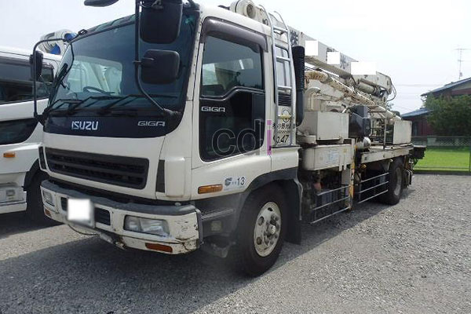

**Mengenal Bagian-Bagian Concrete Pump: Panduan Lengkap untuk Proyek Konstruksi Anda** - Hai Mitra CDI! Pernah memperhatikan concrete pump di proyek konstruksi? Mesin canggih ini seringkali bekerja tanpa kita menyadari betapa kompleks komponen di dalamnya. Nah, memahami bagian-bagiannya penting lho! Ini bukan cuma soal operasional yang lancar, tapi juga perawatan yang tepat supaya investasi Anda makin optimal.

### Komponen Utama Concrete Pump: Hopper dan Sistem Pengisian

Hopper adalah titik awal penerima material beton dari truk molen. Bayangkan hopper sebagai "wadah" pertama. Ukurannya bervariasi, biasanya antara 300 hingga 600 liter, menyesuaikan kapasitas concrete pump yang dipakai. Desainnya harus memastikan beton mengalir lancar ke sistem pengisian tanpa tersendat. Sistem pengisian ini sendiri menggunakan auger atau sekrup konveyor untuk memindahkan beton ke silinder pompa. Pemilihan material hopper yang tepat, umumnya baja karbon dengan lapisan anti-aus, penting banget untuk menghindari korosi dan memperpanjang usia pakai.

Koordinasi antara operator truk molen dan operator pompa beton berpengaruh besar pada efisiensi pengisian hopper. Pastikan suplai beton konsisten! Pengisian yang tidak merata atau terlalu cepat bisa bikin beton menggumpal dan menghambat proses pemompaan, nih.

### Memahami Fungsi Pipa Distribusi dan Sistem Hidrolik pada Concrete Pump

Setelah dari silinder pompa, beton selanjutnya mengalir melalui jaringan pipa distribusi yang rumit. Pipa-pipa ini terbuat dari baja berkekuatan tinggi, dirancang untuk menahan tekanan internal yang besar. Diameternya pun bervariasi – mulai dari 125 mm hingga 200 mm – disesuaikan dengan kebutuhan volume dan jarak pemompaan. Sistem *quick-coupling* memudahkan pemasangan dan pembongkaran sambungan pipa lho.

Sistem hidrolik adalah "otak" dan "tenaga" concrete pump. Sistem ini menghasilkan kekuatan yang menggerakkan silinder pompa, boom, dan komponen lainnya. Komponen kuncinya meliputi pompa hidrolik, tangki oli, katup kontrol, dan silinder hidrolik. Pemilihan oli hidrolik yang tepat, sesuai spesifikasi pabrikan, sangat krusial untuk kinerja dan umur panjang sistem.

### Boom Concrete Pump: Fleksibilitas dan Jangkauan dalam Konstruksi Modern

Boom concrete pump unggul karena boom teleskopiknya. Ini memungkinkan penyaluran beton ke area yang sulit dijangkau, bahkan yang posisinya tinggi. Panjang boom bervariasi, dari 21 meter sampai 70 meter, tergantung kebutuhan proyek Anda. Sistem hidrolik yang canggih mengendalikan pergerakan boom, menjamin presisi dan keamanan. Perhatikan juga kapasitas beban boom, terutama saat pemompaan di ketinggian tertentu ya.

Perawatan boom concrete pump rutin itu penting. Periksa sambungan, silinder hidrolik, dan sistem pengunciannya secara berkala. Jangan lupa, pelumasan yang tepat pada bagian yang bergerak mencegah keausan dan kerusakan. Operator juga perlu paham batasan jangkauan boom dan memastikan area pemompaan aman dari halangan.

### Perawatan Preventif Bagian-Bagian Concrete Pump untuk Optimalisasi Kinerja

Mitra, perawatan preventif adalah kunci! Ikuti jadwal perawatan rutin dengan disiplin: ganti oli hidrolik, periksa filter, dan lumasi komponen. Inspeksi visual terhadap pipa distribusi, hopper, dan boom juga penting untuk mendeteksi kerusakan sejak dini.

Biaya perawatan concrete pump bervariasi, tergantung kompleksitas dan frekuensinya. Untuk gambaran, biaya perawatan rutin tahunan bisa berkisar antara Rp 10.000.000 hingga Rp 30.000.000. Informasi ini bersifat estimasi, harga dapat berubah sewaktu-waktu — yuk, hubungi Kami untuk penawaran terbaru dan paling akurat sesuai kebutuhan proyek Anda! Ingat, investasi pada perawatan preventif jauh lebih hemat dibandingkan biaya perbaikan akibat kerusakan yang terlambat ditangani.

Butuh informasi lebih lanjut? Jangan ragu menghubungi Kami melalui tombol **WhatsApp** atau **Telepon** di halaman ini. Kami siap membantu! [Concrete Pump Kodok: Solusi Pengecoran Efisien untuk Proyek Jabodetabek](/blog/concrete-pump-kodok/) bisa jadi referensi tambahan untuk penerapan di lapangan.