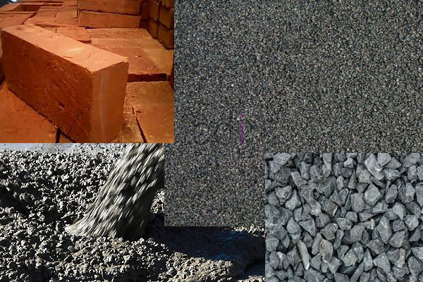

**Inilah Bahan Bangunan Yang Paling Sering Dipakai** - Hai Mitra CDI! Saat membangun atau merenovasi, memilih bahan bangunan yang tepat adalah kunci utama. Bahan yang berkualitas bukan cuma memastikan bangunan kokoh dan tahan lama, tapi juga berpengaruh pada estetika dan kenyamanan. Nah, di artikel ini kami akan kupas tuntas bahan-bahan bangunan yang paling sering digunakan dalam proyek konstruksi, terutama di wilayah (not detected). Yuk, simak selengkapnya!

*Bahan Bangunan Esensial untuk Proyek Anda*

Sebagai mitra terpercaya dalam dunia konstruksi, kami seringkali mendapatkan pertanyaan mengenai material apa saja yang paling krusial. Memahami material yang paling sering dipakai akan membantu Anda merencanakan anggaran dan memastikan kelancaran proyek. Berikut ini adalah daftar bahan bangunan yang wajib ada dalam daftar belanja Anda:

## Material Pasir: Fondasi Kekuatan Bangunan

Pasir adalah bahan bangunan fundamental yang berperan penting sebagai campuran dalam pembuatan mortar dan beton. Kualitas pasir sangat memengaruhi kekuatan bangunan. Untuk menjamin mutu pasir yang digunakan, biasanya dilakukan beberapa pengujian, seperti tes ukuran butiran, kadar lumpur, dan kandungan bahan organik. Dengan mengetahui karakteristik pasir, Anda bisa memastikan adukan yang dihasilkan optimal.

> _Ingin tahu harga pasir terbaru? Cek daftar harga lengkapnya [**DISINI**](/blog/daftar-harga-material-pasir-dan-batu-terlengkap)_

## Bata Merah & Batako: Pilihan Material Dinding

Bata merah dan batako adalah dua material dinding yang paling populer. Bata merah yang berkualitas memiliki ciri-ciri padat, keras, dan matang sempurna. Sementara itu, batako menawarkan kemudahan dan kecepatan dalam pemasangan karena ukurannya yang lebih besar. Ukuran standar batako yang banyak ditemui di pasaran adalah 10 cm x 20 cm x 40 cm. Pilihan antara bata merah dan batako tergantung pada kebutuhan dan preferensi Anda, ya!

> _Bandingkan harga bata merah dan batako langsung di [**DISINI**](/blog/daftar-harga-material-pasir-dan-batu-terlengkap)_

## Semen: Perekat Kuat untuk Bangunan Anda

Semen adalah bahan pengikat yang sangat penting dalam konstruksi. Tanpa semen, bata, pasir, dan material lain tidak akan bisa menyatu secara kuat. Semen tersedia di hampir semua toko bangunan dan biasanya dijual dalam satuan zak yang beratnya berkisar antara 40 kg hingga 50 kg. Pastikan Anda memilih semen dengan kualitas terjamin untuk hasil yang maksimal.

## Beton Cor: Tulang Punggung Struktur Bangunan

Beton cor merupakan material yang sangat umum digunakan untuk membangun fondasi, kolom, balok, dan struktur bangunan lainnya. Beton dibuat dari campuran agregat (pasir, semen, batu), air, dan bahan tambahan tertentu. Mutu beton yang sering digunakan adalah K225, yang berarti mampu menahan tekanan hingga 225 kg/m². Pemilihan mutu beton harus disesuaikan dengan kebutuhan dan beban bangunan.

> _Cari tahu harga beton cor sesuai kebutuhan Anda di [**DISINI**](/page/daftar-harga-rental-pompa-beton-dan-readymix-cor)_

## Besi Tulangan Beton: Penguat Struktur Beton

Besi tulangan beton berfungsi untuk menambah kekuatan tarik pada beton, karena beton cenderung lemah terhadap gaya tarik. Ukuran dan jenis besi tulangan yang digunakan bervariasi, misalnya besi M10 untuk tiang atau kolom, dan besi M8 untuk dak lantai. Meski demikian, tren saat ini menunjukkan pergeseran penggunaan besi tulangan tradisional ke wiremesh dan bondek karena lebih praktis dan hemat waktu.

> _Update harga besi cor terbaru dapat Anda lihat di [**DISINI**](/blog/harga-besi-cor-beton-terbaru)_

## Kayu Kaso & Kusen: Sentuhan Alami dalam Konstruksi

Meskipun semakin banyak material pengganti, kayu tetap menjadi pilihan populer untuk kusen, rangka atap, dan elemen dekoratif. Kayu memberikan kesan alami dan estetis pada bangunan. Namun, perlu diingat bahwa harga kayu cenderung fluktuatif dan semakin mahal karena keterbatasan sumber daya. Di (not detected), kami menyediakan berbagai jenis kayu berkualitas dengan harga yang kompetitif!

> _Yuk, bandingkan harga kayu meranti, jati, dan kamper borneo di [**DISINI**](/blog/perbandingan-harga-kayu-meranti-jati-kamper-borneo)_

Itulah dia, Mitra, rangkuman bahan bangunan yang paling sering dipakai dalam proyek konstruksi di (not detected). Semoga informasi ini bermanfaat dan membantu Anda dalam merencanakan proyek impian! Jangan ragu untuk menghubungi kami jika Anda membutuhkan konsultasi lebih lanjut atau ingin mendapatkan penawaran harga terbaik untuk material bangunan berkualitas. Kami siap membantu Anda mewujudkan bangunan yang kuat, indah, dan tahan lama!  [[TABEL_MULAI]] {"title": "Perbandingan Bahan Material Dinding", "headers": ["Material", "Kelebihan", "Kekurangan"]} {"row": ["Bata Merah", "Kuat dan tahan lama", "Pemasangan lebih lama"]} {"row": ["Batako", "Pemasangan lebih cepat", "Kurang kuat dibandingkan bata merah"]} [[TABEL_SELESAI]]