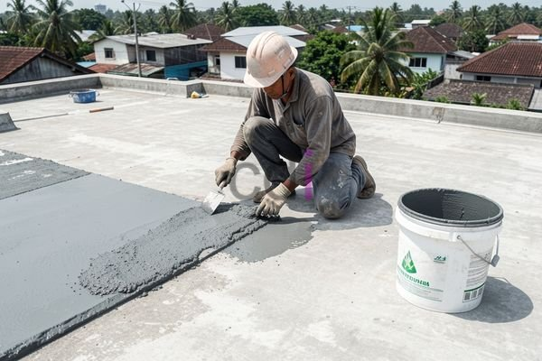

**Bahan untuk Mengatasi Dak Bocor** - Hai Mitra CDI! Pernahkah Mitra menghadapi masalah dak beton yang bocor saat musim hujan? Masalah yang bikin frustrasi dan bisa merusak bangunan, ya kan? Nah, Kami dari CDI siap membantu!

Mencari cara efektif buat mengatasi dak bocor? Tenang, Anda sudah berada di tempat yang tepat. Memilih bahan yang pas itu kunci utama, lho, supaya bangunan Mitra CDI tetap awet dan terlindungi. Artikel ini akan membahas tuntas soal bahan mengatasi dak bocor – dari jenis-jenis material sampai cara penerapannya. Yuk, simak selengkapnya!

## Kenali Dulu Penyebab Dak Bocor, Barulah Cari Solusi

Sebelum berburu bahan, penting bagi Mitra CDI untuk tahu dulu kenapa dak bisa bocor. Beberapa penyebab umum, antara lain kualitas beton kurang baik, proses pengecoran yang kurang tepat, ada retakan di struktur beton, atau kurangnya perawatan rutin.

Kebocoran dak bukan cuma bikin tampilan jadi nggak enak karena dinding berjamur dan langit-langit ngelupas, tapi juga bisa merusak struktur bangunan secara permanen. Bahkan, bisa bikin biaya perbaikan membengkak di kemudian hari! Jadi, mencegah sejak awal dengan bahan yang tepat dan perawatan rutin itu sangat penting.

## Pilihan Bahan Unggulan untuk Mengatasi Dak Bocor: Material dan Cara Pakainya

Ada banyak sekali bahan yang bisa dipakai buat mengatasi dak bocor. Bahan yang paling cocok tergantung seberapa parah kebocorannya, jenis dak beton yang digunakan, dan tentu saja, anggaran yang tersedia. Berikut adalah beberapa opsi yang sering kami rekomendasikan:

*   **Lapisan Waterproofing:** Ini solusi paling populer dan efektif buat mencegah air meresap ke dalam beton. Ada beberapa jenis lapisan *waterproofing*:
    *   **Waterproofing Membrane:** Terbuat dari aspal, karet, atau polimer, dipasang dengan cara ditempel atau dibakar.
    *   **Waterproofing Coating:** Berupa cairan yang bisa diaplikasikan pakai kuas, rol, atau *sprayer*. Cocok buat retakan kecil dan gampang dipasang sendiri.
    *   **Waterproofing Cementitious:** Bahan berbasis semen yang dicampur aditif khusus supaya kedap air. 

*   **Resin Epoksi:** Resin epoksi itu kuat dan tahan lama banget, sering dipakai buat memperbaiki retakan besar di dak beton. Kemampuannya mengisi celah dan membentuk lapisan kedap air itu juara.

*   **Poliuretan:** Bahan poliuretan ini fleksibel, cocok buat dak beton yang sering kena perubahan cuaca ekstrem. Daya tahannya juga tinggi terhadap abrasi dan bahan kimia.

## Bandingkan Bahan Anti Bocor: Kelebihan, Kekurangan, dan Estimasi Biayanya

Supaya Mitra CDI makin yakin memilih bahan yang tepat, Kami siapkan perbandingan beberapa bahan anti bocor yang banyak dicari:

<table class="table">
  <caption>Perbandingan Bahan Anti Bocor</caption>
  <thead>
    <tr><th>Jenis Bahan</th><th>Kelebihan</th><th>Kekurangan</th><th>Estimasi Biaya (per m²)</th></tr>
  </thead>
  <tbody>
    <tr><td>Waterproofing Membrane</td><td>Efektifitas tinggi, daya tahan lama</td><td>Pemasangan memerlukan keahlian khusus, kurang fleksibel</td><td>Rp 40.000 - Rp 70.000</td></tr>
    <tr><td>Waterproofing Coating</td><td>Mudah diaplikasikan, harga terjangkau</td><td>Kurang tahan lama dibandingkan membrane, perlu aplikasi ulang berkala</td><td>Rp 20.000 - Rp 40.000</td></tr>
    <tr><td>Resin Epoksi</td><td>Kekuatan tinggi, mengisi retakan besar dengan baik</td><td>Membutuhkan persiapan permukaan yang baik, harga relatif mahal</td><td>Rp 60.000 - Rp 100.000</td></tr>
    <tr><td>Poliuretan</td><td>Fleksibilitas tinggi, tahan terhadap cuaca ekstrem</td><td>Harga paling mahal, pemasangan memerlukan keahlian khusus</td><td>Rp 80.000 - Rp 150.000</td></tr>
  </tbody>
</table>

Harga di atas itu perkiraan ya, dan bisa berubah sewaktu-waktu. Untuk penawaran paling akurat sesuai kebutuhan proyek Anda, jangan ragu untuk menghubungi Kami.

## Tips Tambahan: Jaga Dak Tetap Kering dan Awet

Selain memilih bahan yang tepat, ada beberapa tips tambahan yang bisa dilakukan untuk mencegah kebocoran:

*   **Rutin Cek Kondisi Dak:** Lakukan inspeksi rutin untuk mendeteksi retakan atau kerusakan sejak awal.
*   **Segera Perbaiki Kerusakan:** Jangan tunda, segera perbaiki jika ada retakan atau kerusakan.
*   **Pastikan Drainase Lancar:** Sistem drainase yang baik akan mencegah air menggenang di atas dak.
*   **Gunakan Jasa Ahli:** Untuk pengerjaan pengecoran dak beton, sebaiknya pakai jasa kontraktor profesional yang berpengalaman.

Dengan kombinasi pencegahan yang tepat dan bahan berkualitas, Mitra CDI bisa melindungi bangunan dari kebocoran dak dan menikmati kenyamanan serta keamanan keluarga. Jangan lupa, [Cara Memperbaiki Dak Beton Bocor](/blog/cara-memperbaiki-dak-beton-bocor/) juga bisa jadi referensi tambahan.

Ada pertanyaan atau butuh konsultasi lebih lanjut? Jangan sungkan, tombol **Telepon** dan **WhatsApp** di bawah ini siap melayani Anda!