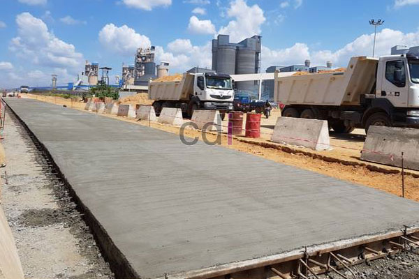

**Baikkah Melakukan Pengecoran Saat Hujan?** - Hai Mitra CDI! Punya proyek pembangunan di (not detected) yang harus jalan terus? Seringkali kita menghadapi dilema: bolehkah pengecoran dilakukan saat hujan? Padahal, kualitas beton yang kokoh dan tahan lama adalah kunci utama, kan? Nah, membahas soal pengecoran saat musim hujan itu penting banget. Risiko bahan semen, pasir, dan batu yang kurang menyatu bisa bikin hasil akhirnya kurang optimal, apalagi kalau nggak didukung peralatan yang memadai.

*Pengecoran Saat Musim Hujan: Apa yang Perlu Diperhatikan?*

## Pengecoran Saat Hujan: Boleh atau Tidak?

Sebenarnya, secara teori pengecoran di tengah hujan masih memungkinkan, asalkan hujannya tidak terlalu deras hingga membuat campuran beton terlalu encer. Kalau memang harus mengejar *deadline* proyek di (not detected), pengecoran beton harus dilakukan di bawah perlindungan yang memadai sampai beton benar-benar mengeras. Jangan lupa, uji laboratorium tetap diperlukan untuk memastikan kekuatan beton, terutama untuk bangunan publik atau jalan raya. Penting banget, lho, untuk memastikan kualitasnya sesuai standar!

## **Tips Penting Saat Pengecoran**

Untuk mendapatkan hasil beton berkualitas prima, ada beberapa hal yang wajib diperhatikan saat pengecoran:

- 1\. Prioritaskan kecepatan! Transportasi beton harus dilakukan secepat mungkin untuk menghindari segregasi material dan tercecernya campuran. Gunakan alat yang sesuai, seperti ember, gerobak dorong, pompa beton, atau truk beton.
- 2\. Periksa begisting dengan teliti. Pastikan bentuknya sesuai desain, bersih dari kotoran organik, tidak berlubang, dan kedap air.
- 3\. Verifikasi kesesuaian tulangan dengan perencanaan. Pastikan juga beton *decking* berada pada posisi yang tepat dan tulangan bebas dari kotoran.
- 4\. Wajib lakukan *slump test* untuk mengukur konsistensi campuran.
- 5\. Siapkan seluruh alat dan material pengecoran sebelum memulai pekerjaan.
- 6\. Lakukan pengecoran dengan hati-hati agar tidak merusak begisting atau cetakan beton.
- 7\. Mulailah pengecoran dari titik terjauh dari area pencampuran beton.
- 8\. Tuangkan beton secara berkelanjutan dan secepatnya setelah dicampur.
- 9\. Pastikan proses pengecoran berlangsung tanpa henti untuk hasil yang maksimal di (not detected).
- 10\. Untuk pengecoran di area dalam atau ketinggian, gunakan pipa tremi (corong) untuk mencegah segregasi beton.
- 11\. Segera padatkan beton setelah dituang menggunakan alat vibrator atau metode manual lainnya.
- 12\. Lakukan perawatan beton setelah pengecoran untuk optimalisasi pengerasan.
- 13\. Minimalkan pergerakan begisting selama dan setelah proses pengecoran.
- 14\. Lakukan proses *finishing* beton segera setelah pengecoran selesai.
- 15\. Pertimbangkan uji tekan beton untuk memastikan kualitasnya memenuhi standar yang diharapkan.

Nah, itulah mitra, beberapa hal penting yang perlu diperhatikan saat melakukan pengecoran. Intinya, pengecoran saat hujan deras sebaiknya dihindari karena bisa memengaruhi *slump* beton dan proses pengeringannya. Semoga informasi ini bermanfaat ya. Untuk pemesanan beton siap pakai atau *readymix* di (not detected), hubungi kami melalui halaman kontak website ini. [Beberapa Masalah Saat Pengecoran](/blog/beberapa-masalah-saat-pengecoran/) untuk informasi lebih lanjut.