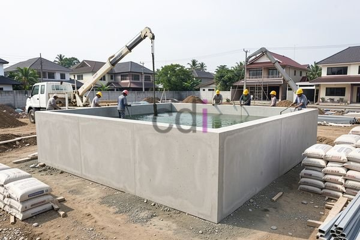

**Bak Penampungan Air Beton: Panduan Lengkap Ukuran, Harga, dan Pemasangan** - Hai Mitra CDI! Apakah Anda sedang mencari solusi penyimpanan air yang handal dan awet untuk kebutuhan rumah atau proyek konstruksi di (not detected)? Bak penampungan air beton bisa jadi jawaban tepat. Kuat, tahan lama, dan memberikan pasokan air yang stabil — yuk, kita bahas lebih lanjut!

## Keunggulan Bak Penampungan Air Beton: Mengapa Memilihnya?

Mengapa banyak yang memilih bak beton? Karena banyak keuntungannya, lho! Material beton ini terkenal dengan kekuatannya. Bak beton mampu menahan tekanan air dalam volume besar tanpa khawatir retak atau bocor. Selain itu, bak ini juga tahan terhadap cuaca ekstrem, korosi, dan serangan hama, menjamin umur pakainya yang panjang. Perawatannya pun relatif mudah, dan tidak butuh penggantian seperti material plastik atau fiberglass.

Lebih dari itu, bak beton adalah pilihan yang lebih ramah lingkungan dibandingkan material sintetis. Meskipun proses pembuatannya membutuhkan energi, hasil akhirnya adalah material yang tahan lama dan bisa didaur ulang. Memahami volume air yang bisa ditampung juga penting. Anda bisa temukan panduan lengkapnya di 1 Kubik Air Berapa Kg? Penjelasan Lengkap dan Contoh Perhitungan.

## Pilihan Ukuran dan Kapasitas Bak Beton untuk Kebutuhan Anda

Memilih ukuran yang pas adalah kunci utama. Ukuran bak penampungan air beton bervariasi, mulai dari yang kecil untuk rumah tangga hingga yang besar untuk skala komersial. Ini beberapa ukuran umum dan kapasitasnya:

*   **Kecil (1m x 1m x 1m):** Kapasitas sekitar 1.000 liter (1 m³). Ideal untuk rumah tangga dengan kebutuhan air kecil atau penampungan air hujan.
*   **Sedang (2m x 2m x 1.5m):** Kapasitas sekitar 6.000 liter (6 m³). Cocok untuk rumah tangga dengan kebutuhan air sedang atau proyek skala kecil.
*   **Besar (3m x 3m x 2m):** Kapasitas sekitar 18.000 liter (18 m³). Sering digunakan untuk proyek komersial, pertanian, atau sebagai cadangan air utama.

Pertimbangkan baik-baik kebutuhan air harian, jumlah penghuni, dan sumber air yang tersedia sebelum memutuskan ukuran yang tepat. Kami sarankan memilih bak dengan kapasitas sedikit lebih besar untuk mengantisipasi kebutuhan di masa depan.

## Perkiraan Biaya dan Proses Pemasangan di (not detected)

Perlu diketahui bahwa harga bak penampungan air beton bisa berbeda-beda tergantung ukuran, ketebalan beton, dan lokasi Anda di (not detected). Secara umum, kisaran harganya mulai dari Rp 1.500.000 hingga Rp 15.000.000 per unit. Harga ini hanyalah estimasi dan dapat berubah sewaktu-waktu. Untuk penawaran paling akurat sesuai proyek Anda, jangan ragu menghubungi Kami!

Selain harga bak, biaya pemasangan juga perlu diperhitungkan. Pemasangan memerlukan tenaga ahli dan peralatan khusus. Biaya pemasangan biasanya sekitar 10% hingga 20% dari harga bak itu sendiri.

Berikut contoh perhitungan biaya untuk bak ukuran sedang (2m x 2m x 1.5m):

*   Harga bak: Rp 7.500.000
*   Biaya pemasangan (15%): Rp 1.125.000
*   Total biaya: Rp 8.625.000

Kami sangat menyarankan menggunakan jasa pemasangan profesional untuk memastikan bak terpasang dengan benar dan aman. Pastikan juga lokasi pemasangan cukup kuat dan rata untuk menopang berat bak yang terisi air.

## Tips Jitu Merawat Bak Beton Agar Tahan Lama

Ingin bak penampungan air beton Anda awet dan berfungsi optimal? Lakukan perawatan rutin! Berikut beberapa tips yang bisa Anda terapkan:

*   **Pembersihan Rutin:** Bersihkan bagian dalam bak secara berkala (setidaknya 6 bulan sekali) untuk menghilangkan endapan lumpur, kotoran, dan alga.
*   **Inspeksi Retakan:** Periksa secara rutin apakah ada retakan di dinding atau dasar bak. Segera perbaiki jika menemukan retakan untuk mencegah kebocoran.
*   **Lapisan Anti Bocor:** Pertimbangkan melapisi bagian dalam bak dengan material anti bocor untuk meningkatkan ketahanan terhadap kebocoran.
*   **Penutup Bak yang Rapat:** Pasang penutup bak yang rapat untuk mencegah kotoran, debu, dan serangga masuk ke dalam air.
*   **Jaga Kebersihan Sekitar:** Jaga kebersihan lingkungan sekitar bak untuk mencegah kontaminasi air.

Dengan perawatan yang tepat, bak penampungan air beton Anda akan menjadi investasi jangka panjang yang sangat bermanfaat. Untuk memahami kebutuhan bekisting saat membuat bak beton, 1 m3 beton berapa m2 bekisting: Panduan Praktis Menghitung dan Mengoptimalkan bisa menjadi referensi berharga. Kami juga menyediakan berbagai pilihan material bangunan berkualitas lainnya di (not detected).

Ada pertanyaan atau butuh bantuan langsung? Jangan sungkan untuk klik tombol **WhatsApp** atau **Telepon** di bawah dan berkonsultasi dengan tim ahli Kami! Kami siap membantu Anda.