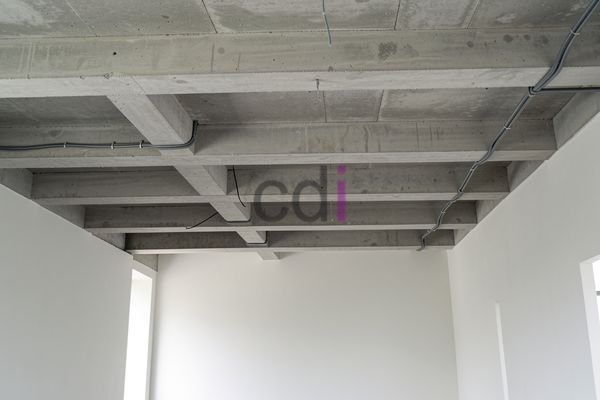

**Balok Gantung Rumah: Solusi Desain Modern dan Pemasangan yang Tepat** - Hai Mitra CDI! Sedang mencari cara untuk memberikan sentuhan berbeda pada hunian Anda? Balok gantung rumah bisa jadi jawaban yang tepat. Mari kita telaah lebih lanjut!

Tren penggunaan balok gantung dalam desain interior dan eksterior rumah terus meningkat. Lebih dari sekadar elemen struktural, balok ini berfungsi sebagai aksen artistik, menghadirkan kesan lapang dan visual yang memukau pada bangunan Anda. Artikel ini akan membahas tuntas mengenai keunggulan, pilihan material, tahapan pemasangan, hingga perkiraan biaya yang perlu Anda ketahui.

## Mengapa Memilih Balok Gantung? Keuntungannya Dibanding Balok Biasa

Dibandingkan balok beton konvensional, balok gantung menawarkan sejumlah kelebihan menarik. Salah satu yang paling signifikan adalah kemampuannya menciptakan ruangan tanpa kolom penyangga yang menghalangi. Ini memberi Anda kebebasan berkreasi dengan tata letak interior, terutama pada ruang tamu, ruang keluarga, atau area komersial yang membutuhkan kesan luas.

Selain itu, visual balok gantung memberikan kesan ringan dan elegan. Karena tampak “melayang”, ia menghadirkan nuansa modern dan minimalis yang sedang populer. Secara estetika, balok ini bisa menjadi focal point yang menarik perhatian, memberikan sentuhan mewah dan berkelas pada desain interior Anda. Pilihan material dan finishing yang beragam memungkinkan Anda menyesuaikannya dengan gaya arsitektur rumah, mulai dari kayu alami, baja industrial, hingga beton ekspos yang stylish.

## Pilihan Material Balok Gantung: Mana yang Paling Sesuai?

Pemilihan material balok gantung sangat penting untuk menjamin kekuatan, keamanan, dan tampilan yang sesuai dengan harapan Anda. Beberapa opsi umum meliputi:

*   **Beton Bertulang:** Kuat, tahan lama, dan relatif ekonomis. Sangat cocok untuk bentang panjang dan menahan beban berat.
*   **Baja:** Pilihan populer karena kekuatannya luar biasa dan kemampuannya menopang beban besar. Sering digunakan di bangunan komersial atau industri yang membutuhkan ruang terbuka.
*   **Kayu (Laminasi atau Solid):** Menawarkan kehangatan alami dan cocok untuk gaya klasik atau tropis. Penting memilih kayu berkualitas tinggi seperti kamper, ulin, atau menggunakan kayu laminasi (glulam) untuk bentang yang lebih panjang.

<table class="table">
  <caption>Perbandingan Material Balok Gantung</caption>
  <thead>
    <tr><th>Material</th><th>Kekuatan</th><th>Harga (Estimasi per Meter)</th><th>Estetika</th><th>Perawatan</th></tr>
  </thead>
  <tbody>
    <tr><td>Beton Bertulang</td><td>Sangat Tinggi</td><td>Rp 300.000 - Rp 600.000</td><td>Minimalis, Modern</td><td>Rendah</td></tr>
    <tr><td>Baja</td><td>Sangat Tinggi</td><td>Rp 500.000 - Rp 1.000.000</td><td>Industrial, Modern</td><td>Sedang</td></tr>
    <tr><td>Kayu (Solid/Laminasi)</td><td>Tinggi - Sedang</td><td>Rp 700.000 - Rp 1.500.000</td><td>Alami, Klasik</td><td>Tinggi</td></tr>
  </tbody>
</table>

Informasi harga di atas bersifat estimasi dan dapat berubah — hubungi Kami untuk mendapatkan penawaran harga yang paling akurat dan sesuai kebutuhan proyek Anda.

## Tahapan Pemasangan Balok Gantung: Perhatikan Setiap Detail

Pemasangan balok gantung memerlukan perencanaan matang dan eksekusi yang presisi. Proses ini melibatkan beberapa langkah kunci:

1.  **Perencanaan Struktural:** Meliputi perhitungan beban, penentuan dimensi balok, dan detail sambungan. Konsultasikan dengan ahli struktur untuk memastikan keamanan dan stabilitas bangunan.
2.  **Pemasangan Angkur (Anchor Bolts):** Angkur berfungsi sebagai titik tumpu balok gantung. Pemasangan harus akurat sesuai desain struktural.
3.  **Pengangkatan dan Pemasangan Balok:** Balok diangkat dan diposisikan dengan alat berat seperti crane atau hoist. Pastikan tenaga profesional yang menangani proses ini.
4.  **Pengujian Beban:** Setelah terpasang, dilakukan pengujian beban bertahap untuk memastikan kekuatan dan stabilitas struktur.

Demi keamanan dan kualitas terbaik, Kami sarankan menggunakan jasa kontraktor berpengalaman dan bersertifikasi. [Bata Merah Expose Untuk Dinding Rumah Modern](/blog/bata-merah-expose-dinding-rumah-modern/) juga bisa menjadi inspirasi untuk melengkapi desain eksterior rumah Anda dengan material yang kokoh dan menarik.

## Estimasi Biaya Pemasangan Balok Gantung: Faktor-faktor yang Mempengaruhi

Biaya pemasangan balok gantung dipengaruhi oleh beberapa faktor, seperti material pilihan, ukuran balok, kompleksitas desain, dan lokasi proyek. Secara umum, perkiraan biayanya berkisar antara Rp 5.000.000 hingga Rp 20.000.000 per meter persegi, sudah termasuk material, tenaga kerja, dan peralatan.

Rentang harga ini bersifat perkiraan. Untuk mendapatkan penawaran yang lebih akurat, silakan berkonsultasi dengan tim desain interior yang terpercaya. Jangan lupa pertimbangkan biaya tambahan seperti desain, perizinan, serta perawatan berkala.

Siap mewujudkan hunian impian Anda? Hubungi Kami melalui tombol **Telepon** atau **WhatsApp** yang tersedia di bawah ini untuk konsultasi gratis dan penawaran terbaik! Kami siap membantu mewujudkan desain rumah yang modern dan aman bagi Anda dan keluarga.