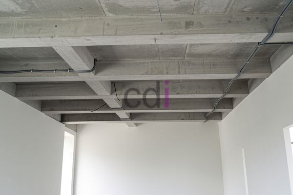

**Balok Gantung Teras: Pilihan Material, Perhitungan Biaya, dan Tips Pemasangan** - Hai Mitra CDI! Ingin memberikan sentuhan berbeda pada teras rumah Anda? Desain yang unik dan modern tentu menjadi dambaan.

Teras adalah ruang penghubung vital antara interior dan eksterior rumah. Memilih desain dan material yang tepat bukan cuma soal tampilan, tapi juga fungsi dan keamanan. Salah satu opsi yang makin populer adalah balok gantung teras. Konsep ini mampu menciptakan kesan luas dan artistik. Nah, di artikel ini, kita akan kupas tuntas semua yang perlu Anda tahu tentang balok gantung teras — mulai dari pilihan material terbaik, perkiraan biaya yang realistis, sampai tips pemasangan supaya hasilnya awet dan aman. Yuk, simak selengkapnya!

## Material Balok Gantung Teras: Mana yang Paling Sesuai?

Pemilihan material sangat menentukan tampilan akhir, kekuatan struktur, dan tentu saja, budget proyek Anda. Ada beberapa opsi populer: kayu, baja, dan beton. Masing-masing punya kelebihan dan kekurangan yang perlu dipertimbangkan secara matang.

Kayu memberikan kesan hangat dan alami yang tak terbantahkan. Kayu jati, ulin, atau kamper adalah pilihan yang umum karena ketahanannya terhadap cuaca ekstrem. Tapi ingat, kayu butuh perawatan rutin, seperti lapisan anti-rayap dan pelapisan ulang vernis untuk menjaga kualitasnya.

Baja ringan menawarkan kekuatan tinggi dengan bobot yang relatif ringan. Material ini bebas dari serangan rayap dan perawatannya juga lebih mudah dibandingkan kayu. Kekurangannya? Baja rentan korosi jika tidak dilapisi cat anti-karat berkualitas.

Beton memberikan kesan kokoh dan modern. Balok beton bisa dicor langsung di lokasi atau dibuat prefabrikasi. Kekuatannya tak perlu diragukan, tapi perlu diingat, beton punya bobot yang cukup berat, jadi butuh perhitungan struktural dan pondasi yang tepat.

## Estimasi Biaya Pembuatan Balok Gantung Teras

Perkiraan biaya pembuatan balok gantung teras sangat fleksibel. Faktor-faktor yang memengaruhi harga antara lain material, ukuran balok, kerumitan desain, dan tarif tenaga kerja di (not detected). Berikut adalah perkiraan kasar biaya per meter (harga ini bisa berubah sewaktu-waktu, ya — hubungi Kami untuk penawaran detail sesuai kebutuhan Anda):

*   **Kayu:** Rp 500.000 – Rp 1.500.000 per meter (tergantung jenis kayu)
*   **Baja Ringan:** Rp 400.000 – Rp 800.000 per meter (termasuk pengecatan)
*   **Beton:** Rp 600.000 – Rp 1.200.000 per meter (termasuk biaya cor dan finishing)

Misalnya, Anda ingin membuat balok gantung teras sepanjang 4 meter dari kayu jati. Estimasi biayanya: 4 meter x Rp 1.000.000/meter = Rp 4.000.000. Ingat, angka ini belum termasuk biaya desain, pemasangan, dan biaya tambahan seperti finishing serta aksesoris.

## Tips Pemasangan Balok Gantung Teras yang Aman dan Tahan Lama

Pemasangan balok gantung teras membutuhkan perencanaan cermat dan keahlian yang mumpuni. Ini beberapa tips yang perlu diperhatikan:

*   **Perhitungan Struktural:** Lakukan perhitungan struktural yang akurat untuk menentukan ukuran balok yang tepat, jarak ideal antar penyangga, dan jenis pondasi yang sesuai. Jangan ragu berkonsultasi dengan ahli konstruksi.
*   **Penyangga Kuat:** Pilih penyangga yang terbuat dari material berkualitas tinggi, seperti baja atau beton bertulang. Pastikan penyangga terpasang dengan kokoh ke struktur bangunan utama.
*   **Pemasangan Presisi:** Pastikan pemasangan dilakukan dengan presisi sesuai desain yang telah direncanakan. Gunakan alat yang tepat dan pastikan balok terpasang dengan horizontal dan stabil.
*   **Finishing Rapi:** Setelah pemasangan selesai, lakukan finishing yang rapi untuk melindungi balok dari cuaca ekstrem dan meningkatkan tampilan estetikanya.

## Hal-Hal Penting Lainnya yang Perlu Dipertimbangkan

Selain material dan biaya, ada beberapa faktor lain yang perlu Anda pertimbangkan sebelum memutuskan untuk memasang balok gantung teras. Sesuaikan desain balok gantung teras dengan gaya arsitektur rumah agar tampak serasi. Pertimbangkan juga fungsi teras yang Anda inginkan — apakah untuk bersantai, makan outdoor, atau area bermain anak? Desain balok gantung harus mendukung fungsi tersebut.

Butuh informasi lebih lanjut? Jangan sungkan untuk menghubungi Kami! Tombol **Telepon** dan **WhatsApp** di bawah ini siap membantu Anda mendapatkan solusi terbaik untuk proyek Anda di (not detected). Jangan lupa juga untuk melihat [Bekisting Balok dan Plat: Panduan Lengkap Material, Perhitungan, dan Biaya 2026](/blog/bekisting-balok-dan-plat/) untuk pemahaman lebih mendalam tentang konstruksi balok. [Balok Gantung Rumah: Solusi Desain Modern dan Pemasangan yang Tepat](/blog/balok-gantung-rumah/) juga bisa menjadi referensi bermanfaat.