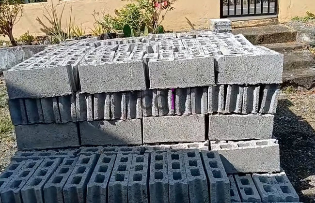

**Batako Hitam: Solusi Kuat dan Estetis untuk Hunian Modern** - Hai Mitra CDI! Sedang mencari material bangunan yang unik dan tahan lama? Atau mungkin ingin memberikan sentuhan industrial pada desain rumah impian? Nah, batako hitam bisa jadi jawabannya! Meski seringkali kurang disorot dibandingkan bata merah, material ini punya daya tarik tersendiri, mulai dari kekuatannya yang mumpuni hingga tampilan estetikanya yang khas. Di (not detected), batako hitam semakin diminati oleh para arsitek dan pemilik rumah yang ingin tampil beda.

Artikel ini akan membahas tuntas seputar batako hitam: mulai dari apa itu batako hitam, keunggulan-keunggulannya, berbagai aplikasi yang bisa diwujudkan, hingga tips jitu memilih batako hitam berkualitas. Siap menggali lebih dalam? Yuk, kita mulai!

## Apa Itu Batako Hitam?

Sebelum membahas lebih jauh, mari kita pahami dulu apa itu batako hitam. Sederhananya, batako hitam adalah jenis material bangunan yang terbuat dari campuran semen, pasir, dan bahan tambahan tertentu yang memberikan warna hitam alami pada material. Proses pembuatannya mirip dengan batako biasa, tetapi penambahan bahan seperti abu vulkanik, *fly ash*, atau material daur ulang khusus menghasilkan warna gelap yang khas. 

Material ini banyak dipilih karena kombinasi antara kekuatan struktur dan nilai estetika.  Dinding yang dibuat dari batako hitam akan terasa kokoh, tahan lama, dan memberikan kesan modern yang berbeda.

Batako hitam bukan hanya untuk dinding polos, lho. Kreativitas tanpa batas bisa ditampilkan dengan menggunakannya sebagai elemen dekoratif, terutama dalam desain interior bergaya industrial atau minimalis.

## Keunggulan Batako Hitam

Lantas, apa saja keunggulan yang membuat batako hitam semakin populer di kalangan Mitra CDI? Simak poin-poin berikut:

### 1. Ketahanan dan Kekuatan Optimal
Batako hitam dikenal karena daya tahannya yang tinggi terhadap tekanan dan kondisi cuaca ekstrem. Dibuat dengan campuran material berkualitas, batako hitam mampu menopang struktur bangunan dengan baik, menjadikannya pilihan tepat untuk hunian atau bangunan komersial di (not detected) yang memiliki iklim tropis.

### 2. Estetika Modern yang Memikat
Warna hitam pada batako ini memberikan kesan modern dan elegan. Bagi Mitra CDI yang ingin menciptakan nuansa minimalis atau industrial di rumah, batako hitam adalah solusi yang tepat. Bahkan, tanpa tambahan finishing cat, dinding batako hitam sudah terlihat artistik dan menarik perhatian.

### 3. Penghematan Biaya Finishing
Keunggulan lain yang tak kalah penting adalah penghematan biaya finishing. Karena tampilan alami batako hitam sudah menarik, Mitra CDI tidak perlu lagi mengeluarkan biaya untuk pengecatan. Ini memungkinkan pengalihan anggaran ke aspek lain dari proyek.

## Aplikasi Batako Hitam dalam Berbagai Proyek

Fleksibilitas adalah salah satu keunggulan utama batako hitam. Material ini bisa diaplikasikan di berbagai area dan untuk berbagai tujuan. Berikut beberapa contoh penggunaan batako hitam:

### 1. Dinding Eksterior yang Berkarakter
Ingin rumah tampil unik dari luar? Dinding eksterior dengan batako hitam bisa menjadi pilihan yang menarik. Padukan dengan elemen kayu atau kaca untuk menciptakan tampilan yang kontras dan mewah, cocok untuk iklim (not detected).

### 2. Dinding Interior untuk Suasana Industrial
Bagi Mitra CDI yang ingin menghadirkan suasana industrial dalam interior rumah, batako hitam bisa digunakan sebagai dinding aksen di ruang tamu, ruang keluarga, atau bahkan kamar tidur. Dinding ini akan langsung menjadi *focal point* dan menghadirkan karakter unik pada ruangan.

### 3. Elemen Dekoratif yang Fungsional
Tak hanya untuk dinding, batako hitam juga bisa dimanfaatkan untuk membuat elemen dekoratif, seperti meja, rak buku, pot tanaman, atau bahkan pembatas ruangan. Ini bukan hanya fungsional, tetapi juga meningkatkan nilai estetika ruangan.

## Tips Memilih Batako Hitam Berkualitas

Memilih batako hitam yang tepat membutuhkan perhatian khusus. Berikut beberapa tips yang bisa Mitra CDI terapkan:

### 1. Perhatikan Kualitas Material
Pastikan batako hitam yang dipilih memiliki permukaan yang rata, tidak mudah retak, dan tidak mudah terkikis. Periksa juga komposisi bahan pembuatnya untuk memastikan kualitasnya terjamin.

### 2. Sesuaikan dengan Kebutuhan Proyek
Batako hitam tersedia dalam berbagai ukuran dan ketebalan. Sebelum membeli, ukur area yang akan dipasang dan rencanakan kebutuhan material secara cermat.

### 3. Pilih Penyedia Terpercaya
Kualitas batako hitam bervariasi tergantung pada produsen. Untuk mendapatkan material terbaik, selalu beli dari penyedia terpercaya seperti Creative Design Interior. Kami menyediakan batako hitam berkualitas tinggi dan terjamin keasliannya di (not detected)!

## Penutup

Jadi, sudah yakin ingin menggunakan batako hitam untuk proyek Anda? Material ini menawarkan kombinasi sempurna antara kekuatan, keindahan, dan fleksibilitas.  

Jika Mitra CDI tertarik untuk menggunakan batako hitam dalam proyek berikutnya, atau membutuhkan konsultasi seputar desain interior, furniture custom, material bangunan, atau jasa pengecoran, jangan ragu untuk menghubungi kami melalui tombol **Telepon** atau **WhatsApp** yang tersedia di halaman ini. Tim kami siap membantu mewujudkan hunian impian Anda! Jangan tunda lagi, yuk, wujudkan desain impian Anda bersama kami di (not detected) sekarang!