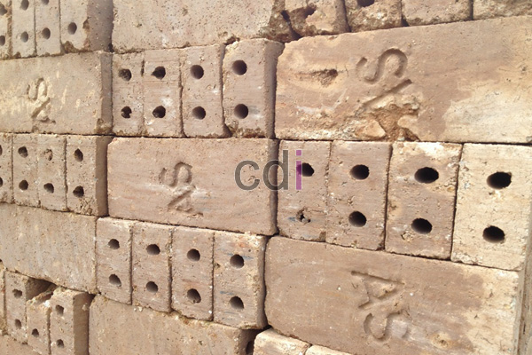

**Batako Putih** - Hai Mitra CDI! Pernahkah Anda memikirkan bagaimana pemilihan material bangunan bisa berdampak signifikan pada kenyamanan dan keindahan rumah? Material yang tepat bukan hanya soal kekuatan, tapi juga soal estetika. Nah, batako putih hadir sebagai solusi yang menarik. Material ini menawarkan kesan bersih, modern, dan pastinya, kokoh untuk bangunan impian Anda. Yuk, kita kupas tuntas keunggulan batako putih!

## Memahami Batako Putih: Lebih dari Sekadar Bata
Batako putih adalah material bangunan hasil campuran semen, pasir, dan air yang diproses melalui cetakan dan pemadatan. Proses ini menghasilkan tekstur padat dengan permukaan yang relatif halus. Warna putihnya memberikan kesan bersih dan modern, menjadikannya pilihan populer untuk berbagai desain interior dan eksterior.

Material ini serbaguna, digunakan untuk dinding, pagar, bahkan elemen dekoratif. Fleksibilitas ini membuat batako putih sering menjadi andalan arsitek dan desainer interior, termasuk tim Creative Design Interior.

### Mengapa Memilih Batako Putih? Keunggulannya Dibanding Material Lain
Batako putih punya beberapa keunggulan yang membuatnya menjadi pilihan menarik. Pertama, bobotnya lebih ringan dibandingkan bata merah konvensional. Ini akan mempermudah dan mempercepat proses pemasangan. Kedua, permukaan yang lebih halus berarti Anda bisa mengurangi ketebalan plesteran, sehingga berpotensi menghemat biaya finishing.

Selain itu, daya tahan batako putih juga patut diacungi jempol. Material ini cukup tahan terhadap kondisi cuaca ekstrem dan minim risiko keropos. Jadi, bagi Mitra CDI yang mencari material bangunan awet dan tetap terlihat menarik, batako putih bisa jadi pilihan tepat.

## Kenyamanan dan Estetika: Kelebihan Batako Putih untuk Hunian Minimalis
Buat Anda yang menyukai konsep hunian minimalis, batako putih adalah pasangan serasi! Apa saja alasannya?

### 1. Tampilan Modern yang Segar
Batako putih dengan warna netralnya menghadirkan kesan modern dan bersih. Warna ini mudah dipadukan dengan elemen desain lain, seperti kayu, kaca, atau logam. Ideal untuk menciptakan tampilan yang rapi dan estetik tanpa perlu usaha berlebihan.

### 2. Efisiensi Waktu dan Anggaran
Ukuran batako putih yang lebih besar mempercepat proses pemasangan. Permukaannya yang rata dan halus juga mengurangi kebutuhan plester atau cat yang tebal. Dengan begitu, Mitra CDI bisa menghemat waktu dan biaya finishing.

## Panduan Memilih Batako Putih Berkualitas Tinggi
Agar hasil konstruksi maksimal, penting untuk memilih batako putih berkualitas. Berikut beberapa tips yang bisa Anda ikuti:

### 1. Perhatikan Tekstur dan Permukaan
Pastikan batako putih memiliki tekstur yang padat dan permukaan yang halus. Hindari produk yang memiliki retakan atau pori-pori besar, karena hal ini bisa mengurangi kekuatannya.

### 2. Lakukan Uji Ketahanan Sederhana
Batako putih berkualitas tidak mudah hancur saat diketuk atau ditekan. Sebelum membeli dalam jumlah besar, lakukan uji sampel untuk mengecek kualitasnya secara langsung.

### 3. Percayakan pada Produsen Terpercaya
Creative Design Interior menjalin kerja sama dengan produsen batako putih terpercaya yang sudah teruji kualitasnya. Dengan memilih produk dari kami, Mitra CDI tidak perlu khawatir akan kualitas material.

## Harmoni Batako Putih dan Furniture Custom: Sentuhan Personal pada Hunian Anda
Salah satu keuntungan menggunakan batako putih adalah fleksibilitasnya. Dinding dari batako putih sangat mudah dipadukan dengan furniture custom untuk menciptakan tampilan hunian yang unik dan merefleksikan gaya pribadi Anda.

Misalnya, untuk ruang tamu bergaya industrial, batako putih bisa dibiarkan terekspos untuk menonjolkan teksturnya yang khas. Padukan dengan furniture custom berbahan kayu atau besi, dan voilà—ruang tamu minimalis yang *chic* langsung siap menyambut tamu!

Batako putih juga bisa menjadi *background* yang menarik bagi furniture berwarna cerah, menciptakan kontras yang artistik.

## Kesimpulan
Mitra CDI, batako putih bukan sekadar material bangunan biasa. Ini adalah elemen penting yang berkontribusi pada estetika dan kenyamanan rumah impian Anda. Dengan memilih batako putih berkualitas dan merancangnya dengan desain interior yang tepat, rumah impian Anda bisa menjadi kenyataan.

Jika Anda membutuhkan bantuan lebih lanjut dalam perencanaan desain interior, furniture custom, atau pemilihan material bangunan, tim Creative Design Interior siap membantu. Jangan ragu untuk menghubungi kami melalui tombol **Telepon** atau **WhatsApp** yang tersedia di bawah halaman ini. Kami siap mewujudkan hunian impian Anda di (not detected)!