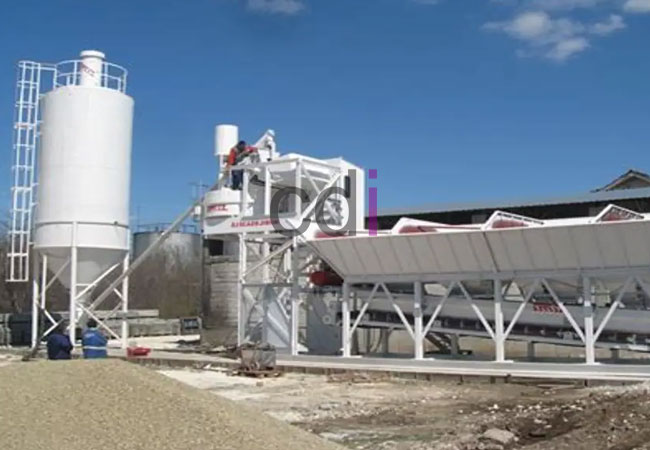

**Batching Plant Merah Putih: Solusi Efisien untuk Kebutuhan Beton Jabodetabek** - Hai Mitra CDI! Apakah Anda sedang merencanakan proyek konstruksi di wilayah Jabodetabek? Mencari cara untuk memastikan suplai beton berkualitas tinggi, tepat waktu, dan efisien? Nah, *batching plant* Merah Putih hadir sebagai solusi yang tepat untuk mengatasi tantangan tersebut. Kami menawarkan kemudahan dan kehandalan dalam memenuhi kebutuhan beton Anda.

## Mengapa Batching Plant Merah Putih Menjadi Pilihan Tepat untuk Proyek Anda?

Investasi dalam infrastruktur konstruksi di Jabodetabek terus meningkat. Bersamaan dengan itu, kebutuhan akan material bangunan berkualitas juga semakin tinggi. *Batching plant* Merah Putih hadir untuk menjawab kebutuhan tersebut. Salah satu keunggulan utama kami adalah lokasi strategis yang dirancang untuk mempercepat distribusi beton ke seluruh area Jabodetabek. Ini berarti Anda dapat menghemat waktu tunggu dan menjaga kelancaran jadwal proyek.

Selain lokasi yang strategis, kami juga menekankan pada kualitas. *Batching plant* kami dilengkapi dengan teknologi modern dan menerapkan sistem kontrol kualitas yang ketat sesuai standar SNI. Kami memahami betul bahwa beton yang kuat dan tahan lama adalah kunci keberhasilan setiap proyek konstruksi. Percayakan kualitas beton Anda pada ahlinya!

## Ragam Jenis Beton Berkualitas dari Batching Plant Merah Putih

Kami menyediakan berbagai jenis beton untuk mengakomodasi beragam kebutuhan konstruksi Anda. Beberapa pilihan yang tersedia antara lain:

*   **Beton Normal:** Ideal untuk konstruksi umum seperti bangunan hunian, fasilitas komersial sederhana, jalan, dan trotoar.
*   **Beton Mutu Tinggi (K-300, K-400, K-500):** Dirancang untuk menahan beban berat, sangat cocok untuk fondasi bangunan tinggi, kolom, balok, dan jembatan.
*   **Beton Pompa:** Solusi praktis untuk pengecoran di area yang sulit dijangkau, misalnya konstruksi bertingkat atau lokasi dengan akses terbatas.
*   **Beton Self-Compacting Concrete (SCC):** Memiliki kemampuan mengisi ruang secara mandiri tanpa vibrasi, memastikan kepadatan optimal untuk struktur kompleks.

Sebagai gambaran, misalkan proyek Anda membutuhkan 100 meter kubik beton K-300 untuk pondasi. Kami dapat memproduksinya sesuai jadwal yang Anda tentukan, menjamin ketersediaan material saat Anda membutuhkannya. Informasi lebih lanjut mengenai  dapat Anda temukan di halaman produk kami. 

## Tips Memilih Batching Plant Merah Putih yang Sesuai Kebutuhan

Memilih *batching plant* yang tepat membutuhkan pertimbangan matang. Pertama, pastikan *batching plant* tersebut memiliki sertifikasi mutu yang terpercaya, seperti ISO 9001. Sertifikasi ini menjamin konsistensi kualitas produk dan layanan yang diberikan. Kedua, pertimbangkan kapasitas produksi *batching plant*. Pastikan mereka mampu memenuhi permintaan material Anda, terutama untuk proyek berskala besar.

Selanjutnya, perhatikan lokasi *batching plant*. Pilihlah yang lokasinya dekat dengan lokasi proyek Anda untuk meminimalkan biaya transportasi dan mempercepat pengiriman. Anda dapat mencari informasi lebih lanjut tentang [lokasi Plant Ready Mix Beton Jayamix Holcim Adhimix Merah Putih](/blog/lokasi-plant-ready-mix-beton-jayamix-holcim-adhimix-merah-putih/) untuk referensi. Terakhir, pastikan *batching plant* memiliki reputasi baik dalam hal pelayanan pelanggan dan dukungan teknis.

## Batching Plant vs. Pencampuran Beton di Lokasi: Mana yang Lebih Menguntungkan?

Memutuskan antara menggunakan *batching plant* atau mencampurkan beton di lokasi proyek adalah keputusan penting. Mari kita bandingkan beberapa aspek kunci:

<table class="table">
  <caption>Perbandingan Batching Plant vs. Pembuatan Beton di Lokasi</caption>
  <thead>
    <tr><th>Faktor</th><th>Batching Plant</th><th>Pembuatan di Lokasi</th></tr>
  </thead>
  <tbody>
    <tr><td>Biaya</td><td>Umumnya lebih hemat biaya untuk proyek besar</td><td>Biaya lebih tinggi karena investasi peralatan dan tenaga kerja</td></tr>
    <tr><td>Kualitas</td><td>Konsisten dan terjamin melalui kontrol kualitas ketat</td><td>Variatif, tergantung keahlian operator dan kualitas material</td></tr>
    <tr><td>Waktu</td><td>Pengiriman cepat dan efisien</td><td>Membutuhkan waktu lebih lama untuk persiapan dan pencampuran</td></tr>
    <tr><td>Ruang</td><td>Tidak memerlukan lahan di lokasi proyek</td><td>Membutuhkan area luas untuk penyimpanan material dan peralatan</td></tr>
    <tr><td>Tenaga Kerja</td><td>Membutuhkan tenaga kerja yang lebih sedikit</td><td>Membutuhkan tenaga kerja yang lebih banyak</td></tr>
  </tbody>
</table>

Secara umum, jika Anda membutuhkan beton dalam jumlah besar dan mengutamakan kualitas yang konsisten, *batching plant* Merah Putih adalah solusi terbaik. Jika proyek Anda berskala kecil dan membutuhkan fleksibilitas tinggi, mencampurkan beton di lokasi mungkin lebih sesuai. Cari tahu lebih lanjut tentang [Adhimix Plant Bandung: Solusi Praktis dan Efisien untuk Kebutuhan Beton Precast](/blog/adhimix-plant-bandung/) untuk opsi lain.

Siap memulai proyek konstruksi Anda dengan fondasi yang kokoh dan efisien? Jangan ragu untuk menghubungi Kami melalui tombol **Telepon** atau **WhatsApp** yang tersedia di bawah. Tim Kami siap membantu Anda menemukan solusi beton terbaik untuk kebutuhan Anda di (not detected)!