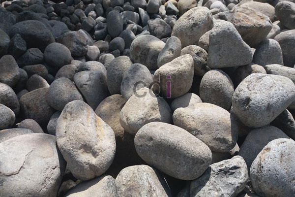

**Batu Belah dan Batu Kali: Pilih yang Tepat untuk Proyek Anda!** - Hai Mitra CDI! Pernahkah Anda bertanya-tanya, apa bedanya batu belah dan batu kali? Kedua material ini memang sering muncul dalam perencanaan konstruksi di (not detected), mulai dari fondasi rumah hingga taman yang indah. Tapi, sebenarnya, apakah keduanya bisa dipertukarkan begitu saja? Yuk, kita kupas tuntas perbedaannya supaya Mitra bisa membuat keputusan terbaik untuk proyek Anda!

Memang sekilas terlihat mirip, sama-sama berasal dari alam, dan sama-sama populer untuk pekerjaan pondasi. Namun, asal-usul dan karakteristik keduanya sangat berbeda, dan ini penting untuk diperhatikan. Salah pilih material bisa berpengaruh besar pada kekuatan bangunan atau bahkan hasil visual yang Anda inginkan.

Seringkali, di toko material di (not detected), kedua jenis batu ini ditampilkan berdampingan tanpa penjelasan rinci. Padahal, pemahaman yang tepat tentang perbedaan keduanya sangat krusial.

## Dari Mana Asalnya?

**Batu belah** diperoleh dari pemecahan batuan besar, biasanya di area perbukitan atau tambang batu, dengan menggunakan alat berat. Proses pemecahan ini menghasilkan bentuk yang tidak beraturan, dengan sudut-sudut tajam dan permukaan kasar. Justru karakteristik inilah yang menjadikannya sangat ideal untuk konstruksi.

Sedangkan **batu kali** berbeda. Batu ini ditemukan secara alami di dasar atau tepi sungai, hasil erosi air selama bertahun-tahun. Bentuknya cenderung bulat atau oval dengan permukaan yang lebih halus, akibat gesekan terus-menerus dengan air dan bebatuan lain.

## Keunggulan dan Kekurangan Masing-masing

| Aspek | Batu Belah | Batu Kali |
|---|---|---|
| Kekuatan Ikat ke Semen | Tinggi (sudut tajam mudah "mencengkeram") | Lebih rendah (permukaan licin) |
| Harga | Lebih ekonomis | Cenderung lebih mahal |
| Nilai Estetika | Kurang cocok untuk dekoratif | Tinggi, cocok untuk taman/kolam |
| Ketahanan Cuaca | Baik | Sangat baik |
| Kemudahan Pemindahan | Berat, butuh alat bantu | Relatif lebih mudah |

## Kapan Sebaiknya Memilih Batu Belah?

Batu belah adalah solusi tepat untuk kebutuhan struktural yang membutuhkan kekuatan dan stabilitas tinggi. Misalnya, untuk pondasi rumah dan bangunan bertingkat, dinding penahan tanah, atau bahkan paving jalan yang membutuhkan daya cengkeram kuat terhadap adukan semen. Permukaannya yang kasar membuat batu ini ideal juga sebagai lapisan dasar (base course) sebelum pengecoran jalan, karena membentuk interlocking yang kuat.

## Kapan Batu Kali Menjadi Pilihan Terbaik?

Di sisi lain, batu kali lebih bersinar ketika digunakan untuk tujuan estetika dan proyek outdoor: kolam ikan, taman air, jalan setapak, atau sebagai aksen dekoratif pada dinding eksterior yang menampilkan kesan alami dan lembut. Bahkan, beberapa desainer interior menggunakannya di area carport atau taman kering, menciptakan kontras tekstur yang menarik.

## Bisakah Keduanya Dikombinasikan?

Sangat bisa! Bahkan, kombinasi ini seringkali menjadi pilihan cerdas. Anda bisa menggunakan batu belah untuk struktur pondasi bagian dalam yang tak terlihat, kemudian melapisi dengan batu kali sebagai elemen dekoratif di bagian luar. Kombinasi ini populer untuk rumah bergaya tropis modern yang ingin menggabungkan kekuatan dan keindahan alam. Di (not detected), banyak sekali contoh penerapannya.

## Panduan Memilih untuk Proyek Anda

Pertimbangkan fungsi utama proyek Anda: jika untuk menahan beban, batu belah lebih diutamakan. Jika untuk mempercantik tampilan, batu kali adalah pilihan yang lebih baik. Jangan lupa sesuaikan dengan anggaran, karena harga keduanya bisa berbeda signifikan untuk proyek berukuran besar.

## Perkiraan Kebutuhan untuk Pondasi Rumah Biasa

Sebagai gambaran, untuk pondasi rumah dengan keliling 40 meter dan kedalaman standar, biasanya dibutuhkan sekitar 8-10 m³ batu belah. Jumlah ini bisa bervariasi tergantung lebar dan kedalaman galian pondasi. Harga batu belah tentu saja dipengaruhi oleh lokasi dan jarak dari sumber tambang, jadi sebaiknya minta penawaran dari beberapa penyedia sebelum membuat keputusan anggaran akhir.

## Mengenali Kualitas Batu Belah yang Baik

Batu belah yang berkualitas memiliki permukaan yang pecah tajam (tidak tumpul atau aus), tidak mudah retak saat dipukul ringan, dan bebas dari retakan halus yang bisa mengurangi kekuatan saat menahan beban. Hindari batu yang terlalu berpori atau mudah terkelupas, karena kualitasnya mungkin di bawah standar.

## Tips Menghindari Kekeliruan Saat Membeli

Beberapa penjual mungkin mencoba mencampur batu belah berkualitas rendah dengan yang lebih baik. Selalu periksa beberapa titik acak dari tumpukan material yang dikirim, bukan hanya bagian atasnya, untuk memastikan kualitasnya konsisten.

## Kesimpulan

Batu belah dan batu kali adalah material bangunan yang serbaguna, namun masing-masing unggul dalam bidangnya sendiri. Batu belah menjamin kekuatan struktural dan ekonomis, sedangkan batu kali menonjol dalam estetika dan ketahanan cuaca.

Butuh bantuan memilih material yang tepat untuk proyek Anda di (not detected)? Tim Creative Design Interior siap membantu! Silakan hubungi kami melalui tombol **Telepon** atau **WhatsApp** yang tersedia di halaman ini.  Kami akan bantu Mewujudkan Proyek Impian Anda!