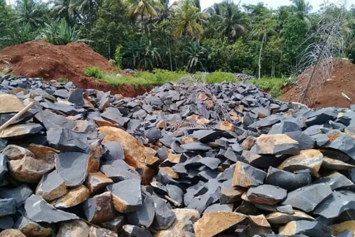

**Batu Belah: Material Kuat untuk Konstruksi dan Desain Interior Anda** - Hai Mitra CDI! Sedang mencari material bangunan yang kokoh sekaligus estetis? Atau mungkin ingin menghadirkan sentuhan alam dalam desain interior? Nah, batu belah bisa jadi solusi yang tepat! Artikel ini akan membahas tuntas segala hal tentang batu belah – mulai dari keunggulannya, berbagai jenisnya, hingga tips pemanfaatannya. Simak terus ya!

## Mengapa Batu Belah Banyak Diminati?  

Batu belah adalah material alam yang dihasilkan melalui pemecahan batuan besar seperti andesit, granit, atau basalt menjadi ukuran-ukuran yang diinginkan. Proses ini menghasilkan material yang unik dengan tekstur dan karakter alami yang khas. Kekuatan dan daya tahannya menjadikannya favorit untuk berbagai aplikasi konstruksi, mulai dari fondasi hingga dinding penahan tanah.  

Lebih dari sekadar kekuatan, batu belah juga menawarkan keindahan alami yang tidak bisa ditiru oleh material buatan. Penggunaan batu belah dalam desain interior dapat menciptakan atmosfer yang menghangatkan, kokoh, dan berkarakter.  

### Keunggulan Batu Belah yang Perlu Anda Tahu  

1. **Kekuatan dan Durabilitas Tinggi**  
   Batu belah sangat tahan terhadap tekanan, benturan, dan perubahan cuaca ekstrem. Inilah mengapa material ini sering digunakan untuk konstruksi yang membutuhkan keandalan jangka panjang, seperti fondasi bangunan dan infrastruktur jalan.  

2. **Dampak Lingkungan Minimal**  
   Menggunakan batu belah berarti memilih material alami yang tidak melalui proses produksi yang kompleks dan menghasilkan limbah berbahaya. Pilihan yang lebih bertanggung jawab terhadap lingkungan.  

3. **Fleksibilitas Desain**  
   Dari tampilan rustic hingga modern, batu belah dapat beradaptasi dengan berbagai gaya desain. Dengan berbagai pilihan warna dan tekstur, Anda bisa menciptakan tampilan yang sesuai dengan selera Anda.  

## Jenis-Jenis Batu Belah: Kenali Karakteristiknya  

Ada berbagai jenis batu belah yang tersedia, masing-masing dengan karakteristik uniknya. Memahami perbedaan ini akan membantu Anda memilih material yang paling sesuai dengan kebutuhan dan preferensi Anda.  

### 1. Batu Andesit: Elegan dan Minimalis  

Batu andesit adalah pilihan populer untuk dinding eksterior dan interior karena penampilannya yang elegan dan minim perawatan. Material ini memiliki tekstur yang halus dan warna abu-abu yang netral, sehingga mudah dipadukan dengan berbagai gaya desain. Karena tahan terhadap lumut dan jamur, batu ini sangat cocok untuk area yang lembap atau sering terkena air.  

### 2. Batu Basalt: Kuat dan Modern  

Batu basalt dikenal karena kekuatannya yang luar biasa dan tahan terhadap abrasi. Warna hitam keabu-abuannya yang khas memberikan kesan modern dan industrial pada aplikasi desain. Material ini ideal untuk pondasi bangunan, jalan, atau sebagai elemen dekoratif yang mencolok.  

### 3. Batu Granit: Mewah dan Beragam  

Batu granit menawarkan palet warna dan pola yang kaya, menjadikannya pilihan yang menarik secara visual. Kekuatannya yang tinggi membuatnya cocok untuk lantai, dinding, meja dapur, atau bahkan sebagai aksen dekoratif. Selain indah, granit juga tahan terhadap goresan dan panas.  

  

## Ide Kreatif Pemanfaatan Batu Belah untuk Interior Anda  

Ingin memberikan sentuhan unik dan alami pada interior rumah atau ruang komersial Anda? Batu belah bisa menjadi elemen desain yang menarik. Berikut beberapa ide yang bisa Anda coba:  

### Sesuaikan Jenis Batu dengan Gaya Desain  

Memilih jenis batu belah yang tepat adalah kunci untuk mencapai tampilan yang diinginkan. Batu andesit cocok untuk gaya minimalis, sementara granit bisa menjadi focal point dalam desain yang mewah.  

### Kombinasikan dengan Material Lain  

Eksperimen dengan memadukan batu belah dengan material lain seperti kayu, kaca, atau logam. Kombinasi ini dapat menciptakan kontras yang menarik dan memberikan dimensi baru pada ruangan.  

### Pertimbangkan Teknik Finishing  

Finishing yang tepat dapat mempercantik tampilan batu belah. Anda bisa memilih finishing poles untuk kesan berkilau, finishing honed untuk tampilan yang lebih lembut, atau finishing alami untuk mempertahankan tekstur dan karakter aslinya.  

## Peran Vital Batu Belah dalam Dunia Konstruksi  

Selain keunggulannya dalam desain interior, batu belah juga memiliki peran krusial dalam berbagai aplikasi konstruksi. Beberapa contohnya adalah:  

- **Fondasi Bangunan**: Kekuatan dan stabilitas batu belah menjadikannya pilihan ideal untuk fondasi rumah, gedung bertingkat, dan infrastruktur lainnya.  
- **Dinding Penahan Tanah**: Batu belah sering digunakan untuk membangun dinding penahan tanah yang kuat dan tahan lama, terutama di daerah berbukit atau lereng.  
- **Pengaspalan dan Infrastruktur Jalan**: Ketahanan batu belah terhadap beban berat menjadikannya bahan yang efektif untuk pembuatan jalan dan infrastruktur transportasi.  

Menggunakan batu belah dalam konstruksi berarti berinvestasi pada kekuatan dan umur panjang bangunan Anda.  

## Percayakan Kebutuhan Material Konstruksi Anda pada Creative Design Interior (CDI) (not detected)!  

Siap mewujudkan impian desain Anda dengan batu belah berkualitas? Creative Design Interior siap membantu! Kami menyediakan berbagai jenis batu belah dengan kualitas terbaik dan layanan yang komprehensif.  

Jangan ragu untuk menghubungi tim ahli kami melalui tombol **Telepon** atau **WhatsApp** yang tersedia di halaman ini untuk konsultasi gratis dan penawaran terbaik. Kami melayani kebutuhan Anda di (not detected) dan sekitarnya.