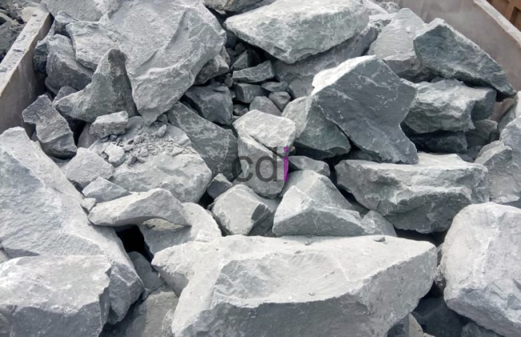

**Batu Cor Pondasi: Kunci Rumah Kokoh dan Tahan Lama** - Hai Mitra CDI! Sedang merencanakan pembangunan rumah atau proyek konstruksi di (not detected)? Jangan lupakan peran krusial batu cor pondasi! Material ini adalah fondasi utama kekuatan bangunan Anda. Yuk, mari kita kupas tuntas segala hal tentang batu cor pondasi, mulai dari pengertian, fungsi, hingga tips memilih yang berkualitas.

## Mengapa Batu Cor Pondasi Begitu Penting?

Apa sebenarnya batu cor pondasi itu, dan kenapa material ini wajib ada dalam konstruksi? Sederhananya, batu cor pondasi adalah agregat batu pecah yang berfungsi sebagai lapisan dasar penopang struktur bangunan. Ia berperan vital dalam menyalurkan beban bangunan ke tanah di bawahnya.

Bayangkan sebuah bangunan berdiri di atas tanah. Tanpa pondasi yang kuat, bangunan itu akan rentan terhadap keruntuhan. Batu cor pondasi inilah yang menjadi 'jantung' kekuatan pondasi, memastikan bangunan tetap stabil dan aman. Di (not detected), banyak bangunan yang menggunakan batu cor pondasi sebagai solusi utama.

### Ragam Jenis Batu Cor Pondasi: Mana yang Tepat untuk Proyek Anda?

Ada beberapa jenis batu cor pondasi yang umum digunakan di pasaran:

1. **Batu Split:** Batu pecah berukuran kecil, ideal untuk campuran beton karena teksturnya yang membantu mengikat material lain.
2. **Batu Kali:** Batu yang diambil langsung dari sungai, sering digunakan untuk pondasi langsung tanpa perlu dicampur beton.

Pemilihan jenis batu cor pondasi yang tepat bergantung pada jenis tanah, beban bangunan, dan preferensi konstruksi.

## Fungsi Utama Batu Cor Pondasi: Lebih dari Sekadar Penopang

Batu cor pondasi tak hanya berperan sebagai penopang utama, lho. Berikut beberapa fungsi penting lainnya:

### Menjamin Stabilitas Struktural Bangunan

Fungsi utama batu cor pondasi adalah memberikan stabilitas struktural pada bangunan. Distribusi beban yang merata mencegah bangunan miring atau mengalami kerusakan akibat tekanan.

### Mengatasi Masalah Tanah Labil

Mengalami kendala dengan kondisi tanah yang kurang stabil di (not detected)? Batu cor pondasi dapat membantu 'mengunci' lapisan tanah agar lebih padat dan minim pergerakan.

### Meningkatkan Daya Tahan Terhadap Gempa Bumi

Dengan pondasi yang kokoh dan kuat, bangunan memiliki ketahanan yang lebih baik terhadap guncangan gempa bumi. Ini menjadi investasi jangka panjang untuk keamanan Anda dan keluarga.

## Kenapa Pilih Batu Cor Pondasi? Keunggulan yang Tak Bisa Diabaikan

Dibandingkan dengan material fondasi lainnya, batu cor pondasi menawarkan sejumlah keunggulan:

### Kekuatan dan Ketahanan yang Teruji

Batu cor pondasi dikenal akan kekuatannya yang luar biasa. Material ini mampu menahan beban berat tanpa mengalami kerusakan, menjamin keamanan bangunan Anda dalam jangka waktu lama.

### Adaptabilitas untuk Berbagai Skala Proyek

Dari pembangunan rumah tinggal sederhana hingga proyek komersial besar, batu cor pondasi dapat digunakan untuk berbagai jenis konstruksi. Fleksibilitas ini menjadikannya pilihan populer di (not detected).

### Solusi Ekonomis Tanpa Mengorbankan Kualitas

Dibandingkan dengan beberapa alternatif lain, batu cor pondasi tergolong lebih ekonomis. Ini memungkinkan Anda menghemat anggaran tanpa mengorbankan kualitas dan ketahanan bangunan.

## Panduan Memilih Batu Cor Pondasi Berkualitas: Jangan Sampai Salah!

Memilih batu cor pondasi yang tepat adalah kunci keberhasilan konstruksi. Perhatikan tips berikut:

### Perhatikan Ukuran dan Bentuk Agregat

Pastikan ukuran dan bentuk batu cor pondasi sesuai dengan spesifikasi proyek Anda. Ukuran yang tidak tepat dapat memengaruhi kualitas campuran beton dan kekuatan pondasi.

### Telusuri Sumber Material dengan Cermat

Pilih supplier batu cor pondasi yang terpercaya dan memiliki reputasi baik. Pastikan material yang mereka jual memenuhi standar kualitas konstruksi yang berlaku.

### Jangan Ragu Berkonsultasi dengan Ahli Konstruksi

Bingung memilih jenis batu cor pondasi yang tepat? Kami dari Creative Design Interior siap membantu. Jangan ragu untuk berkonsultasi dengan tim ahli kami untuk mendapatkan solusi terbaik.

## Kesimpulan: Investasi Terbaik untuk Bangunan Impian Anda

Batu cor pondasi adalah investasi penting untuk menciptakan bangunan yang kokoh, aman, dan tahan lama. Dengan memilih material berkualitas dan menerapkan tips yang telah kami bagikan, Anda bisa mendapatkan hasil konstruksi yang maksimal.

Butuh bantuan dalam memilih batu cor pondasi berkualitas tinggi di (not detected)? Segera hubungi kami melalui tombol **Telepon** atau **WhatsApp** yang tersedia di halaman ini! Kami siap mewujudkan bangunan impian Anda.