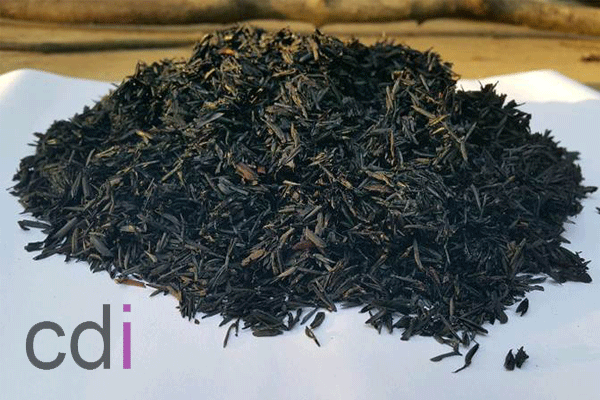

**Beberapa Hal yang Mempengaruhi Kekuatan Cor Beton** - Hai Mitra CDI! Apa kabar? Kami kembali hadir untuk berbagi informasi penting seputar konstruksi beton yang kuat dan tahan lama. Artikel ini membahas beberapa faktor kunci yang memengaruhi kekuatan cor beton, karena kualitas beton adalah fondasi utama kokohnya bangunan Anda. Memahami faktor-faktor ini penting, terutama jika Anda menggunakan *ready mix* beton. Yuk, simak penjelasannya berikut ini!

*Beberapa Hal yang Mempengaruhi Kekuatan Cor Beton*

## Peran Kandungan Semen dalam Cor Beton Berkualitas

Semakin banyak kandungan semen dalam *ready mix* beton, umumnya semakin kuat pula cor beton yang dihasilkan. Namun, perlu diingat, penggunaan semen harus proporsional sesuai standar yang ditetapkan agar sesuai dengan kebutuhan struktur bangunan Anda. Semakin tinggi mutu beton yang Anda butuhkan, biasanya semakin banyak pula kandungan semen dan batu splitnya.

## Pengaruh Kandungan Air Terhadap Kekuatan Cor Beton

Berbeda dengan semen, terlalu banyak air dalam campuran *ready mix* beton justru dapat menurunkan kualitas cor. Idealnya, gunakan air secukupnya agar campuran cor dapat memadat dengan baik di dalam bekisting yang sudah terpasang tulangan besi. Standar kandungan air yang sesuai SNI umumnya berkisar antara 210 hingga 215 liter per meter kubik. Atau, Anda bisa menghitung perbandingan antara berat semen (S) dan berat air (A) dengan rumus: KANDUNGAN AIR = A / S. (Perhatikan: berat jenis air adalah 1 kg/liter, dan berat jenis semen sekitar 3150 kg/m³ – perhitungan ini sesuai standar American Standard Testing and Material).

## Optimalisasi Agregat: Pasir Halus dan Koral Kasar

Kandungan agregat, baik pasir halus maupun koral kasar, turut memengaruhi kekuatan cor beton. Campuran pasir memang menghasilkan tekstur beton yang lebih halus, namun bisa sedikit mengurangi kekuatannya. Jadi, perhatikan takaran pasir yang digunakan. Semakin tinggi mutu beton yang dibutuhkan, semakin sedikit agregat pasir yang digunakan. Sebaliknya, semakin tinggi mutu beton, semakin banyak pula agregat koral yang digunakan. Walaupun teksturnya lebih kasar, penggunaan koral yang lebih banyak justru meningkatkan kekuatan dan kekokohan cor beton.

## Manfaat Material Tambahan: Fly Ash (Abu Terbang)

Penggunaan material tambahan seperti *fly ash* (abu terbang) juga dapat meningkatkan kinerja semen pada *ready mix* beton. Ada dua jenis campuran beton *ready mix*: yang menggunakan *fly ash* dan yang tidak. *Fly ash* berfungsi memaksimalkan kinerja semen dan membuat cor beton lebih halus. Penggunaan *fly ash* memang bisa menekan jumlah semen yang digunakan, tetapi perlu diperhatikan takarannya. Penggunaan *fly ash* yang berlebihan justru dapat menurunkan kualitas *ready mix* beton.

Nah, itulah beberapa hal yang memengaruhi kekuatan cor beton. Semoga informasi ini bermanfaat bagi Anda, Mitra CDI, dalam proyek pembangunan Anda di (not detected). Untuk kebutuhan *ready mix* beton berkualitas, jangan ragu untuk menghubungi kami melalui tombol Telepon/WhatsApp di situs web ini. Kami siap mendukung kesuksesan proyek Anda! Jangan lupa juga untuk mengecek [[[PLACEHOLDER_N]]] untuk mendapatkan informasi harga terkini. Kami juga menyediakan jasa pengecoran profesional di (not detected) lho! [Atap Bondek Cor: Panduan Lengkap Kekuatan, Pemasangan, dan Estimasi Biaya 2026](/blog/atap-bondek-cor/) bisa menjadi pertimbangan tambahan untuk struktur bangunan yang kuat.