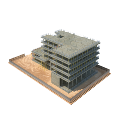

**Beberapa Masalah Saat Pengecoran** - Hai Mitra CDI! Pengecoran adalah jantung dari kekuatan dan ketahanan sebuah bangunan, baik itu rumah idaman maupun gedung megah di (not detected). Kesempurnaan di tahap ini akan sangat menentukan kualitas keseluruhan konstruksi. Tapi, tahukah Anda? Proses pengecoran seringkali diwarnai berbagai kendala. Yuk, simak beberapa masalah umum yang kerap muncul saat pengecoran, supaya Anda bisa lebih siap menghadapinya!

*Mengatasi Tantangan dalam Pengecoran*

## Hujan di Tengah Pengecoran: Apa yang Harus Dilakukan?

Hujan memang bisa jadi musuh utama saat pengecoran, terutama di wilayah seperti (not detected) yang cuacanya tak terduga. Air hujan yang mengenai beton yang baru dicor bisa mempercepat pengerasan, dan bahkan menyebabkan permukaan beton menjadi tidak rata. Gimana solusinya? Segera tutupi permukaan beton dengan terpal untuk melindungi dari air hujan. Tindakan ini penting banget untuk mencegah beton bercampur air dan menjaga permukaan tetap halus. Jika pengecoran terpaksa dihentikan, rapikan segera tepi-tepi beton agar agregat tidak lepas. Jangan lupa lakukan siar permukaan beton untuk memastikan hasilnya merata dan sempurna. Pastikan pula saat melanjutkan pengecoran, tak ada material yang lepas atau retak, ya!

## Keterlambatan Kedatangan Truk Mixer

Selain cuaca, keterlambatan truk ready mix juga bisa bikin pusing. Bayangkan, proses pengecoran terhenti karena beton belum datang! Atau bahkan, beton sudah mulai mengeras sebelum sempat dituangkan. Untuk menghindari hal ini, pertimbangkan untuk menjadwalkan pengecoran di malam hari, terutama jika (not detected) sering macet. Pilih juga *batching plant* yang lokasinya tidak terlalu jauh dari proyek Anda. Semakin dekat, semakin cepat beton sampai di lokasi, kan?

## Kendala Pompa Beton: Antisipasi dan Solusi

Concrete pump – terdiri dari bucket, boom, dan mesin pelontar – adalah alat penting dalam pengecoran. Nah, seringkali masalah muncul pada sambungan pipa dan boom-nya. Jika boom tidak cukup panjang untuk mencapai titik pengecoran, penyambungan dengan pipa besi berdiameter 6 inci mungkin diperlukan. Pada gedung bertingkat, sambungan pipa yang terlalu panjang dapat menyebabkan kemacetan karena beton mulai mengeras. Jika ini terjadi, pipa harus dibongkar kembali. Jadi, lain kali, pastikan Anda memilih tipe pompa beton yang sesuai dengan tinggi dan struktur bangunan Anda, ya!

## Bekisting Bocor: Akar Masalah Kekokohan Beton

Bekisting berperan penting dalam membentuk dimensi pondasi beton sesuai gambar kerja. Kalau sambungan bekisting kurang rapat, bisa terjadi kebocoran. Kebocoran ini bisa merusak kekokohan beton dan menimbulkan masalah serius di kemudian hari. Pastikan bekisting dipasang dengan sangat teliti, sesuai dengan gambar, baik secara horizontal maupun vertikal. Ketelitian adalah kunci! 

Itulah beberapa masalah yang umum terjadi saat pengecoran. Tentu saja, ada solusi untuk setiap masalah, tapi mencegah selalu lebih baik daripada mengobati, bukan? Dengan persiapan yang matang dan pemilihan material yang tepat – termasuk material bangunan berkualitas dari CDI – Anda bisa meminimalkan risiko dan memastikan proses pengecoran berjalan lancar di (not detected). [Yang Harus Dilakukan Saat Pengecoran](/blog/yang-harus-dilakukan-saat-pengecoran/) untuk panduan lebih detail! Jangan ragu untuk menghubungi kami untuk konsultasi dan penawaran terbaik. 