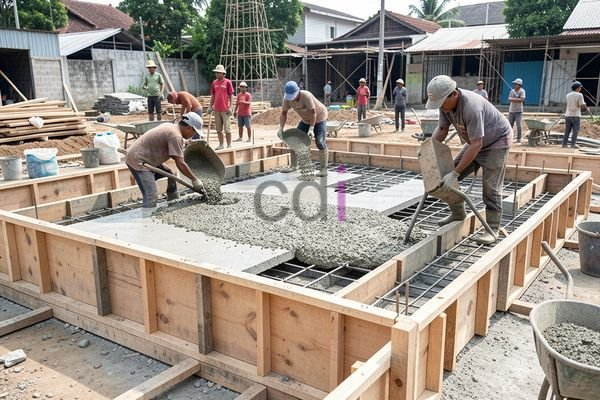

**Bekisting Balok dan Plat: Panduan Lengkap Material, Perhitungan, dan Biaya 2026** - Hai Mitra CDI! Pengecoran beton yang akurat dan efisien itu krusial, kan? Nah, bekisting berperan penting di sini, terutama untuk membentuk balok dan plat. Artikel ini akan membahas tuntas: mulai dari jenis material yang tepat, cara menghitung kebutuhan, sampai estimasi biayanya. Dengan pemahaman yang baik, Mitra bisa mengoptimalkan anggaran dan memastikan kualitas konstruksi.

## Pahami Lebih Dalam Fungsi dan Jenis Bekisting Balok & Plat

Apa sih sebenarnya fungsi bekisting? Sederhananya, bekisting adalah cetakan sementara yang menahan beton cair sampai ia mengeras dan membentuk struktur yang diinginkan. Untuk balok dan plat, bekisting memastikan bentuk yang presisi sesuai dengan desain. Sementara itu, ada beberapa jenis bekisting yang populer di lapangan. Secara umum, kita kenal bekisting kayu, baja, dan *composite*.

Bekisting kayu punya keunggulan biaya yang relatif terjangkau, apalagi kalau proyeknya sederhana. Pemasangannya juga mudah. Tapi, perlu diingat, bekisting kayu tidak terlalu kuat dan kurang tahan untuk dipakai berkali-kali. Beda ceritanya dengan bekisting baja. Meskipun investasi awalnya lebih besar, kekuatan dan daya tahannya jauh lebih unggul. Ini membuatnya ideal untuk proyek besar dan bisa digunakan berulang-ulang, sehingga lebih hemat dalam jangka panjang. Lalu, ada juga bekisting *composite* yang memadukan kayu dan baja. Tujuannya? Mencari yang terbaik dari kedua dunia: kombinasi biaya efektif, kekuatan, dan usia pakai yang lumayan.

## Perhitungan Kebutuhan Bekisting: Lebih dari Sekedar Luas Permukaan

Menghitung kebutuhan bekisting itu penting banget, lho. Ini membantu memperkirakan biaya dan memastikan material yang dipesan cukup. Cara paling dasar adalah dengan menghitung luas permukaan beton yang akan dicor. Untuk balok, hitungnya panjang dikalikan tinggi dan lebar balok (termasuk ketebalan lapisan beton). Kalau untuk plat, cukup hitung luas permukaan platnya saja.

Tapi, jangan cuma mengandalkan perhitungan luas permukaan, ya. Mitra juga perlu memperhitungkan faktor keamanan! Tujuannya untuk mengantisipasi potensi kerusakan atau kehilangan material. Faktor keamanan yang biasa dipakai sekitar 5% sampai 10% dari total luas permukaan. Misalnya, kalau luas permukaan betonnya 100 m², dengan faktor keamanan 10%, kebutuhan bekistingnya jadi 110 m². Penting untuk menyesuaikan angka ini sesuai kompleksitas desain dan kondisi di lapangan.

## Perbandingan Material: Pilih yang Terbaik untuk Proyek Anda

Memilih material bekisting yang tepat itu kunci. Pilihan ini akan memengaruhi biaya, seberapa awet bekisting, dan efisiensi kerja. Yuk, bandingkan bekisting kayu, baja, dan *composite* secara lebih detail:

<table class="table">
  <caption>Perbandingan Material Bekisting</caption>
  <thead>
    <tr><th>Material</th><th>Kekuatan</th><th>Durabilitas</th><th>Biaya Awal</th><th>Biaya Operasional</th><th>Kemudahan Pemasangan</th></tr>
  </thead>
  <tbody>
    <tr><td>Kayu</td><td>Sedang</td><td>Rendah</td><td>Rendah</td><td>Sedang</td><td>Tinggi</td></tr>
    <tr><td>Baja</td><td>Tinggi</td><td>Tinggi</td><td>Tinggi</td><td>Rendah</td><td>Sedang</td></tr>
    <tr><td>Composite</td><td>Sedang-Tinggi</td><td>Sedang-Tinggi</td><td>Sedang</td><td>Sedang</td><td>Sedang</td></tr>
  </tbody>
</table>

Lebih spesifiknya, kayu masih menjadi pilihan ekonomis untuk proyek kecil atau desain yang tidak terlalu rumit. Tapi, ingat, kayu mudah rusak terkena air atau cuaca ekstrem, dan perlu dirawat secara berkala. Kalau prioritasnya kekuatan dan tahan lama, bekisting baja adalah jawabannya. Meskipun lebih mahal di awal, penggunaan berulang bisa menekan biaya operasional. Jadi, sangat cocok untuk proyek besar dengan desain kompleks. Nah, untuk keseimbangan antara harga dan performa, bekisting *composite* bisa jadi solusi yang tepat. Gimana, sudah mulai kebayang pilihan terbaik untuk proyek Mitra?

## Estimasi Biaya Bekisting: Tips Hemat Biaya di (not detected)

Perkiraan biaya bekisting dipengaruhi banyak hal, mulai dari jenis material, luas permukaan yang dicor, seberapa rumit desainnya, sampai harga material di pasaran (termasuk di (not detected)). Sebagai gambaran, biaya bekisting biasanya berkisar antara 15% hingga 25% dari total biaya pengecoran beton. Ingat ya, angka ini hanya estimasi dan bisa berubah sewaktu-waktu. Untuk penawaran yang lebih akurat dan disesuaikan dengan proyek Mitra CDI, hubungi Kami sekarang!

Butuh tips hemat biaya bekisting? Ini dia beberapa saran: optimalkan desain struktur untuk memperkecil luas permukaan beton yang perlu dicor, pilih material bekisting yang sesuai dengan anggaran dan kebutuhan, dan cari penyedia bekisting terpercaya untuk mendapatkan harga yang kompetitif. Jangan lupa, perencanaan yang matang dan koordinasi yang baik antara tim konstruksi dan penyedia bekisting akan membantu meminimalkan pemborosan material dan waktu.

Di CDI (not detected), kami siap membantu Mitra CDI mewujudkan proyeknya. Jangan ragu untuk menghubungi Kami melalui tombol **Telepon** atau **WhatsApp** yang ada di bawah ini untuk konsultasi dan penawaran terbaik! [Bekisting Plat Lantai: Panduan Lengkap Material, Aplikasi, dan Estimasi Biaya 2026](/blog/bekisting-plat-lantai/) — artikel ini bisa jadi referensi tambahan untuk perencanaan proyek Mitra, lho.