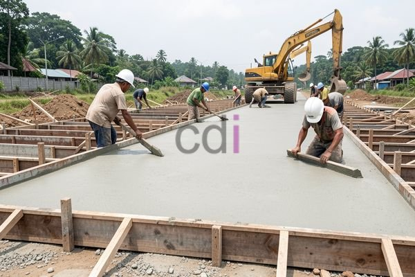

**Bekisting Jalan Rigid: Panduan Lengkap Material, Aplikasi, dan Estimasi Biaya 2026** - Hai Mitra CDI! Pembangunan jalan rigid yang andal itu penting banget, kan? Nah, salah satu kunci keberhasilannya ada di bekisting. Kalau bekistingnya kurang tepat, proyek bisa molor dan biayanya membengkak. Artikel ini akan memandu Anda memahami segala hal tentang bekisting jalan rigid, mulai dari material yang digunakan, cara aplikasinya, sampai perkiraan biayanya di tahun 2026.

## Apa Itu Bekisting Jalan Rigid dan Mengapa Penting?

Bekisting jalan rigid itu sederhananya cetakan sementara yang menahan bentuk beton saat mengeras. Bayangkan seperti wadah kue yang menentukan bentuknya. Proses ini vital karena menentukan kualitas dan kekuatan jalan yang dihasilkan. Tanpa bekisting yang kuat dan presisi, ada risiko beton melendut, retak, atau bahkan gagal sebelum benar-benar kuat. Pasalnya, beban beton segar itu berat banget lho!

Ada beberapa jenis bekisting yang sering digunakan dalam proyek jalan rigid, masing-masing punya kelebihan dan kekurangan:

*   **Bekisting Kayu:** Pilihan yang paling ekonomis, cocok untuk proyek kecil. Tapi, perlu diingat kalau bekisting kayu butuh perawatan ekstra dan kurang tahan terhadap cuaca ekstrem.
*   **Bekisting Baja:** Jauh lebih kuat dan tahan lama dari kayu. Ideal untuk proyek besar dan kompleks yang butuh ketelitian tinggi.
*   **Bekisting Aluminium:** Ringan dan mudah dipasang, tapi biasanya harganya lebih mahal.
*   **Bekisting Plastik:** Semakin populer karena ringan, tahan air, dan minim perawatan. Cocok untuk aplikasi tertentu, meskipun kekuatannya mungkin tidak setara baja untuk beban berat.

Memilih jenis bekisting yang paling pas tergantung pada anggaran proyek, ukuran pembangunan, kondisi lokasi, serta spesifikasi teknis yang dipersyaratkan. Untuk mendapatkan gambaran lebih jelas, Anda bisa membaca juga tentang [Bekisting Cor Jalan: Panduan Lengkap Material, Proses, dan Biaya 2026](https://www.cdi.co.id/blog/bekisting-cor-jalan/) untuk memahami lebih banyak opsi.

## Material Bekisting Jalan Rigid: Apa Saja yang Digunakan?

Material yang digunakan untuk bekisting harus kuat menahan beban beton segar dan gaya-gaya eksternal lainnya selama proses pengerasan. Selain itu, material tersebut harus mudah dilepaskan setelah beton mengeras tanpa merusak permukaan jalan. Material yang paling sering dipakai antara lain:

*   **Kayu:** Pilih kayu berkualitas yang sudah diawetkan agar tidak mudah lapuk.
*   **Baja:** Biasanya menggunakan baja profil atau plat dengan ketebalan sesuai kebutuhan.
*   **Aluminium:** Pastikan aluminium yang digunakan memiliki kekuatan dan kekakuan yang memadai.
*   **Plastik:** Gunakan plastik yang tahan terhadap benturan dan perubahan bentuk.

Selain material utama, jangan lupa komponen pendukung seperti baut, mur, dan pengikat yang kuat. Pastikan semua material memenuhi standar mutu yang berlaku, seperti SNI, demi keamanan dan kualitas jalan yang optimal.

## Estimasi Biaya Bekisting Jalan Rigid di Tahun 2026

Biaya bekisting jalan rigid itu dinamis, alias bisa berubah-ubah. Ada beberapa faktor yang mempengaruhinya:

*   **Jenis Bekisting:** Bekisting baja biasanya lebih mahal daripada kayu.
*   **Luas Area:** Semakin luas area yang akan dicor, semakin besar biayanya.
*   **Ketebalan Jalan:** Jalan yang lebih tebal membutuhkan bekisting yang lebih kuat dan mahal.
*   **Kompleksitas Desain:** Desain yang rumit dengan banyak lekukan akan meningkatkan biaya bekisting.
*   **Harga Material:** Harga material bisa naik turun mengikuti kondisi pasar, jadi penting untuk memantau perkembangannya.

Sebagai gambaran, perkiraan biaya bekisting jalan rigid di tahun 2026 berkisar antara Rp 150.000 – Rp 400.000 per meter persegi. Perlu diingat bahwa ini hanyalah estimasi. Untuk mendapatkan penawaran yang lebih akurat sesuai dengan proyek Mitra CDI, silakan hubungi Kami.

Sebagai contoh, kalau Anda akan membangun jalan rigid seluas 1000 meter persegi dengan ketebalan 20 cm dan menggunakan bekisting baja seharga Rp 250.000 per meter persegi, maka total biaya bekistingnya adalah 1000 m² x Rp 250.000/m² = Rp 250.000.000.

## Tips Memilih Penyedia Jasa Bekisting Jalan Rigid yang Terpercaya

Memilih penyedia jasa bekisting yang tepat itu krusial untuk kelancaran dan keberhasilan proyek. Berikut beberapa tips yang bisa Anda pertimbangkan:

*   **Pengalaman dan Reputasi:** Cari penyedia jasa yang punya pengalaman luas dan reputasi baik di bidang bekisting jalan rigid.
*   **Kualifikasi dan Sertifikasi:** Pastikan penyedia jasa memiliki kualifikasi dan sertifikasi yang relevan.
*   **Peralatan dan Teknologi:** Cek apakah mereka punya peralatan dan teknologi yang memadai untuk proyek Anda.
*   **Harga dan Penawaran:** Bandingkan harga dan penawaran dari beberapa penyedia jasa sebelum memutuskan.
*   **Layanan Purna Jual:** Pastikan mereka memberikan layanan purna jual yang baik, seperti garansi dan dukungan teknis.

Dengan memilih penyedia jasa yang tepat, Anda bisa meminimalkan risiko kesalahan, menghemat biaya, dan memastikan proyek selesai tepat waktu dengan kualitas yang memuaskan. Jangan lupa, [1 m3 beton berapa m2 bekisting: Panduan Praktis Menghitung dan Mengoptimalkan](https://www.cdi.co.id/blog/1-m3-beton-berapa-m2-bekisting/) bisa jadi referensi tambahan untuk menghitung kebutuhan bekisting Anda.

Butuh bantuan lebih lanjut? Jangan sungkan untuk menghubungi Kami melalui tombol **WhatsApp** atau **Telepon** yang tersedia di halaman ini. Kami siap membantu! [2] [3] [4] [5] [6]