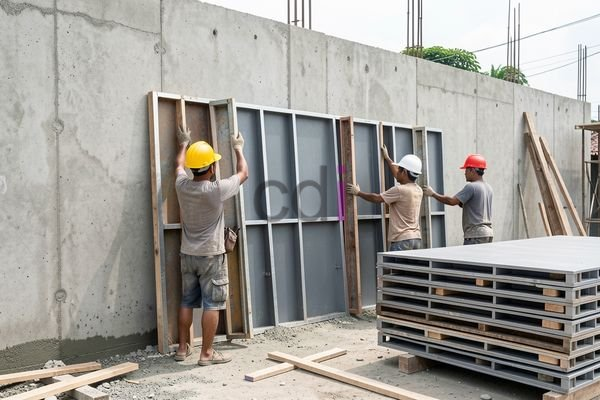

**Bekisting Knock Down: Solusi Efisien dan Ekonomis untuk Proyek Konstruksi Anda** - Hai Mitra CDI! Pernahkah Anda menghadapi tantangan dalam hal penyimpanan dan transportasi bekisting tradisional di lokasi proyek di (not detected)? Ruang terbatas dan perakitan yang rumit seringkali menjadi hambatan, kan? Nah, dalam artikel ini, Kami akan mengulas tuntas bekisting knock down sebagai solusi cerdas untuk mengatasi masalah tersebut.

## Mengapa Memilih Bekisting Knock Down? Keunggulan yang Perlu Anda Ketahui

Bekisting knock down adalah sistem bekisting modern yang dirakit dari komponen-komponen terpisah. Bedanya dengan bekisting konvensional? Sistem ini dirancang agar mudah dibongkar dan disimpan dalam bentuk terurai, menghemat ruang dan biaya pengiriman. Bayangkan betapa praktisnya, terutama untuk proyek di (not detected) dengan akses yang terbatas!

Keuntungan utama dari bekisting knock down terletak pada fleksibilitasnya yang luar biasa. Ia dapat disesuaikan dengan berbagai desain dan ukuran struktur beton. Selain itu, bobotnya yang relatif ringan memudahkan proses pemasangan dan pembongkaran, bahkan di area yang sulit dijangkau. Inilah yang berkontribusi pada percepatan penyelesaian proyek. Pilihan materialnya pun beragam, mulai dari baja ringan, aluminium, hingga kayu lapis, masing-masing dengan kelebihan dan harga yang berbeda.

## Ragam Jenis Bekisting Knock Down: Mana yang Cocok untuk Proyek Anda?

Ada beberapa jenis bekisting knock down yang umum digunakan di industri konstruksi (not detected). Masing-masing memiliki karakteristik unik yang sesuai dengan kebutuhan proyek yang berbeda:

*   **Bekisting Knock Down Baja Ringan:** Populer karena kombinasi kekuatan tinggi dan bobot yang ringan. Ideal untuk pembuatan dinding dan kolom yang presisi.
*   **Bekisting Knock Down Aluminium:** Menawarkan daya tahan yang sangat baik terhadap korosi dan bobot yang ringan, membuatnya sangat mobile – pilihan tepat untuk proyek-proyek dinamis.
*   **Bekisting Knock Down Kayu Lapis:** Solusi paling ekonomis, walau membutuhkan perawatan rutin untuk melindungi dari kelembapan dan kerusakan. Cocok untuk aplikasi yang tidak memerlukan ketahanan ekstrem.

Memilih jenis yang tepat untuk proyek Anda di (not detected) memerlukan pertimbangan matang. Perhatikan anggaran, kompleksitas desain, dan kondisi lingkungan kerja. Dengan memahami kebutuhan spesifik proyek, Anda dapat membuat keputusan yang paling tepat.

## Estimasi Biaya Bekisting Knock Down: Apa yang Mempengaruhi Harga?

Harga bekisting knock down sangat bervariasi, tergantung pada jenis material, ukuran, dan kompleksitas desainnya. Perlu diingat bahwa harga di atas adalah estimasi dan bisa berubah sewaktu-waktu. Untuk mendapatkan penawaran terbaru dan paling akurat sesuai dengan kebutuhan proyek Anda di (not detected), hubungi Kami. Kami siap memberikan solusi terbaik untuk anggaran Anda.

Sebagai ilustrasi, jika Anda membutuhkan bekisting knock down baja ringan untuk dinding seluas 100 meter persegi, perkiraan biayanya adalah: 100 m² x harga per meter persegi = total biaya.  Biaya ini belum termasuk transportasi dan jasa pemasangan. Semakin sering bekisting digunakan, semakin cepat investasi Anda akan kembali.

## Aplikasi Bekisting Knock Down: Fleksibilitas untuk Berbagai Proyek Konstruksi

Sistem bekisting knock down sangat serbaguna dan dapat digunakan dalam berbagai proyek konstruksi, mulai dari hunian pribadi, gedung komersial, hingga infrastruktur publik. Di sektor perumahan, bekisting knock down sering digunakan untuk pengecoran dinding, kolom, dan balok. Untuk proyek skala besar, ia cocok untuk pengecoran plat lantai dan dinding penahan tanah.

Pemilihan material yang tepat juga penting. Baja ringan menawarkan kekuatan dan daya tahan, tetapi perlu perlindungan anti-korosi. Aluminium unggul dalam ketahanan korosi, meski harganya lebih tinggi. Kayu lapis adalah opsi ekonomis, namun perlu dilapisi bahan anti air.  Ingin tahu lebih dalam tentang jenis-jenis bekisting? Baca artikel Kami sebelumnya di sini.

Butuh solusi bekisting yang handal untuk proyek Anda di (not detected)? Jangan ragu untuk berkonsultasi dengan tim ahli Kami melalui tombol **Telepon** atau **WhatsApp** di bawah. Kami siap memberikan layanan terbaik!