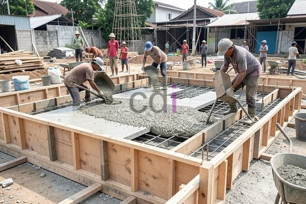

**Bekisting Plat Besi: Panduan Lengkap Pemilihan, Pemasangan, dan Biaya 2026** - Hai Mitra CDI! Pengecoran plat beton yang kokoh dan presisi? Kuncinya ada di bekisting yang tepat. Nah, bekisting plat besi ini sering jadi andalan para profesional konstruksi di (not detected). Kenapa? Mari kita bedah tuntas!

Bekisting itu cetakan sementara yang menahan beton cair sampai mengeras. Pemilihan material bekisting yang tepat – seperti plat besi – sangat krusial. Ini bukan cuma soal kekuatan, tapi juga efisiensi biaya dan waktu proyek Anda di (not detected). Artikel ini akan membahas secara mendalam semua yang perlu Anda ketahui tentang bekisting plat besi: mulai dari jenis-jenisnya, cara menghitung kebutuhan, perkiraan biaya, hingga perbandingan dengan opsi lain.

## Mengapa Memilih Bekisting Plat Besi? Keunggulan dan Jenisnya

Apa saja sebenarnya keunggulan bekisting plat besi yang membuatnya populer di kalangan Mitra CDI? Pertama, kekuatan materialnya sangat andal. Plat besi mampu menahan beban berat beton segar tanpa masalah. Kedua, proses bongkar pasangnya relatif cepat dan mudah, sehingga memperpendek waktu pengerjaan. Ketiga, bekisting ini tahan lama dan bisa dipakai berkali-kali, menjadikannya investasi yang cerdas.

Ada beberapa pilihan jenis bekisting plat besi yang bisa Anda temukan. Ada bekisting konvensional yang dirakit dari plat-plat besi dengan baut dan mur. Lalu ada bekisting modular, yang terdiri dari panel-panel standar siap pakai. Pilihan lainnya adalah bekisting *adjustable* yang fleksibel untuk menyesuaikan dengan berbagai ukuran dan bentuk plat. Memilih jenis yang tepat tergantung kebutuhan spesifik proyek Anda di (not detected), anggaran, dan preferensi.

## Perhitungan Kebutuhan & Estimasi Biaya Bekisting Plat Besi

Agar tidak kehabisan atau kelebihan material, perhitungan kebutuhan bekisting plat besi harus akurat. Luas area pengecoran plat beton adalah titik awal perhitungan. Misalnya, jika proyek Anda di (not detected) membutuhkan pengecoran plat seluas 100 m² dengan tebal 12 cm, maka luas bekisting yang dibutuhkan minimal sama dengan luas area tersebut. Tapi, ada baiknya tambahkan faktor keamanan sekitar 5-10% untuk mengantisipasi pemborosan atau kerusakan yang mungkin terjadi.

Soal biaya, estimasi bekisting plat besi bisa bervariasi. Harga dipengaruhi oleh harga besi, biaya tenaga kerja, dan kompleksitas desain. Sebagai gambaran, harga sewa berkisar antara Rp 35.000 – Rp 60.000 per meter persegi per hari. Jika Anda lebih memilih membeli, harga per meter persegi bisa mencapai Rp 200.000 – Rp 350.000 (tergantung kualitas dan ketebalan besi). Penting diingat, angka ini hanyalah estimasi, ya. Untuk penawaran harga terkini dan paling akurat, jangan ragu untuk menghubungi Kami.

## Perbandingan: Bekisting Plat Besi vs. Alternatif Lainnya

Selain plat besi, masih ada opsi bekisting lain yang bisa dipertimbangkan. Bekisting kayu memang lebih murah, tapi daya tahannya kurang baik dan mudah rusak jika terkena air. Bekisting bambu ramah lingkungan, tetapi kekuatannya terbatas dan perlu perawatan ekstra. Sementara itu, bekisting aluminium menawarkan kemudahan pemasangan dan ringan, namun harganya lebih mahal.

Untuk gambaran yang lebih jelas, berikut tabel perbandingan singkat:

<table class="table">
  <caption>Perbandingan Jenis Bekisting</caption>
  <thead>
    <tr><th>Jenis Bekisting</th><th>Kekuatan</th><th>Daya Tahan</th><th>Biaya</th><th>Kemudahan Pemasangan</th></tr>
  </thead>
  <tbody>
    <tr><td>Bekisting Plat Besi</td><td>Tinggi</td><td>Tinggi</td><td>Menengah - Tinggi</td><td>Menengah</td></tr>
    <tr><td>Bekisting Kayu</td><td>Sedang</td><td>Rendah</td><td>Rendah</td><td>Mudah</td></tr>
    <tr><td>Bekisting Bambu</td><td>Rendah</td><td>Sedang</td><td>Rendah</td><td>Mudah</td></tr>
    <tr><td>Bekisting Aluminium</td><td>Tinggi</td><td>Tinggi</td><td>Tinggi</td><td>Sangat Mudah</td></tr>
  </tbody>
</table>

## Tips Pemasangan Bekisting Plat Besi yang Aman dan Efisien

Pemasangan bekisting yang tepat itu vital untuk kualitas dan keamanan struktur beton Anda. Pastikan permukaan tanah rata dan stabil sebelum mulai. Gunakan penyangga (shoring) yang cukup kuat untuk menahan berat beton segar. Periksa dengan teliti setiap sambungan plat besi untuk mencegah kebocoran adukan. Jangan lupa, lumasi bekisting dengan minyak atau bahan anti lengket agar mudah dilepas setelah beton mengeras.

Keselamatan kerja juga nomor satu! Gunakan alat pelindung diri (APD) seperti helm, sarung tangan, dan sepatu keselamatan. Hindari bekerja di area yang licin atau berbahaya. Jika Anda kurang yakin, jangan ragu memanfaatkan jasa tenaga ahli profesional untuk pemasangan bekisting. [Besi Foot Plat: Panduan Lengkap Pemilihan, Fungsi, dan Estimasi Biaya 2026](/blog/besi-foot-plat/) juga bisa jadi referensi tambahan yang berguna.

Butuh bantuan untuk proyek di (not detected)? Tim Kami siap mewujudkan konstruksi impian Anda! Hubungi Kami sekarang juga melalui tombol **Telepon** atau **WhatsApp** di bawah ini.