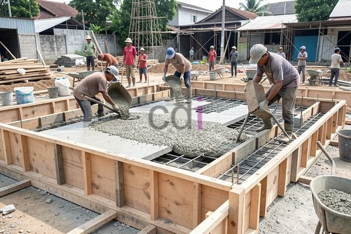

**Bekisting Plat Lantai: Panduan Lengkap Material, Aplikasi, dan Estimasi Biaya 2026** - Halo Mitra CDI! Pernahkah Anda membayangkan bagaimana sebuah lantai beton bisa terbentuk begitu rapi dan kokoh? Kuncinya terletak pada sistem bekisting yang andal. Di artikel ini, kami akan membahas tuntas segala hal tentang bekisting plat lantai, mulai dari fungsi, jenis, material, hingga perkiraan biayanya.

## Mengapa Bekisting Plat Lantai Begitu Penting?
Bekisting plat lantai adalah cetakan sementara yang menahan adukan beton cair sampai mengeras dan mencapai kekuatan optimal. Bayangkan beton tanpa penahan… hasilnya bisa jadi jauh dari harapan! Sistem ini memastikan plat lantai memiliki dimensi, bentuk, dan permukaan akhir yang sesuai dengan perencanaan arsitektur dan struktur. Dengan kata lain, bekisting yang baik adalah fondasi hasil konstruksi yang presisi dan aman.

Ada beragam pilihan bekisting plat lantai, masing-masing dengan karakteristik unik. Bekisting kayu menawarkan kemudahan dalam pengerjaan dan biaya awal yang lebih rendah, meskipun perlu perhatian ekstra soal daya tahannya. Bekisting baja, di sisi lain, menawarkan kekuatan dan umur pakai yang lebih lama, ideal untuk proyek jangka panjang. Lalu ada juga bekisting pracetak yang semakin digemari karena proses pemasangan yang cepat dan hasil akhir yang mulus.

## Material Bekisting: Mana yang Paling Cocok untuk Proyek Anda?
Pilihan material bekisting langsung memengaruhi kualitas dan efisiensi biaya proyek Anda, lho. Beberapa opsi populer termasuk kayu, baja, aluminium, dan plastik. Kayu, seperti kayu balok atau triplek, masih sering digunakan karena harganya yang relatif terjangkau. Namun, penting untuk memastikan kayu tersebut terlindungi dari rayap dan kelembapan agar tidak cepat lapuk. Baja ringan menjadi pilihan yang tepat jika Anda mencari kekuatan dan kemampuan untuk digunakan berulang kali. Aluminium unggul dalam hal ringan dan tahan korosi. Sementara itu, bekisting plastik (seperti polypropylene) semakin populer karena kemudahannya dibersihkan dan tahan terhadap bahan kimia.

Sebagai contoh konkret, untuk membuat plat lantai setebal 120 mm, biasanya digunakan kayu balok berukuran 10x20 cm sebagai penyangga utama. Kemudian, permukaan cetakannya dilapisi dengan triplek tebal 9-12 mm. Jika Anda memilih bekisting baja, rangka baja ringan dengan ketebalan minimal 0.8 mm adalah pilihan yang baik, dan biasanya dilapisi dengan multipleks atau material pelapis lain.

## Menghitung Biaya: Perkiraan Anggaran untuk Bekisting Plat Lantai
Perhitungan kebutuhan material bekisting plat lantai harus dilakukan secara teliti supaya tidak ada material yang kurang atau berlebihan. Luas area plat lantai yang akan dicor adalah titik awal perhitungan. Selain itu, Anda juga perlu menghitung kebutuhan penyangga (shoring), balok pengaku (ledger), dan penguat lainnya.

Mari kita ambil contoh. Katakanlah Anda akan mencor plat lantai seluas 50 m² dengan ketebalan 120 mm menggunakan sistem bekisting kayu. Berikut adalah estimasi biaya yang mungkin Anda keluarkan:

*   Kayu balok (penopang): 20 m³ x Rp 1.500.000/m³ = Rp 30.000.000
*   Triplek (permukaan): 50 m² x Rp 150.000/lembar (asumsi 1 lembar = 3 m²) = Rp 2.500.000
*   Paku, baut, dan perlengkapan lainnya: Rp 500.000
*   Biaya tenaga kerja (pemasangan & pembongkaran): Rp 5.000.000

Total estimasi biaya: Rp 38.000.000. Perlu diingat, angka ini hanyalah perkiraan. Untuk mendapatkan penawaran yang paling akurat dan sesuai dengan kebutuhan proyek Anda, hubungi Kami untuk konsultasi lebih lanjut. 

## Memilih Bekisting Plat Lantai yang Tepat: Apa yang Perlu Dipertimbangkan?
Memilih jenis bekisting yang ideal bergantung pada beberapa faktor penting, seperti anggaran proyek, kompleksitas desain, dan waktu pelaksanaan. Jika anggaran Anda terbatas, bekisting kayu bisa jadi solusi yang paling ekonomis. Namun, jika Anda mengutamakan kekuatan, daya tahan, dan penggunaan berulang, bekisting baja adalah investasi yang lebih bijak. Pastikan juga bekisting yang Anda pilih memenuhi standar keselamatan dan kualitas yang berlaku. Untuk informasi lebih detail, Anda bisa membaca [Bekisting Balok dan Plat: Panduan Lengkap Material, Perhitungan, dan Biaya 2026](/blog/bekisting-balok-dan-plat/) sebagai bahan referensi tambahan.

Butuh panduan langsung untuk menentukan solusi bekisting terbaik untuk proyek Anda di (not detected)? Jangan ragu untuk berkonsultasi dengan tim ahli Kami! Silakan klik tombol **WhatsApp** atau **Telepon** di bawah untuk mendapatkan bantuan profesional. Dan jangan lupa, Kami juga menyediakan jasa desain interior, furniture custom, material bangunan, dan jasa pengecoran di (not detected) — solusi lengkap untuk kebutuhan konstruksi Anda!