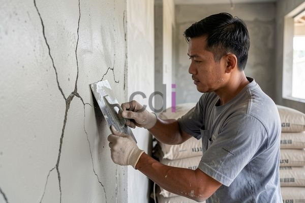

**Benerin Tembok Retak: Panduan Lengkap Penyebab, Solusi, dan Biaya** - Hai Mitra CDI! Pernahkah Anda melihat tembok rumah mulai muncul garis-garis halus atau bahkan retakan yang lebih lebar? Jangan panik dulu! Kondisi ini memang sering terjadi, tapi perlu ditangani dengan tepat. Retakan pada dinding bukan cuma soal tampilan, lho. Bisa jadi ada masalah tersembunyi yang perlu segera diatasi. Yuk, simak panduan lengkapnya di artikel ini!

### Mengenali Berbagai Jenis Retakan di Tembok

Retakan di tembok itu macam-macam, Mitra. Ada yang terlihat tipis seperti rambut, ada juga yang lebar dan mengkhawatirkan. Retakan rambut biasanya tidak terlalu berpengaruh pada kekuatan bangunan dan lebih ke masalah estetika saja. Namun, retakan vertikal yang lebar, terutama yang berada di dekat kusen pintu atau jendela, bisa jadi indikasi adanya pergeseran pada pondasi. Nah, kalau retakan justru melintang secara horizontal, ini sudah masuk kategori serius dan perlu penanganan khusus. Memahami jenis retakan yang muncul akan membantu kita menentukan solusi yang paling tepat dan efektif.

Penyebab retakan pada tembok bisa beragam. Penyusutan material bangunan adalah hal yang wajar, terutama pada bangunan baru di (not detected). Perubahan cuaca ekstrem, seperti suhu yang berganti-ganti dan kelembapan tinggi, juga bisa memicu retakan. Tapi, retakan yang semakin lebar dan terus berkembang biasanya disebabkan oleh masalah yang lebih dalam, seperti pondasi yang kurang kuat, kualitas material yang buruk, atau kesalahan saat proses konstruksi. [Cara Mengatasi Atap Beton Rembes: Penyebab, Solusi, dan Pencegahan Efektif](/blog/cara-mengatasi-atap-beton-rembes/) juga bisa menjadi referensi penting, karena masalah kebocoran juga bisa memperparah kondisi tembok.

### Langkah-Langkah Efektif Memperbaiki Tembok Retak

Setelah tahu jenis retakannya, saatnya mencari solusi. Untuk retakan rambut, cara paling mudah adalah dengan menggunakan dempul tembok atau plamir. Pastikan dulu permukaan dinding bersih dan kering sebelum mengaplikasikannya. Kalau retakannya lebih lebar, Anda butuh material yang lebih kuat, seperti mortar atau epoxy.

Namun, jika retakan disebabkan oleh masalah struktural, perbaikannya akan lebih rumit. Konsultasi dengan ahli konstruksi sangat disarankan untuk mendapatkan diagnosis yang tepat dan rekomendasi perbaikan yang sesuai. Mereka mungkin menyarankan perbaikan pondasi, pemasangan penopang tambahan, atau penggantian material yang sudah rusak.

### Perkiraan Biaya untuk Memperbaiki Tembok Retak

Biaya untuk memperbaiki tembok retak bervariasi tergantung pada tingkat kerusakan, luas area yang terdampak, dan metode perbaikan yang dipilih. Untuk retakan rambut, biaya perbaikan biasanya cukup terjangkau, berkisar antara Rp 50.000 hingga Rp 150.000 per meter persegi, sudah termasuk material dan jasa tukang. Tapi, untuk retakan yang lebih parah yang membutuhkan perbaikan struktural, biaya bisa membengkak hingga jutaan, bahkan puluhan juta rupiah.

Sebagai gambaran, berikut ini perkiraan biaya perbaikan berdasarkan jenis kerusakannya:

<table class="table">
  <caption>Estimasi Biaya Perbaikan Tembok Retak</caption>
  <thead>
    <tr><th>Jenis Kerusakan</th><th>Estimasi Biaya (Rp/m²)</th></tr>
  </thead>
  <tbody>
    <tr><td>Retakan Rambut</td><td>50.000 - 150.000</td></tr>
    <tr><td>Retakan Sedang (lebar &lt; 1 cm)</td><td>150.000 - 300.000</td></tr>
    <tr><td>Retakan Serius (lebar &gt; 1 cm, melibatkan struktural)</td><td>300.000 - 1.000.000+</td></tr>
  </tbody>
</table>

Harga di atas hanyalah estimasi, ya. Untuk mendapatkan penawaran yang lebih akurat sesuai dengan kondisi proyek Anda di (not detected), silakan hubungi Kami. Jangan lupa, biaya ini belum termasuk biaya konsultasi dengan ahli konstruksi, jika diperlukan.

Selain perbaikan, pencegahan juga penting dilakukan. Memasang lapisan pelindung pada dinding, memperbaiki sistem drainase, dan memastikan pondasi rumah kuat akan membantu mencegah retakan muncul kembali. Memahami [Inilah Penyebab Cor Beton Bisa Retak](/blog/inilah-penyebab-cor-beton-bisa-retak/) juga bisa jadi investasi yang baik untuk jangka panjang.

Butuh bantuan ahli untuk mengatasi masalah tembok retak di properti Anda di (not detected)? Jangan ragu untuk berkonsultasi dengan tim ahli Kami. Tombol **Telepon** dan **WhatsApp** di bawah ini siap membantu Anda!