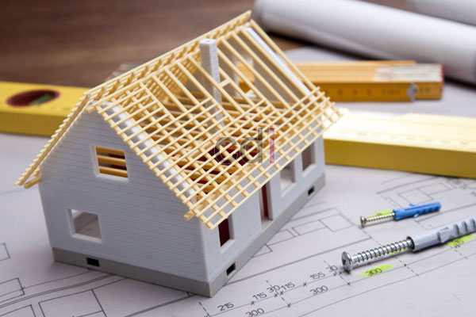

**Berapa Besi yang Dibutuhkan untuk Membangun Rumah?** - Hai Mitra CDI! Punya proyek bangun rumah tapi bingung soal kebutuhan besi beton? Banyak yang merasa kesulitan menentukan jumlah yang pas – jangan sampai kurang yang malah membahayakan kekuatan bangunan, atau kelebihan yang bikin anggaran membengkak. Nah, perencanaan yang cermat soal besi beton ini kunci utama, lho! Yuk, kita bahas tuntas panduan lengkapnya.

## Faktor yang Mempengaruhi Kebutuhan Besi Beton

Lantas, apa saja sih yang bikin kebutuhan besi beton bisa beda-beda? Ada beberapa hal penting yang perlu diperhatikan. Pertama, **desain rumah** itu sendiri. Semakin rumit desainnya, biasanya besi yang dibutuhkan juga makin banyak untuk memastikan kestabilan struktur. Rumah bertingkat tentu akan membutuhkan perhitungan besi yang lebih detail dibandingkan rumah satu lantai. Kedua, **kondisi tanah tempat rumah dibangun** juga berpengaruh besar. Kalau tanahnya kurang padat, fondasi harus lebih kuat, dan itu berarti besi beton yang dipakai juga perlu lebih banyak. Ketiga, **mutu beton** yang digunakan juga menentukan. Semakin bagus kualitas betonnya, mungkin saja kebutuhan besi beton bisa sedikit lebih hemat. Terakhir, jangan lupakan **standar bangunan** yang berlaku. Kami selalu menyarankan penggunaan besi beton yang sudah bersertifikasi SNI untuk menjamin keamanan dan kualitas bangunan Anda di (not detected).

## Menghitung Kebutuhan Besi Beton: Fondasi, Kolom, dan Balok – Panduan Praktis

Untuk menghitung kebutuhan besi beton secara akurat, penting memahami elemen-elemen struktur rumah. Mulai dari **fondasi**, besi beton berperan penting dalam menahan beban bangunan. Biasanya besi yang dipakai adalah besi sengkang dan besi polos dengan diameter umum antara 10 mm hingga 16 mm, tergantung ukuran fondasi. Selanjutnya, **kolom** bertugas menahan beban vertikal dari atap dan lantai. Perhitungan besi kolom melibatkan analisis momen lentur dan gaya aksial. Kami merekomendasikan diameter besi antara 12 mm hingga 20 mm untuk kolom rumah tinggal. Terakhir, **balok** berfungsi menopang lantai dan mendistribusikan beban ke kolom. Perhitungan besi balok juga mempertimbangkan momen lentur dan gaya geser. Untuk balok, besi dengan diameter 10 mm hingga 16 mm biasanya sudah cukup.

Sebagai gambaran awal, bayangkan kita punya pondasi batu kali berukuran 60 cm x 40 cm x 100 cm. Jika kita membutuhkan 2 lapis besi sengkang dengan jarak 20 cm, maka total panjang besi sengkang yang dibutuhkan adalah (60 cm + 40 cm + 60 cm + 40 cm) x 2 lapis = 400 cm (4 meter). Kalau menggunakan besi sengkang diameter 8 mm, perkiraan beratnya sekitar 1,8 kg per meter. Jadi, total berat besi sengkang untuk pondasi ini sekitar 7,2 kg. Ingat ya, ini cuma contoh sederhana; perhitungan yang presisi butuh analisis struktur yang mendalam.

## Mengenal Jenis-Jenis Besi Beton yang Sering Digunakan

Memilih jenis besi beton yang tepat itu krusial, Mitra. Secara garis besar, ada dua jenis yang paling umum: **besi polos** dan **besi ulir**. Besi polos punya permukaan halus dan cocok untuk tulangan pelengkap. Sementara besi ulir memiliki permukaan bergerigi yang memberikan daya rekat lebih kuat dengan beton. Perbedaan keduanya bisa dilihat di tabel berikut:

<table class="table">
  <caption>Perbandingan Besi Polos dan Besi Ulir</caption>
  <thead>
    <tr><th>Fitur</th><th>Besi Polos</th><th>Besi Ulir</th></tr>
  </thead>
  <tbody>
    <tr><td>Permukaan</td><td>Halus</td><td>Bergerigi</td></tr>
    <tr><td>Daya Rekat</td><td>Rendah</td><td>Tinggi</td></tr>
    <tr><td>Kekuatan Tarik</td><td>Lebih Rendah</td><td>Lebih Tinggi</td></tr>
    <tr><td>Penggunaan</td><td>Tulangan Pelengkap</td><td>Tulangan Utama</td></tr>
  </tbody>
</table>

Selain itu, besi beton juga diklasifikasikan berdasarkan mutu baja, misalnya BJTP 300 atau BJTP 400. BJTP (Besi Baja Tulangan Penarik) menunjukkan kekuatan tarik minimum baja tersebut. Semakin tinggi angkanya, semakin kuat pula baja tersebut. Untuk informasi harga besi beton per kilogram di tahun 2026, serta penawaran terkini, silakan hubungi Kami melalui tombol di bawah ya!

## Percayakan Perhitungan Besi Beton pada Ahlinya

Menghitung kebutuhan besi beton yang tepat bukanlah pekerjaan mudah. Butuh keahlian dan pengalaman khusus untuk memastikan struktur bangunan kuat dan aman. Percayakan perhitungan kebutuhan besi beton Anda pada tim ahli Creative Design Interior. Kami akan menganalisis desain rumah Anda, mempertimbangkan kondisi tanah, dan memastikan penggunaan besi beton yang sesuai standar SNI. Dengan begitu, Mitra CDI bisa membangun rumah impian yang kokoh, aman, dan tahan lama di (not detected). Jangan ragu untuk bertanya, ya!

Ada pertanyaan lebih lanjut? Atau ingin konsultasi gratis? Silakan klik tombol **Telepon** atau **WhatsApp** di bawah halaman ini untuk menghubungi Kami. Kami siap membantu!