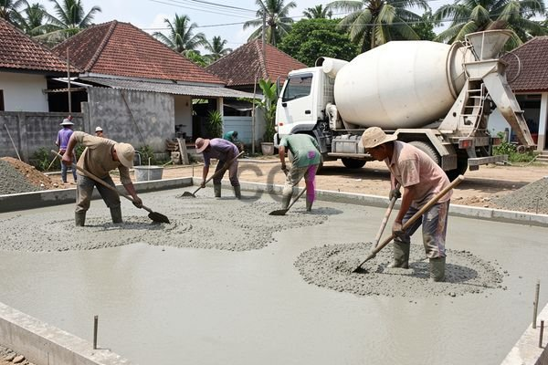

**Berapa Biaya Ngecor Rumah?** - Hai Mitra CDI! Pernahkah Anda bertanya-tanya soal biaya yang dibutuhkan untuk pengecoran rumah? Proses ini vital dalam membangun struktur yang kokoh, tapi seringkali sulit untuk memperkirakan anggarannya. Jangan khawatir, Kami hadir untuk membantu!

### Faktor-Faktor yang Mempengaruhi Biaya Pengecoran Rumah

Biaya ngecor rumah itu bervariasi, lho. Ada beberapa hal penting yang mempengaruhinya. Yang pertama tentu saja **luas area** yang akan dicor. Semakin besar areanya, semakin banyak material dan tenaga yang dibutuhkan, yang otomatis akan menaikkan biaya. Lalu, **ketebalan cor** juga penting. Semakin tebal cor, semakin banyak volume beton yang dibutuhkan. Selain itu, **jenis beton** yang dipilih punya pengaruh besar. Pilihan mutu beton seperti K-250, K-300, hingga K-350 akan menentukan harga — semakin tinggi mutu, semakin mahal. 

Faktor lain yang perlu dipertimbangkan adalah **lokasi proyek**. Harga material dan upah tenaga kerja bisa berbeda di setiap daerah di (not detected). Bahkan, **aksesibilitas lokasi** juga berpengaruh! Lokasi yang sulit dijangkau akan meningkatkan biaya transportasi material.

### Estimasi Biaya Ngecor Rumah per Meter Persegi di (not detected)

Supaya lebih jelas, ini dia estimasi biaya ngecor rumah per meter persegi di wilayah (not detected) pada tahun 2026. Harga ini hanya perkiraan ya Mitra, dan bisa berubah sewaktu-waktu. Untuk penawaran paling akurat sesuai proyek Mitra CDI, langsung saja hubungi Kami!

| Jenis Cor | Ketebalan (cm) | Estimasi Biaya per m² (Rp) |
|---|---|---|
| Lantai | 8 - 12 | 350.000 - 500.000 |
| Sloof | 15 - 20 | 450.000 - 600.000 |
| Kolom | Variatif (15x15, 20x20, dll.) | 500.000 - 700.000 |
| Balok | Variatif (20x30, 25x40, dll.) | 550.000 - 750.000 |

Harga di atas sudah termasuk material (semen, pasir, batu split, air, dan besi beton) serta upah tenaga kerja. Tapi perlu diingat, biaya ini belum termasuk biaya mobilisasi alat berat (pompa beton, vibrator), yang biasanya ada biaya tambahan.

### Contoh Perhitungan Biaya Ngecor Rumah

Nah, biar lebih mudah dipahami, yuk kita hitung biaya ngecor untuk lantai rumah berukuran 70 meter persegi dengan ketebalan 10 cm. Contoh ini akan membantu Mitra CDI memperkirakan anggaran proyek.

*   **Luas area:** 70 m²
*   **Ketebalan cor:** 10 cm = 0,1 meter
*   **Volume beton:** 70 m² x 0,1 m = 7 m³
*   **Harga beton per m³ (K-300):** Rp 3.500.000 (estimasi tahun 2026)
*   **Biaya beton:** 7 m³ x Rp 3.500.000 = Rp 24.500.000
*   **Biaya upah tenaga kerja (estimasi):** Rp 300.000 per m³
*   **Total biaya upah:** 7 m³ x Rp 300.000 = Rp 2.100.000
*   **Total biaya ngecor:** Rp 24.500.000 + Rp 2.100.000 = Rp 26.600.000

Ingat ya, ini cuma estimasi! Biaya sebenarnya bisa fluktuatif tergantung harga material dan upah tenaga kerja di (not detected). Mitra juga bisa mencari referensi tambahan di artikel Kami tentang [Besi untuk Pondasi Rumah: Jenis, Ukuran, dan Estimasi Biaya Terbaru 2026](/blog/besi-untuk-pondasi-rumah/) untuk memperkirakan biaya besi beton yang dibutuhkan.

### Tips Jitu Menghemat Biaya Pengecoran Rumah

Ada beberapa cara cerdas yang bisa dilakukan untuk menekan biaya pengecoran rumah. Pertama, **bandingkan harga material** dari berbagai supplier di (not detected). Jangan sungkan minta penawaran dari beberapa toko bangunan untuk mendapatkan harga terbaik. Kedua, **optimalkan penggunaan material**. Perencanaan matang dan perhitungan akurat akan membantu menghindari pemborosan. Ketiga, **pilih jenis beton yang tepat** sesuai kebutuhan. Tidak selalu mutu beton tertinggi yang terbaik. Pilihlah yang sesuai dengan beban struktur bangunan. Dan yang keempat, pertimbangkan menggunakan jasa profesional seperti Creative Design Interior. Kami berpengalaman dalam menangani berbagai proyek pengecoran, dari rumah tinggal hingga bangunan komersial.

Butuh konsultasi lebih lanjut atau ingin mendapatkan penawaran khusus untuk proyek di (not detected)? Jangan ragu untuk menghubungi Kami melalui tombol **WhatsApp** atau **Telepon** yang tertera di halaman ini. Kami siap membantu Mitra CDI mewujudkan bangunan impian!