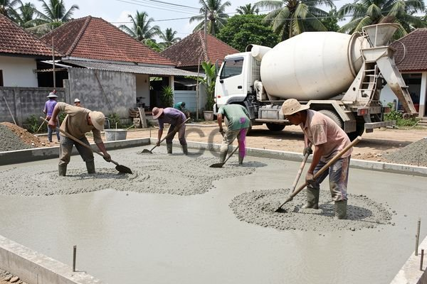

**Berapa Jam Cor Boleh Kena Air?** - Hai Mitra CDI! Pernahkah Anda bertanya-tanya, kapan waktu yang tepat beton cor bisa terkena air? Pertanyaan ini sering muncul, terutama saat musim hujan atau proyek konstruksi di daerah dengan curah hujan tinggi. Nah, memahami durasi ideal ini sangat penting lho, untuk memastikan bangunan Anda kokoh dan tahan lama. Mari kita bahas tuntas!

### Mengapa Beton Baru Sensitif Terhadap Air?

Beton yang baru saja dicor rentan terhadap kerusakan jika terpapar air terlalu dini. Proses pengerasan beton, yang disebut hidrasi, memerlukan lingkungan yang stabil. Air yang mengenai beton sebelum mengeras bisa mengganggu reaksi kimia ini, membuat beton jadi rapuh, kekuatannya berkurang, dan berpotensi retak. Selain itu, air bisa melarutkan senyawa penting dalam beton, mengurangi ketahanannya jangka panjang.

### Faktor Penentu Waktu Aman Cor Beton

Waktu ideal beton untuk terkena air tidaklah baku. Banyak faktor yang mempengaruhinya, di antaranya:

*   **Jenis Semen yang Digunakan:** Pilihan semen (Portland Type I, II, III, IV, V) sangat memengaruhi kecepatan pengerasan. Semen jenis III, misalnya, mengeras lebih cepat dibanding jenis I.
*   **Perbandingan Air dan Semen (Water-Cement Ratio):** Semakin banyak air yang digunakan dalam campuran, semakin lama beton mengering. Rasio idealnya biasanya antara 0,4 hingga 0,6.
*   **Suhu dan Kelembaban Lingkungan:** Suhu hangat mempercepat proses hidrasi, sementara kelembaban tinggi cenderung memperlambatnya.
*   **Penggunaan *Admixture*:** Penambahan *admixture* tertentu bisa mempercepat (*accelerator*) atau memperlambat (*retarder*) proses pengerasan.
*   **Ketebalan Elemen Cor:** Semakin tebal cor-an, semakin lama waktu yang dibutuhkan untuk benar-benar mengeras.

### Kapan Beton Aman Dibasahi? Panduan Praktis

Sebagai patokan, sebaiknya hindari membasahi beton secara langsung selama minimal 24 jam setelah pengecoran. Setelah itu, Anda bisa mulai melakukan proses *curing* — yaitu menyiram beton secara berkala untuk menjaga kelembaban dan mencegah retak karena pengeringan terlalu cepat. Perlu diingat, *curing* berbeda dengan membiarkan beton terendam air. 

Beton umumnya dianggap aman terkena air terus-menerus setelah mencapai kekuatan desain yang ditargetkan. Kekuatan desain ini bervariasi, tetapi biasanya tercapai setelah 7 hari. Sebagai contoh, untuk beton mutu K-300, kekuatan tekan minimum yang harus dicapai setelah 7 hari adalah 300 kg/cm².

### Tabel Estimasi Waktu Aman Cor Beton Terkena Air (Estimasi)

Berikut rangkuman estimasi waktu aman beton terkena air untuk berbagai jenis cor:

<table class="table">
  <caption>Estimasi Waktu Aman Cor Beton Terkena Air</caption>
  <thead>
    <tr><th>Jenis Cor</th><th>Waktu Minimal Tidak Kena Air</th><th>Waktu Aman Terkena Air (Estimasi)</th><th>Keterangan</th></tr>
  </thead>
  <tbody>
    <tr><td>Cor Lantai</td><td>24 Jam</td><td>7 Hari</td><td>Pastikan kekuatan desain tercapai</td></tr>
    <tr><td>Cor Kolom/Tiang</td><td>24 Jam</td><td>7 Hari</td><td>Penting untuk kekuatan struktural</td></tr>
    <tr><td>Cor Balok</td><td>24 Jam</td><td>7 Hari</td><td>Perhatikan beban yang akan ditanggung</td></tr>
    <tr><td>Cor Dak</td><td>24 Jam</td><td>14 Hari</td><td>Memerlukan waktu lebih lama karena luas permukaan besar</td></tr>
  </tbody>
</table>

Informasi harga yang Anda butuhkan? Silakan cek tabel harga di atas atau hubungi Kami untuk mendapatkan penawaran khusus untuk proyek Anda.

### Studi Kasus: Bahaya Terkena Air Sebelum Waktunya

Kami pernah menghadapi proyek di (not detected) di mana cor lantai tidak terlindungi dari hujan lebat hanya 3 hari setelah pengecoran. Hasilnya? Permukaan beton retak dan kekuatan tekan berkurang drastis. Uji laboratorium menunjukkan bahwa beton tidak memenuhi standar kekuatan yang disyaratkan. Solusinya? Perlu dilakukan perbaikan dengan menambah lapisan cor baru, yang tentu saja menambah biaya dan waktu pengerjaan.

### Langkah Pencegahan: Melindungi Beton dari Air

Berikut beberapa langkah sederhana yang bisa Anda lakukan untuk melindungi beton dari kerusakan akibat air:

*   **Gunakan Terpal:** Segera setelah pengecoran, tutupi beton dengan terpal atau plastik untuk menghalangi air hujan.
*   **Buat Sistem Drainase:** Pastikan tidak ada genangan air di sekitar area cor. Buat saluran air yang baik untuk mengalirkan air.
*   **Lakukan *Curing* yang Benar:** Siram beton secara teratur (minimal 7 hari) untuk menjaga kelembaban dan mencegah retak.
*   **Manfaatkan *Admixture*:** Pertimbangkan penggunaan *admixture* yang meningkatkan ketahanan beton terhadap air.
*   **Konsultasi Ahli:** Ragu dan butuh saran? Jangan sungkan konsultasi dengan ahli konstruksi atau tim CDI (not detected).

Ingat, mencegah kerusakan akibat air jauh lebih baik daripada memperbaikinya. Dengan perawatan yang tepat, beton Anda akan kuat, tahan lama, dan aman digunakan bertahun-tahun.

Butuh bantuan profesional? Tinggal klik tombol **Telepon** atau **WhatsApp** di bawah ini dan tim Kami siap membantu Anda! Kami melayani jasa pengecoran di (not detected) dan sekitarnya.