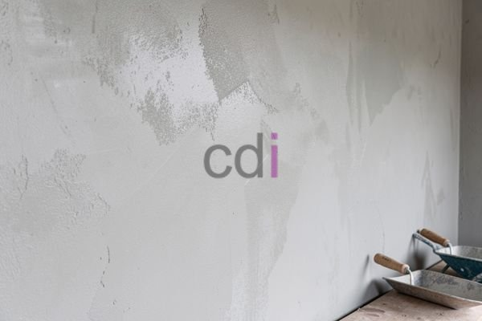

**Berapa Lama Acian Kering?** - Hai Mitra CDI! Pernahkah Anda bertanya-tanya, kapan waktu yang ideal untuk melanjutkan pekerjaan setelah proses pengacian? Nah, keringnya acian itu penting banget, lho. Acian yang belum benar-benar kering bisa bikin proyek jadi molor dan hasilnya kurang maksimal. Yuk, kita bahas tuntas panduan lengkapnya biar pekerjaan Mitra CDI makin lancar dan hasilnya optimal di (not detected)!

## Apa Saja yang Mempengaruhi Lama Acian Mengering?

Proses pengeringan acian itu nggak instan, ada beberapa hal yang bikin waktunya bisa beda-beda. Salah satu yang paling berpengaruh adalah **ketebalan lapisan acian**. Semakin tebal acian yang diaplikasikan, jelas waktu keringnya juga akan lebih lama. Misalnya, lapisan acian setebal 1-2 mm akan lebih cepat kering dibandingkan lapisan 5 mm atau lebih.

Selain itu, **kondisi lingkungan** juga punya peran penting. Suhu udara, tingkat kelembapan, dan ventilasi ruangan benar-benar memengaruhi kecepatan pengeringan. Di cuaca panas dan kering dengan sirkulasi udara yang baik, acian akan lebih cepat mengering. Sementara itu, area lembap atau dengan ventilasi buruk akan membuat proses pengeringan jadi lebih lama.

Jenis **bahan campuran acian** juga berpengaruh, nih. Komposisi bahan seperti jenis semen, pasir, dan bahan tambahan lainnya bisa memengaruhi waktu pengeringan. Beberapa produk acian instan bahkan diformulasikan khusus untuk mempercepat prosesnya.

## Perkiraan Waktu Pengeringan Acian – Kondisi Standar

Sebagai gambaran, acian idealnya membutuhkan waktu minimal **24 jam** untuk benar-benar kering sebelum bisa diamplas atau dicat. Tapi ingat, ini cuma perkiraan kasar, ya. Kalau kondisinya mendukung – suhu sekitar 25-30°C, kelembapan rendah, ventilasi lancar, dan lapisan tipis – acian bisa kering dalam **18-24 jam**.

Namun, kalau cuaca kurang bersahabat, misalnya lembap atau ventilasi terbatas, waktu pengeringan bisa molor hingga **48-72 jam** atau bahkan lebih lama. Kuncinya, pastikan acian benar-benar kering sebelum melanjutkan pekerjaan. Coba perhatikan visual dan sentuh permukaannya. Kalau masih terasa dingin dan lembap, berarti kadar airnya masih tinggi dan belum siap diproses lebih lanjut.

## Tips Jitu Percepat Pengeringan Acian

Ada beberapa cara yang bisa Mitra CDI lakukan untuk mempercepat proses pengeringan acian:

*   **Maksimalkan ventilasi ruangan:** Buka jendela dan pintu lebar-lebar agar sirkulasi udara semakin lancar.
*   **Manfaatkan kipas angin:** Arahkan kipas angin ke area yang baru diacian untuk membantu mempercepat penguapan air.
*   **Hindari pengacian saat musim hujan:** Kalau memungkinkan, tunda pekerjaan pengacian sampai cuaca membaik.
*   **Pilih produk acian berkualitas:** Gunakan produk acian instan yang dirancang untuk mengering lebih cepat.
*   **Dehumidifier bisa jadi solusi:** Di lingkungan lembap, pertimbangkan penggunaan dehumidifier untuk mengurangi kadar air di udara dan mempercepat pengeringan.

## Cara Memastikan Acian Sudah Kering dan Siap Digarap

Setelah menunggu beberapa waktu, bagaimana cara memastikan acian sudah benar-benar kering dan siap untuk diamplas atau dicat? Perhatikan tanda-tanda berikut:

*   **Perubahan warna permukaan:** Acian yang basah biasanya terlihat lebih gelap. Saat kering, warnanya akan menjadi lebih terang dan seragam.
*   **Tekstur kering dan keras:** Sentuh permukaan acian. Kalau terasa kering dan keras, berarti sebagian besar kadar air sudah menguap.
*   **Tidak meninggalkan bekas sidik jari:** Coba tekan permukaan acian dengan jari. Kalau tidak meninggalkan bekas sidik jari, berarti acian sudah cukup kering.
*   **Tidak ada bau lembap:** Cium area yang diacian. Jika tidak tercium bau lembap, berarti acian sudah kering sempurna.

Jika Mitra CDI masih ragu, lebih baik tunggu satu hari lagi sebelum melanjutkan. Kehati-hatian itu penting, lho, agar hasil finishing-nya maksimal.

Butuh bantuan untuk proyek di (not detected)? Tim Kami siap sedia membantu! Silakan hubungi lewat tombol **Telepon** atau **WhatsApp** yang tersedia di bawah. Jangan ragu, ya!

Internal Link tambahkan: [Besi Buat Cor: Panduan Memilih dan Menggunakan untuk Hasil Optimal](/blog/besi-buat-cor/)