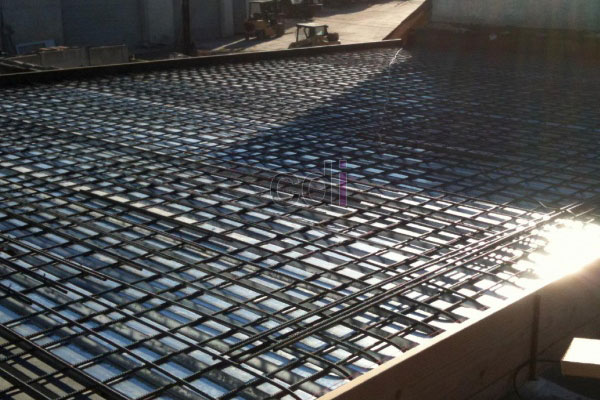

**Berapa Lama Cor Lantai 2 Kering? Panduan Lengkap untuk Mitra CDI** - Hai Mitra CDI! Pernahkah Anda bertanya-tanya tentang waktu yang dibutuhkan untuk pengeringan cor lantai 2? Ini pertanyaan umum, terutama bagi Anda yang sedang membangun rumah atau proyek bertingkat. Artikel ini akan membahas proses pengeringan cor lantai 2, faktor-faktor yang mempengaruhinya, serta tips untuk hasil yang optimal. Simak terus ya!

Seringkali terjadi kesalahan dalam memahami proses pengeringan cor lantai 2. Banyak yang mengira permukaan yang terlihat kering sudah cukup kuat menahan beban. Ini adalah kesalahpahaman yang bisa berakibat serius pada integritas struktural bangunan dalam jangka panjang. Mari kita bedah lebih dalam mengenai Berapa Lama Cor Lantai 2 Kering ini.

Memang, secara kasat mata, permukaan beton bisa terasa kering dan padat hanya dalam hitungan hari. Namun, proses pengerasan beton sebenarnya jauh lebih kompleks dan butuh waktu lebih lama dari sekadar melihat permukaannya saja.

## Memahami Dua Fase Pengeringan Beton

Ada **dua fase** penting yang harus Anda pahami dalam proses pengeringan beton:

**Pertama**, fase pengerasan awal. Dalam waktu 24-48 jam, beton sudah cukup kuat untuk menahan beban ringan seperti langkah kaki pekerja. Namun, ini belum berarti beton siap untuk menerima beban penuh.

**Kedua**, fase pengerasan penuh atau *curing period*. Fase ini memakan waktu sekitar **28 hari** untuk mencapai kekuatan desain beton secara maksimal (100%). Sebaiknya hindari aktivitas berat selama masa ini, meskipun secara visual beton sudah terlihat solid sebelumnya.

## Faktor-Faktor yang Mempengaruhi Kecepatan Pengeringan

### Pengaruh Ketebalan Cor
Pada umumnya, ketebalan lantai 2 yang dicor berkisar antara 10-12 cm. Semakin tebal lapisan cor, semakin lama waktu yang dibutuhkan agar bagian dalam beton mengeras secara merata. Perbedaan waktu pengeringan antara permukaan dan inti beton dapat memengaruhi kekuatan keseluruhan jika proses *curing* tidak dilakukan dengan tepat.

### Kondisi Cuaca di Wilayah (not detected)
Iklim di (not detected) sangat memengaruhi kecepatan pengeringan. Di musim kemarau dengan suhu tinggi, penguapan air beton cenderung lebih cepat. Namun, penguapan yang terlalu cepat bisa menyebabkan retak karena permukaan kering lebih dulu daripada bagian dalam beton. Sebaliknya, musim hujan memperlambat proses pengeringan, tetapi risiko retak akibat kekeringan permukaan berkurang.

### Kualitas Campuran Beton
Komposisi campuran beton sangat krusial. Rasio air-semen yang tepat akan menghasilkan beton yang kuat dan tahan lama. Campuran dengan air berlebih memang mudah dituang, namun hasilnya adalah beton yang lebih lambat mengeras dan memiliki kekuatan akhir yang lebih rendah dibandingkan dengan campuran yang terkontrol sejak awal.

## Pentingnya Curing: Jangan Sampai Terlewat!

*Curing* bukan hanya sekadar menunggu beton mengering, tapi sebuah proses aktif untuk menjaga kelembapan beton selama masa pengerasan. Anda dapat melakukan *curing* dengan cara menyiram permukaan beton secara berkala (2-3 kali sehari) selama seminggu pertama, atau dengan menutupnya menggunakan plastik atau karung basah untuk mempertahankan kelembapan.

Mengabaikan proses *curing* bisa menyebabkan retak susut (*shrinkage crack*) pada beton, meskipun rasio campuran sudah tepat. Ketelitian dalam tahap ini membedakan lantai yang tahan lama dengan yang rentan bermasalah.

## Kapan Lantai 2 Aman Digunakan?

Untuk beban ringan seperti meletakkan perabotan rumah tangga standar, lantai 2 umumnya aman digunakan setelah 7 hari. Namun, untuk beban berat atau akan melanjutkan aktivitas konstruksi di atasnya, sebaiknya tunggu hingga 28 hari penuh atau konsultasikan dengan ahli struktur untuk memastikan kekuatan beton sudah optimal.

## Perhatikan Tanda-Tanda Beton yang Belum Siap Beban

Beberapa tanda yang mengindikasikan beton belum ideal untuk menahan beban penuh antara lain: permukaan terasa agak lunak saat ditekan, munculnya retak rambut halus di beberapa area, atau warna beton masih terlihat gelap dan merata (belum berubah menjadi abu-abu terang seperti beton kering). Jika masih ada tanda-tanda ini, lebih baik tunda penggunaan lantai untuk aktivitas berat meskipun sudah melewati 7 hari.

## Bahaya Membebani Lantai Terlalu Cepat

Memaksakan beban terlalu dini pada lantai yang belum mengeras dengan sempurna dapat menyebabkan lendutan permanen, bahkan retak struktural yang baru terlihat setelah beberapa bulan. Memperbaiki kerusakan struktural membutuhkan biaya dan waktu yang jauh lebih besar dibandingkan dengan menunggu proses *curing* selesai dengan sabar.

## Kesimpulan: Kunci Kekuatan Lantai Ada Pada Proses Pengeringan

Jadi, berapa lama cor lantai 2 kering? Secara umum, lantai 2 siap digunakan untuk beban ringan setelah sekitar 7 hari, dan mencapai kekuatan penuh setelah 28 hari. Namun, kunci utama agar target waktu ini tercapai adalah *curing* yang tepat selama periode tersebut. 

Butuh bantuan untuk proyek pengecoran lantai 2 di (not detected)? Tim Kami dari Creative Design Interior siap memberikan solusi terbaik. Hubungi Kami melalui tombol **Telepon** atau **WhatsApp** yang tersedia di bawah ini! [Jasa Cor Lantai di Babakan Cikao Purwakarta](/cor/jasa-cor-lantai-di-babakan-cikao-purwakarta/) 