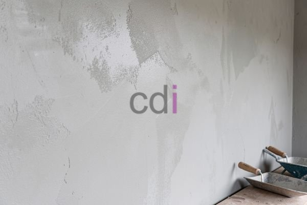

**Berapa Lama Semen Kering?** - Hai Mitra CDI! Pernahkah Anda bertanya-tanya, kenapa pekerjaan konstruksi seringkali molor karena masalah semen yang belum kering sempurna? Nah, ini masalah umum, apalagi di daerah seperti (not detected) saat musim hujan tiba. Memahami waktu pengeringan semen yang tepat itu krusial untuk memastikan bangunan Anda kuat dan awet, lho. Mari kita bahas lebih lanjut!

### Apa Saja yang Mempengaruhi Waktu Pengeringan Semen?

Proses pengeringan semen itu *gak* bisa dianggap remeh. Waktu yang dibutuhkan itu bervariasi, dan dipengaruhi oleh beberapa faktor penting. Ada **jenis semen** yang Anda pakai. Semen Portland biasa butuh waktu lebih lama dibanding Semen Portland Komposit (PCC). Lalu ada **kondisi cuaca**, di mana suhu hangat dan kering mempercepat pengeringan, sementara suhu dingin dan lembap justru menghambatnya. Selanjutnya, **perbandingan air dan semen** juga berpengaruh – semakin banyak airnya, semakin lama semen mengering. Terakhir, **ketebalan lapisan semen** juga berperan; lapisan tebal tentu membutuhkan waktu lebih lama.

Pada kondisi yang ideal—suhu antara 20-30°C, kelembapan normal, dan perbandingan air-semen yang sesuai—semen Portland biasa umumnya butuh sekitar 7 hari untuk mencapai kekuatan awal (sekitar 50% dari kekuatan yang diharapkan) dan 28 hari untuk mencapai kekuatan maksimal. Tapi ingat, angka ini bisa berubah tergantung faktor-faktor tadi. 

### Tahapan Pengeringan Semen dan Perkembangan Kekuatan Beton

Pengeringan semen itu sebenarnya adalah proses hidrasi – reaksi kimia antara semen dan air yang menghasilkan senyawa pengikat. Proses ini berlangsung dalam beberapa tahapan penting:

*   **Pengerasan Awal (Initial Set):** Tahap awal ini terjadi beberapa jam setelah semen dicampur. Adukan mulai kehilangan sifat plastisnya dan mulai mengeras.
*   **Pengerasan Akhir (Final Set):** Biasanya terjadi dalam 24-48 jam setelah pencampuran. Di tahap ini, adukan sudah cukup keras dan bentuknya tidak mudah diubah.
*   **Pengembangan Kekuatan:** Proses ini terus berlanjut selama berhari-hari, berminggu-minggu, bahkan berbulan-bulan! Kekuatan beton terus bertambah seiring waktu.

Jangan lupa, kekuatan beton yang diukur pada usia 7 dan 28 hari itu hanya indikator. Beton akan terus mengeras dan menguat, meskipun lajunya semakin lambat. Ini penting diperhatikan, terutama jika Anda membangun di (not detected).

### Cara Mempercepat Proses Pengeringan Semen

Meskipun kondisi lingkungan sulit dihindari, ada beberapa trik yang bisa Anda coba untuk mempercepat pengeringan semen. Pertama, gunakan **Semen Portland Komposit (PCC)** yang memang dirancang untuk pengeringan lebih cepat. Kedua, pastikan **perbandingan air-semen** sudah sesuai dengan rekomendasi pabrikan.  Terlalu banyak air hanya akan memperlambat proses dan mengurangi kualitas beton. Ketiga, hindari penggunaan **air yang terlalu dingin** saat mencampur semen. Keempat, pertimbangkan penggunaan **aditif percepat pengeringan** (concrete accelerator) dengan mengikuti petunjuk pemakaian yang benar. Terakhir, pastikan **sirkulasi udara** di area kerja cukup baik untuk mengurangi kelembapan.

Sebagai contoh, saat Anda menggunakan PCC dengan rasio air-semen 0,45, kekuatan awal beton bisa tercapai dalam 3-5 hari, dan kekuatan penuh dalam 21-28 hari. Penggunaan aditif percepat pengeringan juga bisa membantu memangkas waktu tersebut.

### Perbandingan Waktu Pengeringan Jenis-Jenis Semen

Supaya lebih jelas, yuk kita lihat perbandingan waktu pengeringan beberapa jenis semen yang sering digunakan:

<table class="table">
  <caption>Waktu Pengeringan Berbagai Jenis Semen</caption>
  <thead>
    <tr><th>Jenis Semen</th><th>Kekuatan Awal (Hari)</th><th>Kekuatan Penuh (Hari)</th></tr>
  </thead>
  <tbody>
    <tr><td>Semen Portland Biasa (OPC)</td><td>7</td><td>28</td></tr>
    <tr><td>Semen Portland Komposit (PCC)</td><td>3-5</td><td>21-28</td></tr>
    <tr><td>Semen Portland Putih</td><td>5-7</td><td>28-35</td></tr>
    <tr><td>Semen Rendah Panas Hidrasi</td><td>7-10</td><td>28-42</td></tr>
  </tbody>
</table>

Khusus untuk kebutuhan konstruksi di (not detected), kami siap membantu menyediakan material berkualitas dengan harga terbaik. Informasi harga terbaru bisa Anda lihat di tabel di atas, atau hubungi Kami langsung untuk penawaran yang lebih akurat.

Butuh informasi lebih lanjut? Jangan ragu untuk menekan tombol **Telepon** atau **WhatsApp** yang ada di bawah ini. Tim Kami siap menjawab semua pertanyaan Anda! Kami di CDI siap menjadi mitra Anda dalam membangun struktur yang kokoh dan tahan lama di (not detected).