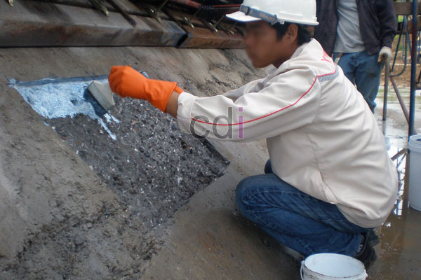

**Berapa Lapis Besi Untuk Cor Dak** - Hai Mitra CDI! Pernahkah Anda bertanya-tanya, sebenarnya berapa lapis besi yang dibutuhkan untuk membuat dak cor yang benar-benar kuat dan awet? Pertanyaan ini sering muncul banget, lho, terutama saat kita lagi merencanakan pembangunan rumah atau proyek bangunan lainnya. Salah perhitungan bisa berakibat fatal, dan tentu saja, kita semua ingin hasil yang optimal kan?

Nah, sebagai Mitra CDI yang cerdas dan selalu mengutamakan kualitas, Anda pasti ingin struktur bangunan yang kokoh dan aman. Yuk, kita bahas tuntas panduan lengkap dari kami tentang lapis besi pada cor dak. Dijamin, setelah baca artikel ini, Anda jadi lebih paham!

Penting untuk diingat, menentukan apakah perlu satu atau dua lapis besi untuk cor dak bukanlah keputusan yang bisa diambil sembarangan. Ukuran bangunan, apakah itu dak rumah sederhana atau dak gedung bertingkat, memerlukan pendekatan yang sangat berbeda dalam hal perencanaan dan penggunaan tulangan besi.

Kesalahan dalam menentukan jumlah lapisan besi bukan hanya soal anggaran yang terbuang percuma. Lebih dari itu, ini menyangkut keselamatan dan keawetan struktur bangunan Anda dalam jangka panjang. Dak yang kurang besinya berpotensi melendut atau retak seiring waktu, sedangkan dak yang kelebihan besi untuk bangunan sederhana hanya akan menambah biaya tanpa memberikan manfaat signifikan.

## Mengapa Besi Tulangan Penting dalam Cor Dak?

Beton memang punya kekuatan tekan yang luar biasa, tapi sayangnya, ia sangat lemah dalam menahan gaya tarik. Di sinilah peran besi tulangan menjadi krusial. Besi tulangan berfungsi untuk menahan gaya tarik yang tidak bisa ditanggung oleh beton. Dengan kombinasi beton dan besi, struktur dak menjadi mampu menahan beban dari dua arah gaya sekaligus, yaitu tekan dan tarik. Akibatnya? Struktur yang jauh lebih kuat dan tahan lama.

## Lalu, Berapa Lapis yang Ideal?

Untuk **dak rumah tinggal** dengan bentang standar (kurang dari 4 meter), **satu lapis besi** umumnya sudah cukup memadai. Gunakan besi dengan diameter 8–10 mm, dengan jarak antar besi sekitar 15–20 cm.

Namun, untuk **gedung bertingkat atau dak dengan bentang lebih dari 4 meter**, penggunaan dua lapis besi (tulangan atas dan bawah) adalah suatu keharusan. Diameter besi yang disarankan adalah 12–16 mm, dengan mempertimbangkan hasil perhitungan struktur yang akurat dari konsultan ahli. Tulangan lapis atas bertugas menahan momen negatif di area tumpuan, sementara lapisan bawah bertugas menahan momen positif di tengah bentang. Keduanya sama-sama penting untuk memastikan kestabilan keseluruhan struktur.

## Faktor-Faktor Penentu Jumlah Lapis Besi

### Ketebalan Dak
Ketebalan dak juga memengaruhi kebutuhan tulangan. Dak dengan ketebalan di atas 10 cm umumnya membutuhkan dua lapis tulangan untuk mendistribusikan beban secara merata di kedua sisi penampang. Semakin tebal dak, semakin penting juga untuk memastikan tulangannya memadai agar tidak terjadi retak susut.

### Jenis dan Fungsi Bangunan
Jenis bangunan juga berpengaruh. Gudang, ruko dua lantai, atau bangunan komersial dengan beban lantai yang lebih berat membutuhkan tulangan yang lebih rapat dan berlapis dibandingkan rumah tinggal biasa. Bangunan yang akan menampung mesin atau peralatan berat juga memerlukan perhitungan khusus yang berbeda dari standar rumah tinggal.

### Beban yang Akan Ditopang
Pertimbangkan rencana pemakaian dak di masa depan. Jika dak akan dijadikan lantai atas dan bukan hanya atap datar biasa, kebutuhan tulangannya akan berbeda sejak awal. Banyak pemilik rumah yang menyesal karena tidak memperhitungkan rencana penambahan lantai saat pengecoran dak pertama.

## Besi Polos vs Besi Ulir: Mana yang Tepat?

- **Besi polos** — memiliki permukaan yang halus dan harga yang lebih ekonomis. Pilihan yang baik untuk struktur ringan yang tidak menahan beban ekstrem. Umumnya digunakan untuk sengkang atau elemen pendukung non-utama.
- **Besi ulir** — memiliki permukaan bergelombang yang memberikan daya cengkeram lebih baik terhadap beton. Ini menjadikannya pilihan utama untuk dak yang menopang beban lebih besar, karena meminimalkan risiko selip antara besi dan beton.

## Tips Tambahan untuk Cor Dak yang Lebih Kokoh

Pastikan Anda menggunakan beton dengan mutu minimal K-225 untuk dak rumah tinggal. Gunakan vibrator beton saat proses pengecoran untuk meratakan dan menghilangkan rongga udara yang dapat melemahkan struktur. Setelah pengecoran, lakukan curing rutin selama minimal 7 hari dengan menyiram permukaan secara berkala untuk membantu beton mengeras secara merata dan mencegah retak akibat kekeringan. Pemasangan penutup sementara pada permukaan dak yang baru dicor juga sangat disarankan untuk melindunginya dari hujan deras di hari-hari awal.

## Kesalahan Umum yang Sering Terjadi

Kami sering menjumpai beberapa kesalahan umum di lapangan, seperti pemilihan diameter besi yang terlalu kecil demi menghemat biaya, jarak antar besi yang tidak konsisten yang menyebabkan distribusi kekuatan tidak merata, dan pengabaian penyambungan besi yang tumpang tindih (overlap) minimal 40 kali diameter besi di setiap sambungan. Ketiga kesalahan ini dapat menurunkan kekuatan dak secara signifikan meskipun jumlah lapisnya sudah sesuai.

## Kapan Sebaiknya Berkonsultasi dengan Ahli Struktur?

Untuk bentang dak di atas 4 meter, bangunan bertingkat, atau dak yang direncanakan menahan beban khusus, jangan ragu untuk berkonsultasi dengan insinyur sipil. Perhitungan struktur yang akurat akan memberikan spesifikasi tulangan yang tepat sesuai dengan kondisi bangunan Anda, termasuk mempertimbangkan faktor keamanan tambahan, terutama di wilayah yang rawan gempa.

## Kesimpulan

Menentukan jumlah lapis besi untuk cor dak memerlukan pertimbangan matang terhadap berbagai faktor, termasuk ukuran dak, jenis bangunan, dan beban yang akan ditopang. Jangan mengambil keputusan berdasarkan perkiraan atau informasi yang kurang akurat.

Jika Mitra CDI ingin mendapatkan bantuan dalam menghitung kebutuhan tulangan untuk proyek cor dak Anda, jangan sungkan untuk menghubungi kami melalui tombol **Telepon** atau **WhatsApp** yang tersedia di bawah ini. Kami siap membantu Anda mendapatkan hasil yang terbaik! [[TABEL_MULAI]] {"title": "Perbandingan Besi Polos dan Besi Ulir", "headers": ["Fitur", "Besi Polos", "Besi Ulir"]} {"row": ["Permukaan", "Halus", "Bergelombang"]} {"row": ["Daya Cengkeram", "Kurang Baik", "Baik"]} {"row": ["Harga", "Lebih Ekonomis", "Lebih Mahal"]} {"row": ["Penggunaan", "Struktur Ringan, Sengkang", "Dak, Kolom, Balok"]} [[TABEL_SELESAI]]

 [Pentingnya Besi Dak Cor untuk Konstruksi Bangunan yang Kokoh](/blog/besi-dak-cor/) - Mitra CDI dimana saja berada, apa kabar hari ini? Kali ini, kami ingin ngobrol soal salah satu elemen penting yang nggak boleh absen dalam proyek konstruksi, yaitu besi dak cor. Buat Mitra CDI yang lagi re