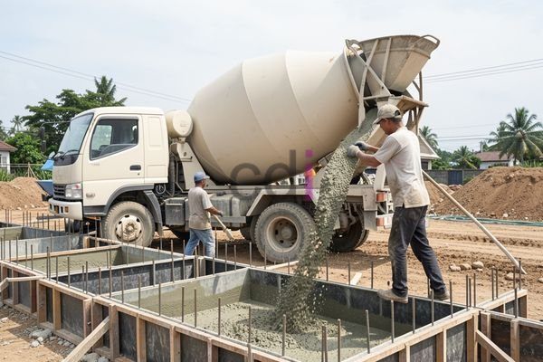

**Berat Beton Per M3: Panduan Lengkap dan Faktor yang Mempengaruhi** - Hai Mitra CDI! Memulai proyek konstruksi? Salah satu hal fundamental yang perlu dipahami adalah berat beton per m3. Informasi ini bukan cuma soal angka, tapi kunci untuk perencanaan yang matang, perhitungan biaya yang tepat, dan struktur bangunan yang kokoh. Yuk, kita bahas tuntas!

### Mengapa Mengetahui Berat Beton Per M3 Sangat Penting?
Angka berat beton per m3 ini jadi fondasi banyak perhitungan penting, lho. Bayangkan, tanpa tahu beratnya, bagaimana kita bisa memperkirakan beban total struktur bangunan? Atau merencanakan fondasi yang cukup kuat? Dengan data yang akurat, Mitra CDI bisa lebih tenang dalam merancang bangunan yang aman dan tahan lama. Selain itu, pemahaman ini membantu Anda mengelola anggaran proyek dengan lebih efisien.

### Faktor-faktor yang Mempengaruhi Berat Jenis Beton

Ternyata, berat beton per m3 nggak cuma satu angka pasti. Ada beberapa faktor yang mempengaruhinya. Nah, dengan memahami faktor-faktor ini, Mitra CDI bisa memilih komposisi beton yang paling pas untuk proyek di (not detected).

1.  **Jenis Agregat:** Agregat seperti kerikil, pasir, atau batu pecah punya massa jenis yang berbeda. Semakin berat agregatnya, ya, semakin berat juga betonnya.
2.  **Jenis Semen:** Jenis semen juga berperan, walau nggak sebesar jenis agregat. Semen yang lebih padat menghasilkan beton yang sedikit lebih berat.
3.  **Kandungan Air:** Kandungan air dalam campuran beton berpengaruh pada berat jenisnya. Semakin banyak airnya, biasanya beratnya justru berkurang. Tapi ingat, kelebihan air bisa menurunkan kekuatan beton, ya!
4.  **Admixture (Bahan Tambahan):** Penggunaan *admixture* seperti *air entrainer* atau *superplasticizer* bisa mengubah berat beton. Beberapa *admixture* justru ditujukan untuk mengurangi berat, sementara yang lain menambahnya.
5.  **Mutu Beton:** Mutu beton, yang ditunjukkan dengan angka K (contohnya K-25, K-300), juga memengaruhi berat jenisnya. Biasanya, mutu beton yang lebih tinggi membutuhkan proporsi semen yang lebih tinggi, yang bisa sedikit meningkatkan berat.

### Berat Jenis Beton Berdasarkan Mutu dan Komposisi

Sebagai gambaran, berat jenis beton umumnya berkisar antara 2.200 kg/m³ hingga 2.400 kg/m³. Berikut adalah perkiraan berdasarkan mutu dan komposisi yang umum digunakan di (not detected):

| Mutu Beton | Berat Jenis (kg/m³) |
|---|---|
| K-125 | 2.200 - 2.250 |
| K-200 | 2.250 - 2.300 |
| K-250 | 2.300 - 2.350 |
| K-300 | 2.350 - 2.400 |

Perlu diingat, angka ini hanya perkiraan. Berat jenis beton yang sebenarnya bisa bervariasi tergantung campuran dan kualitas material. Untuk info harga yang akurat, jangan ragu untuk melihat  atau konsultasikan langsung dengan tim Kami.

### Contoh Sederhana: Menghitung Berat Beton
Anggap saja kita butuh 1 m³ beton dengan berat jenis 2.350 kg/m³. Caranya gampang:

Berat Beton = Volume x Berat Jenis
Berat Beton = 1 m³ x 2.350 kg/m³
Berat Beton = 2.350 kg

Kalau Mitra CDI membutuhkan 10 m³ beton dengan berat jenis yang sama, perhitungannya:

Total Berat Beton = 10 m³ x 2.350 kg/m³ = 23.500 kg atau 23,5 ton.

Oh ya, kalau Anda ingin memperkirakan kebutuhan bekisting, artikel tentang [1 m3 beton berapa m2 bekisting: Panduan Praktis Menghitung dan Mengoptimalkan](/blog/1-m3-beton-berapa-m2-bekisting/) bisa jadi referensi yang berguna, lho!

### Standar SNI dan Kualitas Beton
Standar Nasional Indonesia (SNI) 03-1999 tentang Spesifikasi Beton Struktur adalah pedoman penting. Standar ini mengatur mutu beton dan persyaratan pengujian. Walaupun SNI tidak menyebutkan angka pasti berat jenis beton, standar ini memandu proporsi campuran agar menghasilkan mutu beton yang sesuai. Pastikan proyek Anda selalu mengikuti standar SNI untuk keamanan dan kualitas bangunan di (not detected).

### Efisiensi Biaya: Memilih Komposisi Beton yang Tepat
Memilih komposisi beton yang tepat bukan cuma soal kekuatan, tapi juga efisiensi biaya. Dengan memahami faktor-faktor yang memengaruhi berat beton, Mitra CDI bisa memilih agregat dan campuran yang paling ekonomis tanpa mengorbankan kualitas. Jangan sungkan berkonsultasi dengan ahli beton untuk rekomendasi komposisi optimal. Dan, untuk memperkirakan kebutuhan material seperti pasir, artikel [1 M3 Pasir Beton Berapa Kg? Panduan Lengkap untuk Perhitungan Material](/blog/1-m3-pasir-beton-berapa-kg/) bisa sangat membantu!

Butuh bantuan lebih lanjut? Jangan ragu untuk menghubungi Kami. Tombol **Telepon** dan **WhatsApp** ada di bawah ini, siap melayani Mitra CDI kapan saja. 