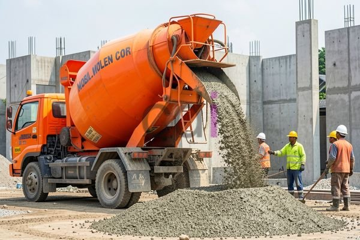

**Berat Molen Cor: Kapasitas, Pengaruh ke Biaya, dan Cara Menghitungnya** - Hai Mitra CDI! Pernahkah Anda menghadapi tantangan dalam menentukan kapasitas molen cor yang ideal untuk sebuah proyek? Seringkali, fokus utama tertuju pada volume adukan yang dihasilkan, namun aspek krusial lainnya, seperti berat molen itu sendiri dan dampaknya terhadap biaya, luput dari perhatian. Artikel ini hadir untuk memberikan panduan lengkap mengenai berat molen cor, pengaruhnya terhadap operasional, serta cara menghitung kebutuhan yang tepat untuk proyek Anda di (not detected).

### Bobot Molen Cor: Menyesuaikan dengan Kapasitasnya

Berat molen cor itu sendiri sangat beragam, tergantung pada kapasitas dan desainnya. Secara garis besar, molen dengan kapasitas 0,25 m³ umumnya memiliki berat antara 80 hingga 120 kilogram. Jika Anda membutuhkan kapasitas lebih besar, misalnya 0,5 m³, bobotnya bisa mencapai 150 sampai 250 kilogram. Sementara itu, untuk molen berukuran besar dengan kapasitas 1 m³ atau lebih, beratnya dapat melebihi 300 kilogram. Perbedaan ini signifikan dan perlu Anda pertimbangkan dengan matang.

Kami dari CDI sangat merekomendasikan agar Anda tidak hanya berfokus pada volume adukan, tetapi juga memperhitungkan berat total molen saat terisi penuh. Ini penting untuk memastikan kesesuaian dengan kemampuan alat pengangkat yang digunakan, seperti forklift atau crane, sekaligus memastikan lantai kerja mampu menopang beban tersebut. Penggunaan molen yang terlalu berat berpotensi merusak lantai dan membahayakan keselamatan pekerja.

### Bagaimana Berat Molen Mempengaruhi Biaya Proyek?

Berat molen cor punya dampak langsung pada biaya operasional proyek Anda. Semakin berat molen, semakin besar tenaga yang diperlukan untuk memindahkannya. Ini bisa berarti kebutuhan akan operator yang lebih terlatih atau penggunaan peralatan bantu seperti forklift. Selain itu, berat molen juga berkontribusi pada peningkatan konsumsi bahan bakar alat pengangkut. Beban yang lebih berat otomatis membutuhkan konsumsi bahan bakar yang lebih banyak.

Biaya perawatan juga bisa terpengaruh oleh berat molen. Molen yang lebih berat umumnya menggunakan komponen yang lebih kuat dan lebih besar, yang mungkin membutuhkan biaya perawatan yang lebih tinggi. Sebagai informasi, harga sewa molen cor dengan kapasitas 0,5 m³ di wilayah (not detected) dan sekitarnya berkisar antara Rp 400.000 hingga Rp 600.000 per hari. Harga ini bersifat fluktuatif — hubungi Kami untuk mendapatkan penawaran harga terbaru yang sesuai dengan kebutuhan proyek Anda.

### Menghitung Kebutuhan Molen: Perhatikan Berat dan Volume

Untuk menghitung kebutuhan molen cor yang optimal, Anda perlu memperhitungkan volume beton yang dibutuhkan, serta kapasitas molen yang tersedia. Misalnya, jika proyek Anda memerlukan 10 meter kubik beton dan Anda menggunakan molen berkapasitas 0,5 m³, maka Anda membutuhkan setidaknya 20 batch adukan. Namun, penting untuk diingat bahwa perhitungan ini belum memperhitungkan potensi kehilangan adukan akibat tumpahan atau sisa adukan yang menempel di dalam molen.

Oleh karena itu, Kami sarankan untuk menambahkan faktor keamanan sebesar 10-15% pada perhitungan volume beton yang Anda butuhkan. Selain itu, pertimbangkan juga waktu yang diperlukan untuk setiap batch, termasuk waktu pengisian, pengadukan, dan penuangan. Semakin cepat siklus per batch, semakin sedikit molen yang Anda perlukan.

Sebagai gambaran, berikut perkiraan biaya sewa molen untuk proyek yang membutuhkan 10 m³ beton:

*   Volume beton: 10 m³
*   Kapasitas molen: 0,5 m³
*   Jumlah batch: 20 batch
*   Harga sewa per hari: Rp 500.000
*   Estimasi waktu per batch: 30 menit
*   Total waktu pengecoran: 10 jam (20 batch x 30 menit)

Dengan asumsi biaya sewa per jam adalah Rp 50.000 (Rp 500.000 / 10 jam), total biaya sewa molen untuk proyek ini adalah Rp 500.000. Perlu diingat bahwa angka ini belum termasuk biaya bahan bakar, upah operator, dan biaya operasional lainnya.

### Memilih Molen yang Tepat: Pertimbangkan Berat dan Spesifikasi

Saat memilih molen cor, ada beberapa faktor penting yang harus diperhatikan, termasuk kapasitas, berat, jenis penggerak (diesel, listrik, atau manual), dan tingkat mobilitas. Untuk proyek berskala kecil, molen dengan kapasitas kecil mungkin sudah mencukupi. Namun, untuk proyek yang lebih besar, molen dengan kapasitas lebih besar akan lebih efisien dan menghemat waktu.

Berikut tabel perbandingan singkat antara beberapa jenis molen cor yang umum digunakan:

<table class="table">
  <caption>Perbandingan Jenis Molen Cor</caption>
  <thead>
    <tr><th>Jenis Molen</th><th>Kapasitas (m³)</th><th>Berat (kg)</th><th>Penggerak</th><th>Mobilitas</th></tr>
  </thead>
  <tbody>
    <tr><td>Molen Kecil</td><td>0.25</td><td>80-120</td><td>Listrik/Manual</td><td>Kurang Mobil</td></tr>
    <tr><td>Molen Menengah</td><td>0.5</td><td>150-250</td><td>Diesel/Listrik</td><td>Cukup Mobil</td></tr>
    <tr><td>Molen Besar</td><td>1+</td><td>300+</td><td>Diesel</td><td>Tinggi</td></tr>
  </tbody>
</table>

Untuk informasi lebih lengkap, Mitra CDI dapat membaca artikel kami tentang [Mobil Molen Cor: Panduan Lengkap Pemilihan, Harga, dan Perawatan Tahun 2026](/blog/mobil-molen-cor/). Memahami berbagai jenis molen dan spesifikasinya akan membantu Anda membuat keputusan yang paling tepat untuk proyek Anda di (not detected).

Jika Anda membutuhkan konsultasi lebih lanjut, jangan ragu untuk menghubungi Kami melalui tombol **Telepon** dan **WhatsApp** yang tersedia di bawah ini. Kami siap membantu Anda! [Jasa Cor Jalan di Abadijaya Depok](/cor/jasa-cor-jalan-di-abadijaya-depok/), sebagai contoh, bisa menjadi solusi untuk kebutuhan fondasi di wilayah ini.