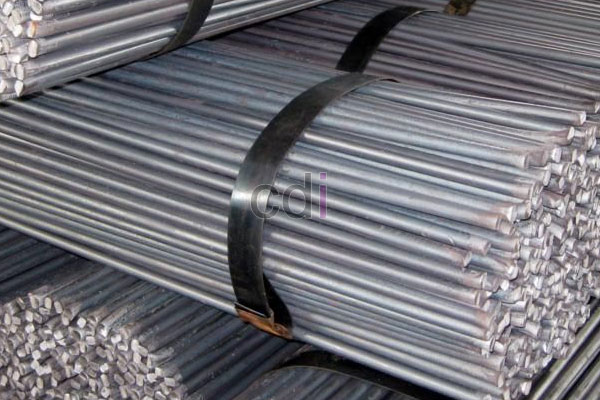

**Besi Beton 10mm: Panduan Lengkap Ukuran, Harga, dan Aplikasi Terbaik** - Hai Mitra CDI! Apakah Anda sedang merencanakan proyek konstruksi dan mencari informasi detail tentang besi beton 10mm? Material ini adalah kunci kekuatan bangunan, lho. Artikel ini akan membahas tuntas segala yang perlu Anda ketahui – mulai dari spesifikasi, perkiraan harga, cara menghitung kebutuhan, hingga contoh aplikasinya. Yuk, kita bahas lebih lanjut!

## Mengenal Lebih Dekat Spesifikasi Besi Beton 10mm

Besi beton 10mm, sesuai namanya, memiliki diameter 10 milimeter. Ukuran ini populer karena memberikan keseimbangan yang pas antara kekuatan tarik dan kelenturan. Material ini umumnya dibuat dari baja karbon tinggi yang melalui proses pengerolan panas untuk memperkuat strukturnya. Standar mutu besi beton di Indonesia diatur dengan ketat melalui SNI 07-2002, dengan mutu yang paling sering digunakan yaitu U-32, U-40, dan U-50. Angka ini menunjukkan kekuatan tarik minimum besi beton tersebut.

Ada dua jenis besi beton 10mm yang tersedia: polos dan ulir. Besi polos memiliki permukaan yang rata, sementara besi ulir memiliki alur spiral. Alur ini berperan penting dalam meningkatkan daya rekat antara besi dan beton, sehingga membangun kekuatan struktural yang lebih solid. Untuk proyek yang memerlukan kekuatan tarik ekstra, besi beton ulir biasanya lebih direkomendasikan.

## Akuratnya Perhitungan Kebutuhan Besi Beton 10mm untuk Proyek Anda

Menghitung kebutuhan besi beton 10mm secara cermat adalah langkah bijak untuk efisiensi anggaran dan jaminan keamanan konstruksi. Perhitungan ini mempertimbangkan berbagai faktor penting, seperti ukuran struktur, jenis beban yang akan diterima, dan jarak antar tulangan besi.

Sebagai ilustrasi, mari kita hitung kebutuhan besi beton untuk kolom berukuran 30 cm x 30 cm dengan tinggi 3 meter, menggunakan 6 batang besi beton 10mm sebagai tulangan utama:

*   Panjang besi beton per batang: 3 meter
*   Jumlah batang: 6
*   Total panjang besi beton: 3 meter x 6 = 18 meter

Namun, ingat! Perhitungan di atas hanya untuk tulangan utama. Anda juga perlu menghitung kebutuhan besi beton untuk sengkang (ring) yang berfungsi menahan besi beton utama agar tidak melengkung akibat tekanan. Umumnya, jarak antar sengkang berkisar 15-30 cm, tergantung beban yang akan ditanggung.

## Perkiraan Harga Besi Beton 10mm Terbaru di Tahun 2026 (not detected)

Harga besi beton 10mm bisa berfluktuasi, dipengaruhi oleh merek, mutu, serta lokasi pembelian. Sebagai gambaran, di tahun 2026, harga besi beton 10mm per meter berkisar antara Rp 10.000 hingga Rp 15.000. Harga ini hanyalah estimasi dan dapat berubah sewaktu-waktu — untuk penawaran harga terkini dan paling akurat, sesuai dengan spesifikasi proyek Anda, silakan hubungi Kami!

Beberapa faktor lain yang memengaruhi harga besi beton antara lain adalah perubahan harga bahan baku baja dan biaya transportasi. Sebaiknya, Anda membandingkan harga dari beberapa supplier sebelum membeli. Membeli dalam jumlah besar juga seringkali bisa mendapatkan harga yang lebih kompetitif.

## Beragam Aplikasi Besi Beton 10mm dalam Konstruksi (not detected)

Besi beton 10mm sangat serbaguna dan diterapkan dalam berbagai jenis konstruksi, dari bangunan sederhana hingga proyek infrastruktur besar. Beberapa contoh aplikasinya antara lain:

*   **Pondasi:** Digunakan sebagai tulangan pada pondasi batu kali, pondasi tapak, dan pondasi menerus. Tujuannya menguatkan struktur dan mencegah retakan.
*   **Kolom:** Merupakan komponen utama tulangan kolom, bertugas menahan beban vertikal dan horizontal yang bekerja pada bangunan.
*   **Balok:** Berfungsi sebagai tulangan tarik pada balok, menahan momen lentur yang disebabkan oleh beban.
*   **Slab:** Digunakan sebagai tulangan pada slab lantai dan atap untuk meningkatkan kekuatan dan mencegah keretakan pada permukaan.
*   **Dinding:** Digunakan sebagai tulangan pada dinding beton bertulang untuk memberikan kekuatan dan ketahanan tambahan, terutama terhadap gempa bumi.

[Besi untuk Pondasi Rumah: Jenis, Ukuran, dan Estimasi Biaya Terbaru 2026](/blog/besi-untuk-pondasi-rumah/)

Apabila Anda memiliki pertanyaan lebih lanjut, tim Kami siap membantu! Jangan ragu untuk menghubungi Kami melalui tombol **WhatsApp** atau **Telepon** yang tersedia di halaman ini. Kami akan dengan senang hati memberikan konsultasi dan penawaran terbaik untuk proyek Anda di (not detected).