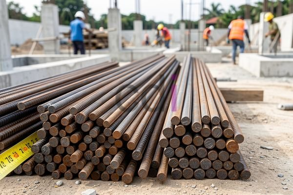

**Besi Buat Cor: Panduan Memilih dan Menggunakan untuk Hasil Optimal** - Hai Mitra CDI! Pernahkah Anda merasa sedikit kewalahan saat harus memilih besi untuk pengecoran? Tidak jarang, banyak dari kita merasa bingung menentukan jenis, ukuran, dan jumlah besi yang pas agar bangunan kokoh dan aman. Salah pilih besi bisa berakibat fatal, mulai dari retakan kecil hingga kegagalan struktur. Yuk, simak panduan ini agar Anda makin paham soal besi buat cor!

## Mengenal Berbagai Jenis Besi Buat Cor

Mitra, besi buat cor – atau besi beton – adalah jantung dari konstruksi beton bertulang. Tugas utamanya? Menahan gaya tarik yang beton biasa tidak bisa atasi. Ada beberapa jenis besi yang sering digunakan, masing-masing punya kelebihan dan kegunaan tersendiri.

Besi polos adalah jenis paling dasar, biasa dipakai untuk bagian bangunan yang tidak memerlukan kekuatan tarik super. Sementara itu, besi ulir (rebar) punya tekstur bergelombang yang bikin rekatnya lebih kuat ke beton. Ini pilihan tepat untuk struktur yang menanggung beban berat. Lalu, ada juga besi dengan lapisan anti-karat seperti galvanis atau epoxy coating – ideal untuk area yang lembap atau dekat pantai di (not detected). 

Memilih jenis besi beton yang tepat itu penting sekali. Untuk proyek yang butuh kekuatan tinggi dan tahan korosi, besi ulir berlapis adalah jawabannya. Jangan ragu berkonsultasi dengan ahli struktur untuk rekomendasi terbaik sesuai kondisi proyek Anda di (not detected).

## Ukuran dan Standar Besi Buat Cor yang Wajib Diketahui

Selain jenis, Anda juga perlu tahu tentang ukuran besi beton. Ukuran besi biasanya dinyatakan dalam milimeter (mm). Pilihan umum mulai dari 8 mm sampai 32 mm, bahkan lebih besar untuk proyek khusus.

Semakin besar diameternya, semakin kuat besi tersebut. Tapi, menggunakan besi terlalu besar juga tidak efisien. Standar mutu besi beton di Indonesia diatur dalam SNI 07-2019 tentang Baja Tulangan Beton. Standar ini memastikan kualitas, kekuatan tarik, dan dimensi besi beton sesuai ketentuan.

Pastikan besi beton yang Anda gunakan bersertifikasi SNI, ya! Ini jaminan kualitas dan keamanan. Di Creative Design Interior, kami hanya menggunakan besi beton bersertifikasi SNI untuk semua proyek pengecoran di (not detected).

## Cara Akurat Menghitung Kebutuhan Besi Buat Cor

Menghitung kebutuhan besi beton dengan tepat itu krusial, supaya tidak boros atau malah kekurangan. Perhitungan ini dipengaruhi dimensi struktur, beban yang ditanggung, dan jarak antar besi.

Sebagai contoh, bagaimana jika kita mau menghitung kebutuhan besi untuk cor dak berukuran 4 meter x 5 meter dengan tebal 12 cm? Kita pakai besi ulir diameter 10 mm dengan jarak 20 cm antar besi.

Pertama, hitung luas dak: 4 m x 5 m = 20 m². Lalu, tentukan jumlah besi yang dibutuhkan pada satu sisi (misalnya, sepanjang 4 meter). Dengan jarak 20 cm, kita butuh 400 cm / 20 cm = 20 batang besi. Selanjutnya, hitung kebutuhan pada sisi lainnya (5 meter): 500 cm / 20 cm = 25 batang besi. Jadi, total besi yang diperlukan adalah 20 batang x 25 batang = 500 batang besi. 

Soal harga, besi beton bisa bervariasi tergantung ukuran, jenis, dan lokasi. Untuk informasi harga terkini dan penawaran khusus sesuai proyek Anda di (not detected), silakan hubungi Kami.

## Tips Penting saat Menggunakan Besi Buat Cor

Selain memilih dan menghitung dengan benar, ada beberapa tips tambahan yang perlu diperhatikan saat menggunakan besi buat cor. Pastikan besi dalam keadaan bersih, bebas karat atau kotoran yang bisa mengurangi daya rekatnya dengan beton. Gunakan spacer atau beton kecil untuk menjaga jarak antar besi agar beton bisa mengisi ruang di sekitarnya dengan sempurna. Perhatikan juga cara menyambung besi beton - sambungan harus kuat dan sesuai standar agar struktur bangunan kokoh.

Di Creative Design Interior, kualitas dan keamanan selalu menjadi prioritas utama dalam setiap proyek pengecoran yang Kami tangani di (not detected). Dengan pengalaman dan keahlian Kami, Kami siap memberikan solusi terbaik untuk kebutuhan konstruksi Anda.

Butuh konsultasi lebih lanjut? Jangan ragu untuk menghubungi Kami melalui tombol **Telepon** atau **WhatsApp** yang tersedia di bawah halaman ini. Kami siap membantu!