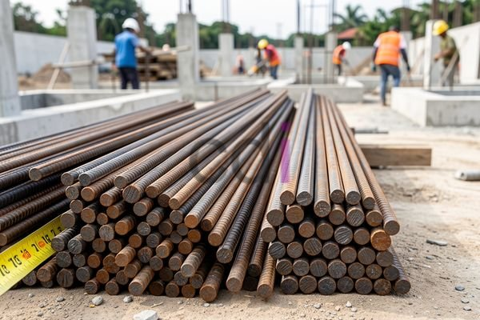

**Besi Cor 8mm: Panduan Lengkap Penggunaan pada Proyek Konstruksi** - Hai Mitra CDI! Pernahkah Anda merasa bingung saat memilih besi yang tepat untuk proyek konstruksi? Memilih besi yang sesuai dengan kebutuhan adalah kunci kekuatan dan keamanan bangunan. Yuk, kita bahas tuntas soal besi cor 8mm, mulai dari keunggulan hingga aplikasinya di lapangan. Tahukah Anda, memilih ukuran yang pas bisa menghemat biaya dan mempercepat penyelesaian proyek!

### Mengenal Lebih Dekat Besi Cor 8mm untuk Konstruksi Anda

Besi cor 8mm adalah salah satu jenis besi beton yang sangat populer dalam berbagai proyek konstruksi di (not detected), mulai dari rumah pribadi hingga proyek infrastruktur besar. Angka 8mm mengacu pada diameternya. Material ini dikenal karena kekuatan tariknya yang baik dan kemampuannya menahan tekanan yang cukup besar. Pemanfaatan yang tepat akan sangat berpengaruh pada kekuatan struktur bangunan Anda.

Besi cor 8mm berfungsi utama sebagai tulangan pada struktur beton bertulang. Fungsinya? Meningkatkan daya tahan beton terhadap gaya tarik, karena beton cenderung lemah dalam menahan tarikan. Dengan besi cor, beton jadi lebih tahan retak dan kerusakan akibat beban, baik yang bersifat statis maupun dinamis. Anda sering menjumpai besi cor 8mm pada fondasi, kolom, balok, dan lantai bangunan.

### Apa Saja Kelebihan dan Kekurangan Besi Cor 8mm?

Seperti material konstruksi lainnya, besi cor 8mm punya kelebihan dan kekurangan yang perlu Anda pertimbangkan. Keunggulannya terletak pada kombinasinya antara kekuatan, daya tahan, dan harga yang relatif ekonomis. Ini menjadi pilihan menarik bagi proyek dengan anggaran terbatas. Selain itu, besi cor 8mm mudah ditemukan di pasaran dengan berbagai pilihan panjang.

Tapi, ada yang perlu Anda waspadai. Besi cor 8mm rentan korosi, terutama jika terpapar kondisi lembap atau air laut. Korosi ini bisa menurunkan kekuatan besi dan memperpendek umur bangunan. Solusinya? Lindungi besi dengan lapisan anti karat atau gunakan beton pelindung yang memadai. Perlu diingat juga, kekuatan luluh besi cor 8mm sedikit lebih rendah dibandingkan besi baja high strength, jadi pertimbangkan ini jika proyek membutuhkan material dengan beban ekstrem.

### Di Mana Saja Besi Cor 8mm Bisa Digunakan?

Aplikasi besi cor 8mm sangat fleksibel, tergantung jenis konstruksi yang dikerjakan. Untuk rumah tinggal sederhana di (not detected), besi cor 8mm sering dipakai sebagai tulangan pondasi, sloof, dan kolom praktis. Sementara untuk bangunan bertingkat atau infrastruktur yang lebih kompleks, besi cor 8mm bisa jadi tulangan pelengkap pada balok dan plat lantai.

Sebagai gambaran, untuk pondasi batu kali berukuran standar 100 x 100 cm, perkiraan kebutuhan besi cor 8mm adalah sekitar 8 batang dengan panjang 6 meter per meter kubik. Harga besi cor 8mm saat ini berkisar antara Rp 7.000 hingga Rp 10.000 per kilogram, tergantung merek dan kualitasnya. Harga ini bisa berubah sewaktu-waktu — untuk penawaran harga terkini dan penyesuaian dengan kebutuhan proyek di (not detected), hubungi Kami!

### Tips Memilih Besi Cor 8mm yang Tepat

Memilih besi cor 8mm tidak boleh asal-asalan. Perhatikan beberapa hal penting: mutu baja, standar SNI, dan reputasi produsen. Pastikan besi cor yang Anda gunakan sudah bersertifikasi SNI untuk menjamin kualitas dan keamanannya. Mutu baja juga kunci utama, karena mutu yang lebih tinggi menghasilkan besi yang lebih kuat dan awet.

Sebagai referensi, besi cor 8mm umumnya memiliki kekuatan tarik sekitar 400 MPa (Mega Pascal) sesuai standar SNI. Selain itu, pertimbangkan kondisi lingkungan tempat bangunan akan berdiri. Jika di daerah pesisir atau rawan korosi, gunakan besi cor berlapis anti karat atau tambahkan aditif anti korosi ke dalam campuran beton. [Besi Buat Cor: Panduan Memilih dan Menggunakan untuk Hasil Optimal](/blog/besi-buat-cor/) bisa menjadi referensi tambahan yang bermanfaat. Jangan lupa, [Besi Diameter 10: Panduan Lengkap Penggunaan, Harga, dan Keunggulan di 2026](/blog/besi-diameter-10/) juga bisa memberikan perspektif tambahan dalam memilih material yang tepat.

Butuh konsultasi lebih lanjut? Jangan sungkan menghubungi Kami melalui tombol **WhatsApp** atau **Telepon** yang tersedia di halaman ini. Kami siap membantu!