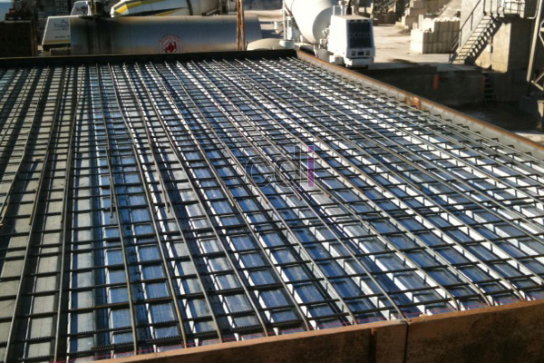

**Besi Dak Cor** - Hai Mitra CDI! Gimana kabarnya? Hari ini, kami mau membahas elemen penting dalam konstruksi bangunan – besi dak cor. Baik untuk renovasi rumah, membangun hunian baru, atau proyek komersial, artikel ini akan memberikan gambaran lengkap tentang besi dak cor. Yuk, kita mulai!

Mungkin terlihat sederhana, tapi besi dak cor memiliki peran krusial dalam kekuatan dan ketahanan bangunan. Jadi, sangat penting bagi Mitra CDI untuk memahami jenis, fungsi, dan cara memilih yang terbaik.  

## Apa Fungsi Utama Besi Dak Cor?

Besi dak cor adalah material konstruksi yang digunakan untuk memperkuat struktur beton, khususnya pada bagian dak atau lantai. Material ini biasanya berupa besi beton ulir atau polos, dirancang khusus untuk meningkatkan daya tahan beton. Tanpa besi ini, beton menjadi rentan terhadap retak dan kurang mampu menahan beban berat, terutama pada bangunan bertingkat.

### Mengapa Besi Dak Cor Begitu Penting?

Besi dak cor bukan sekadar pelengkap, lho! Fungsinya sangat vital untuk memastikan stabilitas dan kekuatan beton dalam jangka panjang. Material ini meningkatkan ketahanan terhadap tekanan, beban berat, bahkan potensi getaran atau gempa. 

Dengan besi dak cor, bangunan lebih aman dan bisa berdiri kokoh bertahun-tahun. Kualitas besi yang baik akan mengurangi risiko kerusakan struktur, jadi jangan sampai salah pilih ya, Mitra CDI.

## Mengenal Jenis-Jenis Besi Dak Cor

Ada beberapa jenis besi dak cor yang umum digunakan dalam konstruksi. Setiap jenis memiliki karakteristik dan kegunaan yang berbeda, sesuai dengan kebutuhan proyek. Mari kita bahas lebih detail!

### Besi Beton Polos: Pilihan Ekonomis

Besi beton polos memiliki permukaan rata tanpa ulir. Jenis ini cocok digunakan untuk struktur beton yang tidak memerlukan daya cengkram ekstra, misalnya untuk keperluan yang relatif ringan. 

Keunggulannya adalah kemudahan dalam pembentukan dan harga yang lebih terjangkau. Solusi yang praktis untuk Mitra CDI yang ingin menghemat biaya, namun tetap mengutamakan kualitas.

### Besi Beton Ulir: Kekuatan Ekstra untuk Struktur Kompleks

Besi beton ulir memiliki permukaan berulir yang dirancang untuk memberikan daya cengkram lebih kuat pada beton. Ini menghasilkan struktur yang lebih stabil dan tahan lama, terutama untuk bangunan bertingkat atau konstruksi yang menahan beban berat. 

Walaupun harganya sedikit lebih mahal, kualitas yang ditawarkan sebanding dengan investasinya. Ideal untuk proyek yang membutuhkan kekuatan dan keamanan tingkat tinggi.

 

## Panduan Memilih Besi Dak Cor yang Berkualitas

Memilih besi dak cor yang tepat itu kunci, Mitra CDI. Salah pilih bisa berakibat fatal pada kekuatan bangunan. Berikut adalah beberapa tips yang bisa Anda terapkan:

### Sesuaikan dengan Spesifikasi Proyek

Pertimbangkan jenis bangunan yang akan dibuat. Apakah itu rumah satu lantai, ruko, atau bangunan bertingkat? Untuk proyek yang lebih kompleks dan membutuhkan daya tahan tinggi, besi beton ulir adalah pilihan yang paling tepat.

### Periksa Kualitas Baja dan Standar SNI

Pastikan besi dak cor yang Anda pilih terbuat dari baja berkualitas tinggi dan memenuhi standar SNI. Ini adalah jaminan bahwa material tersebut tahan lama, kuat, dan aman digunakan.

### Kalkulasi Kebutuhan dengan Akurat

Hitung kebutuhan besi dak cor secara cermat, agar tidak ada kekurangan atau kelebihan material. Kekurangan besi dapat mengurangi kekuatan struktur, sedangkan kelebihan berarti pemborosan biaya. Jika Anda ragu, jangan sungkan untuk meminta bantuan ahli.

## Dapatkan Besi Dak Cor Terbaik di (not detected) dari Kami!

Jadi, sudahkah Mitra CDI memahami pentingnya besi dak cor? Jangan kompromi soal kualitas, karena ini menyangkut keamanan dan keberlangsungan bangunan.  

Kami menyediakan berbagai jenis besi dak cor berkualitas tinggi, siap mendukung proyek konstruksi di (not detected) dan sekitarnya. Untuk info lebih lanjut mengenai spesifikasi produk, harga, dan layanan konsultasi, silakan hubungi kami kapan saja melalui tombol **Telepon** atau **WhatsApp** di halaman ini. Percayakan kebutuhan material bangunan Anda kepada ahlinya! [Batu Cor Pondasi: Pilihan Terbaik untuk Konstruksi Rumah Kokoh](/blog/batu-cor-pondasi/) — Kami juga menyediakan berbagai batu cor pondasi berkualitas!