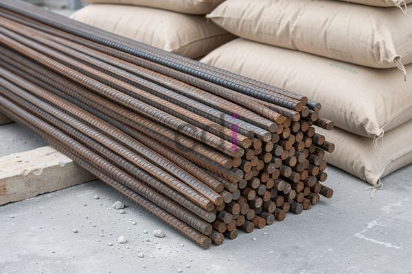

**Besi Diameter 10: Panduan Lengkap Penggunaan, Harga, dan Keunggulan di 2026** - Halo Mitra CDI! Sedang merencanakan pembangunan di 2026 dan mempertimbangkan besi diameter 10? Pemilihan material konstruksi yang tepat adalah kunci utama untuk menghasilkan bangunan yang kokoh dan aman. Yuk, kita bahas tuntas mengenai besi 10mm ini!

### Mengapa Besi Diameter 10 Menjadi Pilihan Utama?

Besi diameter 10, atau besi 10mm, adalah salah satu opsi paling populer di kalangan kontraktor dan pengembang di Indonesia. Kenapa begitu? Sederhana saja: ukurannya yang ideal memudahkan pemasangan, terutama pada detail-detail struktur yang rumit. Kekuatan tariknya juga cukup mumpuni untuk menopang beban pada bangunan dengan tinggi sedang. Ditambah lagi, ketersediaannya di pasar 2026 sangat melimpah, jadi pengadaan pun lebih praktis.

Tapi ingat, Mitra. Besi diameter 10 tidak cocok untuk semua kondisi. Perhitungan yang teliti oleh ahli struktur sangat penting, dengan mempertimbangkan beban, jenis bangunan, dan standar keselamatan yang berlaku.

### Di Mana Saja Besi Diameter 10 Digunakan?

Besi diameter 10 punya banyak peran penting dalam proyek konstruksi. Berikut beberapa aplikasinya yang paling sering kita temui:

*   **Kolom:** Sebagai tulangan utama atau sengkang pada kolom beton bertulang dengan dimensi yang memang sesuai.
*   **Balok:** Digunakan sebagai tulangan utama untuk menahan gaya lentur pada balok beton bertulang.
*   **Slab:** Membantu menopang beban mati dan beban hidup sebagai tulangan pada slab beton bertulang.
*   **Pondasi:** Dapat digunakan sebagai tulangan pada jenis pondasi tertentu, misalnya pondasi tapak.
*   **Detail Struktural:** Pilihan ekonomis dan efisien untuk balok pembantu, ring balok, atau sloof.

### Estimasi Harga Besi Diameter 10 di 2026 & Faktor yang Mempengaruhinya

Kira-kira berapa ya harga besi diameter 10 di 2026? Harga bisa berbeda-beda tergantung merek, kualitas, dan tempat Anda membeli. Untuk mendapatkan info harga terkini dan akurat yang sesuai dengan proyek Mitra CDI, jangan ragu untuk menghubungi Kami.

Ada beberapa hal yang membuat harga besi bisa naik turun:

*   **Harga Bahan Baku:** Harga bijih besi dan batubara, bahan baku utama pembuatan besi, sangat berpengaruh.
*   **Nilai Tukar Rupiah:** Fluktuasi Rupiah terhadap Dolar AS dapat memengaruhi harga besi impor.
*   **Biaya Transportasi:** Ongkos kirim dari pabrik ke lokasi proyek merupakan bagian dari biaya keseluruhan.
*   **Permintaan Pasar:** Semakin banyak permintaan, harga cenderung meningkat jika pasokan terbatas.

Sebagai gambaran, besi diameter 12 biasanya lebih mahal, sementara besi diameter 8 umumnya lebih ekonomis. [Besi Diameter 8: Aplikasi, Kelebihan, Kekurangan, dan Estimasi Harga 2026](/blog/besi-diameter-8/) Penting untuk menyeimbangkan kebutuhan kekuatan dengan efisiensi anggaran.

### Tips Cerdas Memilih dan Menggunakan Besi Diameter 10

Supaya bangunan Anda kokoh dan tahan lama, perhatikan tips berikut saat memilih dan menggunakan besi diameter 10:

*   **Pilih Merek Terpercaya:** Utamakan besi beton dari produsen yang sudah bersertifikasi SNI.
*   **Periksa Kondisi Fisik:** Pastikan tidak ada karat, bengkok, atau cacat pada besi.
*   **Cek Ukuran dan Berat:** Verifikasi bahwa diameter dan berat besi sesuai dengan kebutuhan Anda.
*   **Jaga Kebersihan Besi:** Bersihkan besi dari kotoran, minyak, atau debu sebelum dipasang.
*   **Konsultasi dengan Ahli Struktur:** Selalu ikuti rekomendasi ahli struktur untuk memastikan penggunaan besi beton yang tepat.

Butuh informasi lebih lanjut? Jangan sungkan menghubungi Kami melalui tombol **Telepon** atau **WhatsApp** yang ada di halaman ini! Kami siap membantu Mitra CDI untuk sukses dalam setiap proyek konstruksi di 2026. Nah, bagaimana? Sudah semakin paham tentang besi diameter 10, kan? Semoga informasinya bermanfaat!

<table class="table">
  <caption>Perbandingan Besi Beton</caption>
  <thead>
    <tr><th>Diameter</th><th>Aplikasi Umum</th><th>Estimasi Harga/Meter</th></tr>
  </thead>
  <tbody>
    <tr><td>8mm</td><td>Pondasi, Kolom Kecil</td><td>Rp 7.000 - Rp 10.000</td></tr>
    <tr><td>10mm</td><td>Kolom, Balok, Slab</td><td>Rp 8.000 - Rp 12.000</td></tr>
    <tr><td>12mm</td><td>Kolom Besar, Balok Utama</td><td>Rp 10.000 - Rp 15.000</td></tr>
  </tbody>
</table>
