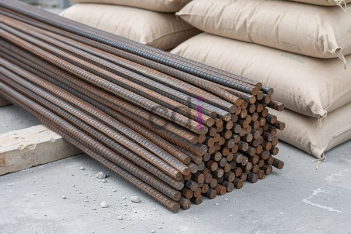

**Besi Diameter 8: Aplikasi, Kelebihan, Kekurangan, dan Estimasi Harga 2026** - Hai Mitra CDI! Apakah Anda sedang merencanakan proyek konstruksi dan mempertimbangkan penggunaan besi diameter 8? Besi berdiameter 8 milimeter ini adalah salah satu pilihan paling populer untuk berbagai aplikasi konstruksi ringan hingga sedang. Artikel ini akan mengupas tuntas kegunaan, keunggulannya, kekurangannya, dan perkiraan harga besi diameter 8 di tahun 2026. Yuk, simak selengkapnya!

## Pemanfaatan Besi Diameter 8 dalam Dunia Konstruksi

Besi diameter 8 dikenal serbaguna, banyak digunakan dalam berbagai elemen struktural bangunan. Aplikasi yang paling umum adalah sebagai tulangan pada sloof, kolom praktis, balok, dan plat lantai pada bangunan dengan jumlah lantai terbatas. Selain itu, besi diameter 8 juga lazim digunakan untuk pembuatan pagar, railing tangga, serta struktur beton bertulang lainnya yang tidak memerlukan kekuatan tarik berlebihan. Ini menjadikannya pilihan yang hemat biaya untuk proyek-proyek skala kecil hingga menengah. 

Penting bagi Anda sebagai Mitra CDI untuk selalu mengingat, pemilihan diameter besi beton harus disesuaikan dengan perhitungan struktur yang tepat. Penggunaan besi diameter 8 yang tidak sesuai dapat berisiko terhadap integritas bangunan. Jadi, pastikan untuk selalu berkonsultasi dengan ahli konstruksi atau insinyur sipil guna memastikan kesesuaiannya dengan kebutuhan proyek Anda. Untuk informasi tambahan terkait perhitungan kebutuhan besi, Anda bisa merujuk pada artikel Berapa Besi yang Dibutuhkan untuk Membangun Rumah? Panduan Lengkap & Perhitungan.

## Keunggulan dan Hal yang Perlu Diperhatikan dari Besi Diameter 8

Besi diameter 8 menawarkan sejumlah keunggulan yang membuatnya banyak diminati. Kemudahan dalam proses pembengkokan dan pemasangan menjadi salah satu kelebihannya. Karena diameternya yang relatif kecil, besi ini mudah dibentuk sesuai kebutuhan desain tanpa memerlukan peralatan khusus yang rumit. Selain itu, bobotnya yang lebih ringan dibandingkan besi berukuran lebih besar, mempermudah proses pengangkutan dan penempatan di lokasi proyek.

Namun, ada beberapa hal yang perlu dipertimbangkan. Kekuatan tarik besi diameter 8 lebih rendah dibandingkan besi yang lebih besar, sehingga kurang ideal untuk aplikasi yang membutuhkan kekuatan struktural yang sangat tinggi. Juga, besi diameter 8 cenderung lebih mudah korosi jika tidak diberikan lapisan pelindung yang memadai. Kami menyarankan Mitra CDI untuk memastikan bahwa besi diameter 8 yang digunakan memiliki lapisan anti-karat yang baik atau memberikan perlindungan tambahan seperti pengecatan atau pelapisan epoksi.

## Mengenai Harga Besi Diameter 8 di Tahun 2026

Harga besi diameter 8 di tahun 2026 diperkirakan akan terus dinamis, dipengaruhi oleh harga bahan baku baja, biaya transportasi, serta fluktuasi permintaan pasar. Secara umum, harga besi diameter 8 per batang (10-12 meter) berkisar antara Rp 50.000 hingga Rp 80.000. Ingatlah bahwa harga ini hanyalah estimasi dan dapat berubah sewaktu-waktu. Untuk penawaran harga terkini dan paling akurat sesuai kebutuhan proyek Anda, segera hubungi Kami!

Sebagai gambaran, berikut adalah estimasi biaya pengadaan besi diameter 8 untuk proyek sederhana:

*   **Sloof (ukuran 150x200mm, panjang 10 meter):** Membutuhkan sekitar 10 batang besi diameter 8. Biaya = 10 batang x Rp 65.000/batang = Rp 650.000
*   **Kolom Praktis (ukuran 200x200mm, tinggi 3 meter):** Membutuhkan sekitar 6 batang besi diameter 8. Biaya = 6 batang x Rp 65.000/batang = Rp 390.000

Perlu diingat, perhitungan ini adalah perkiraan dan belum termasuk biaya transportasi, pemotongan, pembengkokan, dan pemasangan. 

## Membandingkan Besi Diameter 8 dengan Ukuran Lainnya

Memahami perbedaan antara berbagai ukuran besi beton sangat penting untuk membuat pilihan yang tepat. Berikut adalah tabel perbandingan antara besi diameter 8 dan beberapa ukuran lainnya:

<table class="table">
  <caption>Perbandingan Besi Beton Berdasarkan Diameter</caption>
  <thead>
    <tr><th>Diameter (mm)</th><th>Kekuatan Tarik (MPa)</th><th>Aplikasi Umum</th></tr>
  </thead>
  <tbody>
    <tr><td>6</td><td>400</td><td>Tulangan stirrup, detail struktur kecil</td></tr>
    <tr><td>8</td><td>400</td><td>Tulangan sloof, kolom praktis, balok kecil</td></tr>
    <tr><td>10</td><td>400</td><td>Tulangan utama balok, kolom, plat lantai</td></tr>
    <tr><td>12</td><td>400</td><td>Tulangan utama struktur besar, pondasi</td></tr>
  </tbody>
</table>

Dari tabel di atas, Anda bisa melihat bahwa besi diameter 8 memiliki kekuatan tarik yang setara dengan ukuran lain (dengan asumsi mutu baja yang sama), tetapi kurang ideal untuk aplikasi yang membutuhkan kekuatan lebih tinggi. Untuk struktur yang lebih kompleks dan membutuhkan daya tahan lebih baik, besi diameter 10 atau 12 mungkin menjadi solusi yang lebih tepat. Informasi lebih lanjut mengenai penggunaan besi diameter 10 dapat ditemukan di artikel Besi Diameter 10: Panduan Lengkap Penggunaan, Harga, dan Keunggulan di 2026.

Hubungi Kami sekarang juga untuk konsultasi gratis dan penawaran terbaik. Jangan ragu untuk menggunakan tombol **Telepon** atau **WhatsApp** yang tersedia di bawah halaman ini! 