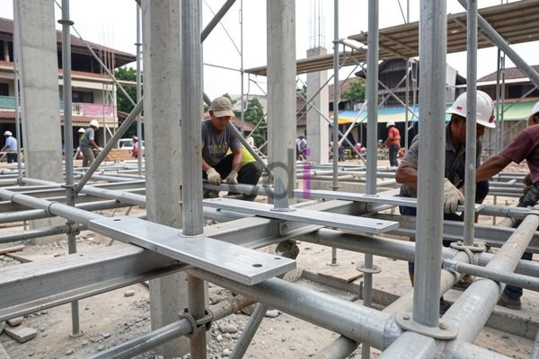

**Besi Foot Plat: Panduan Lengkap Pemilihan, Fungsi, dan Estimasi Biaya 2026** - Hai Mitra CDI! Pernahkah Anda melihat komponen baja berbentuk plat yang menjadi tumpuan utama struktur bangunan? Itulah besi *foot plat*, elemen krusial yang sering terlewatkan. Komponen ini berperan penting dalam menyalurkan beban bangunan ke fondasi, menjamin kekuatan dan keamanan bangunan secara keseluruhan. Artikel ini akan membahas tuntas mengenai besi foot plat, mulai dari fungsi vitalnya, berbagai jenis yang tersedia, cara memilih material yang tepat, hingga perkiraan biayanya. 

## Mengapa Besi Foot Plat Begitu Penting dalam Konstruksi?

Besi foot plat, atau pelat dasar besi, berfungsi sebagai jembatan antara kolom baja atau elemen struktural baja lainnya dengan fondasi bangunan. Tugas utamanya adalah menyebarkan beban vertikal dari struktur ke area fondasi yang lebih luas. Bayangkan pondasi sebagai tanah yang menopang bangunan – foot plat memastikan tekanan beban merata, mencegah penurunan atau kerusakan pondasi.

Lebih dari sekadar penyalur beban, besi foot plat juga bertindak sebagai pelindung terhadap karat pada bagian bawah kolom baja yang rentan bersentuhan dengan tanah atau lingkungan yang keras. Dengan adanya lapisan pelat dasar ini, kolom baja terlindungi dari potensi kerusakan akibat kelembapan dan zat-zat korosif. Selain itu, pemasangan struktur baja pun menjadi lebih mudah dan presisi dengan bantuan foot plat.

## Mengenal Berbagai Jenis Besi Foot Plat: Bentuk dan Material

Ada beragam jenis besi foot plat yang bisa dipilih, dibedakan berdasarkan bentuk dan material pembuatannya. Berikut ini pembagiannya:

*   **Pelat Kotak:** Pilihan paling populer karena kemampuannya mendistribusikan beban secara merata ke semua arah.
*   **Pelat Persegi Panjang:** Ideal untuk struktur yang bebannya terkonsentrasi pada satu sisi tertentu.
*   **Pelat Bulat:** Biasanya digunakan saat beban didistribusikan secara radial, seperti pada tiang penyangga.

Dari segi material, besi foot plat umumnya dibuat dari baja karbon (mild steel) atau baja paduan (alloy steel). Pilihan material tergantung pada seberapa berat beban yang akan ditanggung dan kondisi lingkungan tempat bangunan berdiri. Baja karbon adalah opsi yang lebih ekonomis, tetapi kurang tahan terhadap korosi. Sementara itu, baja paduan menawarkan kekuatan dan ketahanan yang lebih baik terhadap karat, meskipun harganya lebih tinggi. 

Perhatikan tabel berikut untuk perbandingan singkat antara kedua jenis baja tersebut:

<table class="table">
  <caption>Perbandingan Baja Karbon dan Baja Paduan untuk Besi Foot Plat</caption>
  <thead>
    <tr><th>Fitur</th><th>Baja Karbon</th><th>Baja Paduan</th></tr>
  </thead>
  <tbody>
    <tr><td>Kekuatan Tarik</td><td>400-550 MPa</td><td>550-700 MPa atau lebih</td></tr>
    <tr><td>Ketahanan Korosi</td><td>Rendah</td><td>Tinggi</td></tr>
    <tr><td>Biaya</td><td>Lebih Ekonomis</td><td>Lebih Mahal</td></tr>
    <tr><td>Aplikasi Umum</td><td>Struktur ringan, beban kecil</td><td>Struktur berat, lingkungan korosif</td></tr>
  </tbody>
</table>

## Kriteria Penting dalam Memilih Besi Foot Plat yang Sesuai

Memilih besi foot plat yang tepat adalah kunci untuk bangunan yang aman dan kuat. Beberapa hal penting yang perlu diperhatikan antara lain:

*   **Kapasitas Beban:** Hitung beban bangunan dengan teliti. Pastikan besi foot plat yang dipilih mampu menahan beban tersebut tanpa masalah.
*   **Kondisi Lingkungan:** Jika bangunan berada di lingkungan yang korosif (misalnya dekat laut), gunakan besi foot plat dari baja paduan atau berikan lapisan anti-karat tambahan.
*   **Jenis Pondasi:** Sesuaikan ukuran dan bentuk besi foot plat dengan jenis pondasi yang digunakan. Lapisan dasar harus memiliki luas permukaan yang cukup untuk menyebarkan beban secara merata.
*   **Standar Teknis:** Pastikan produk yang Anda pilih memenuhi standar teknis yang berlaku, termasuk SNI terkait baja konstruksi.

Untuk informasi mengenai harga besi foot plat, Kami sarankan Anda memeriksa tabel harga di atas . Harga dapat bervariasi tergantung pada ukuran, ketebalan, jenis material, dan lokasi pembelian. 

## Panduan Pemasangan Besi Foot Plat yang Benar

Pemasangan besi foot plat perlu dilakukan dengan cermat dan mengikuti prosedur yang tepat. Berikut adalah langkah-langkah dasarnya:

1.  **Persiapan Pondasi:** Pastikan permukaan pondasi rata dan bersih dari kotoran atau puing.
2.  **Penempatan Besi Foot Plat:** Letakkan besi foot plat di atas pondasi pada posisi yang sudah ditentukan.
3.  **Pengencangan:** Gunakan baut atau pengelasan untuk mengencangkan besi foot plat ke pondasi atau kolom baja. Pastikan pengencangan dilakukan dengan kuat dan merata.
4.  **Pemeriksaan Akhir:** Periksa kembali seluruh sistem untuk memastikan tidak ada bagian yang longgar atau cacat.

Untuk menjamin kekuatan dan keamanan instalasi, Kami selalu menyarankan penggunaan tenaga ahli yang berpengalaman dalam konstruksi baja. Agar lebih memahami bagaimana bekisting plat besi berfungsi dalam mendukung pondasi, Anda bisa membaca [Bekisting Plat Lantai: Panduan Lengkap Material, Aplikasi, dan Estimasi Biaya 2026](/blog/bekisting-plat-lantai/).

Di (not detected), Kami siap mendukung proyek konstruksi Anda. Hubungi Kami sekarang melalui tombol **Telepon** atau **WhatsApp** untuk mendapatkan penawaran terbaik dan solusi yang tepat! Atur konsultasi gratis dengan tim ahli Kami untuk membahas kebutuhan spesifik proyek Anda di (not detected). Jangan ragu untuk bertanya — Kami selalu siap membantu!