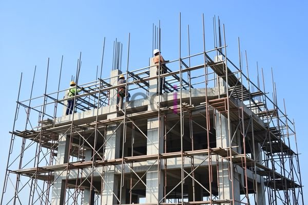

**Besi Penyangga Bangunan: Jenis, Fungsi, dan Tips Memilih yang Tepat** - Hai Mitra CDI! Pernahkah Anda memikirkan bagaimana sebuah bangunan bisa berdiri kokoh dan aman? Salah satu jawabannya terletak pada penggunaan besi penyangga kualitas unggul.

Besi penyangga bangunan, atau yang lebih dikenal sebagai besi tulangan, memainkan peran sentral dalam hampir seluruh proyek konstruksi. Tugas utamanya adalah mengatasi kelemahan beton terhadap gaya tarik. Beton memang unggul dalam menahan tekan, namun tergolong lemah saat ditarik. Di sinilah besi hadir sebagai tulang punggung internal, memberikan kekuatan ekstra yang dibutuhkan. Memilih besi penyangga yang tepat untuk konstruksi Anda akan berdampak signifikan pada keamanan, ketahanan, dan umur bangunan Mitra CDI.

## Mengenal Lebih Dekat Berbagai Macam Besi Penyangga Bangunan

Ada beberapa jenis besi penyangga bangunan yang umum digunakan di lapangan. Memahami perbedaan di antara mereka akan membantu Anda, Mitra CDI, memilih material yang paling cocok dengan kebutuhan proyek. Ini beberapa di antaranya:

*   **Besi Beton Polos:** Jenis ini memiliki permukaan yang halus dan umumnya digunakan untuk komponen beton yang tidak memerlukan daya rekat yang kuat.
*   **Besi Beton Ulir:** Jenis ini memiliki alur ulir yang khas di permukaannya. Fitur ini secara signifikan meningkatkan daya rekat antara besi dan beton, menjadikannya ideal untuk konstruksi yang menahan beban besar dan dinamis. Alur ulirnya memungkinkan besi beton mengunci dengan kuat dalam struktur beton, mencegah pergeseran dan meningkatkan kekuatan tarik secara keseluruhan.
*   **Besi Hollow:** Berbentuk seperti pipa dengan berbagai variasi ketebalan dan ukuran, besi hollow sering dimanfaatkan untuk konstruksi ringan seperti rangka kanopi, pagar, dan rangka atap.

Keputusan jenis besi yang paling ideal sangat bergantung pada tuntutan spesifik proyek dan besaran beban yang akan ditanggung oleh struktur bangunan Anda. Untuk konstruksi yang membutuhkan kekuatan dan daya tahan maksimal, besi beton ulir biasanya menjadi pilihan utama.

## Apa Saja Fungsi Vital Besi Penyangga Bangunan dalam Pembangunan?

Fungsi besi penyangga bangunan jauh lebih luas daripada sekadar menahan gaya tarik. Material ini juga berperan penting dalam:

*   **Meningkatkan Kekuatan Struktural:** Besi tulangan memberikan tambahan kekuatan tarik pada beton, yang notabene meningkatkan kemampuan bangunan untuk menahan beban vertikal atau horizontal.
*   **Meminimalkan Retakan pada Beton:** Besi beton membantu mengendalikan retakan yang mungkin muncul pada beton akibat perubahan suhu, penyusutan, atau beban berlebih. Dengan menahan gaya tarik, besi beton mencegah retakan tersebut berkembang menjadi kerusakan struktural yang serius.
*   **Meningkatkan Ketahanan Terhadap Gempa:** Terutama di daerah-daerah yang rawan gempa, penggunaan besi penyangga bangunan yang memadai sangatlah krusial. Besi tulangan membantu bangunan menyerap energi gempa dan mengurangi risiko keruntuhan.
*   **Memperpanjang Masa Pakai Bangunan:** Dengan menjaga integritas keseluruhan struktur bangunan, besi penyangga berkontribusi pada umur bangunan yang lebih panjang dan lebih aman.

## Panduan Praktis Memilih Besi Penyangga Bangunan Berkualitas

Memastikan kualitas besi penyangga bangunan adalah langkah penting untuk menjamin keamanan dan kekuatan bangunan Mitra CDI. Berikut adalah beberapa tips yang bisa Anda pertimbangkan:

*   **Perhatikan Standar Mutu Besi:** Pastikan besi yang Anda pilih memenuhi standar nasional (SNI) yang berlaku. Biasanya, mutu besi beton ditunjukkan dengan angka, misalnya BJTP-300 atau BJTP-400. Angka ini menunjukkan kekuatan tarik minimum besi tersebut.
*   **Cek Sertifikasi Produk:** Pastikan besi yang Anda beli memiliki sertifikasi dari lembaga pengujian yang kompeten dan terakreditasi. Sertifikasi adalah jaminan bahwa besi tersebut telah memenuhi standar mutu yang ditetapkan.
*   **Inspeksi Kondisi Fisik Besi:** Periksa dengan cermat, pastikan besi tidak berkarat, bengkok, atau memiliki cacat fisik lainnya. Besi berkualitas baik seharusnya memiliki permukaan yang bersih dan rata.
*   **Sesuaikan dengan Spesifikasi Proyek:** Pilih jenis dan ukuran besi yang tepat, sesuai dengan kebutuhan spesifik proyek dan hasil perhitungan struktur. Konsultasikan dengan ahli struktur untuk mendapatkan rekomendasi yang paling akurat.
*   **Lakukan Pembandingan Harga:** Harga besi penyangga bangunan bisa bervariasi tergantung pada mutu, ukuran, dan lokasi pembelian. Luangkan waktu untuk membandingkan harga dari beberapa supplier sebelum membuat keputusan pembelian.

Sebagai informasi tambahan,  akan memberikan gambaran mengenai perkiraan harga besi beton di tahun 2026. Harga ini bersifat fluktuatif, jadi hubungi Kami untuk mendapatkan penawaran terkini dan paling sesuai dengan kebutuhan proyek Mitra CDI.

## Mengapa Perhitungan Kebutuhan Besi yang Akurat Itu Sangat Penting?

Perhitungan kebutuhan besi penyangga bangunan yang tepat sangatlah krusial untuk keberhasilan proyek Anda. Terlalu sedikit besi dapat membahayakan kekuatan dan stabilitas bangunan, sementara terlalu banyak besi justru akan memboroskan anggaran konstruksi. Untuk hasil yang akurat, sangat disarankan untuk menggunakan jasa ahli struktur yang berpengalaman. Mereka akan memperhitungkan berbagai faktor seperti beban bangunan, jenis tanah, dan desain struktur untuk menentukan jumlah besi yang optimal.

Jika Anda memiliki pertanyaan lebih lanjut, jangan ragu untuk menghubungi Kami. Tim Kami siap membantu melalui tombol **Telepon** dan **WhatsApp** yang tersedia di bawah ini. Yuk, bangun masa depan yang kokoh bersama CDI! [Cara Menghitung Besi Untuk Cor Lantai](/blog/cara-menghitung-kebutuhan-besi-untuk-cor-lantai/) akan membantu Anda lebih memahami hal ini.