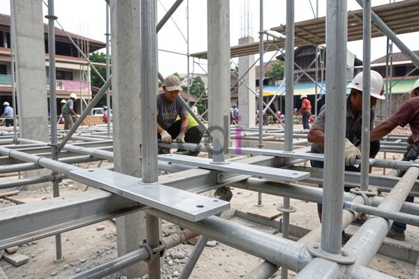

**Besi Plat Lantai: Panduan Lengkap Aplikasi, Ukuran, dan Estimasi Biaya 2026** - Halo Mitra CDI! Ingin membangun lantai beton yang kuat dan tahan lama? Pemilihan material yang tepat, khususnya besi plat lantai, tentu jadi kunci penting. Kami dari CDI siap membantu Anda memahami seluk-beluknya. Karena, faktanya, lebih dari separuh anggaran konstruksi – sekitar 60% – terserap untuk material bangunan.

## Mengapa Besi Plat Lantai Penting dalam Konstruksi?

Besi plat lantai punya peran vital saat pengecoran lantai beton. Bayangkan, saat beton masih cair, ia butuh penyangga yang kuat dan rata. Nah, besi plat inilah yang bertugas memberikan dukungan tersebut. Hasilnya? Lantai yang permukaannya rata, halus, dan kokoh. Dengan begitu, proses pembangunan jadi lebih efisien karena minim pekerjaan perataan setelah beton mengeras.

Jangan pikir besi plat lantai cuma untuk lantai dasar ya, Mitra. Material ini juga ideal untuk lantai mezzanine, area parkir, balkon, bahkan teras. Yang perlu diingat, pilih ketebalan dan jenis besi plat yang sesuai dengan beban yang akan ditanggung lantainya.

## Mengenal Ukuran dan Spesifikasi Besi Plat Lantai

Di pasaran, Anda akan menemukan berbagai ukuran besi plat lantai. Pemilihan ukuran yang pas bergantung pada bentang lantai, kekuatan desain yang diharapkan, dan jarak antar penyangga. Berikut beberapa ukuran yang umumnya tersedia:

*   **Ketebalan:** Pilihan ketebalan besi plat lantai berkisar antara 6 mm hingga 12 mm. Semakin tebal, semakin kuat menahan beban, tapi tentu saja juga lebih berat dan harganya berbeda.
*   **Lebar:** Lebar standar besi plat lantai biasanya antara 1 meter sampai 1,2 meter.
*   **Panjang:** Panjangnya fleksibel, disesuaikan kebutuhan proyek. Ukuran standar yang sering ada adalah 3 meter, 4 meter, atau 6 meter.

Sebagai gambaran, untuk rumah tinggal dengan beban normal, besi plat lantai tebal 8 mm hingga 10 mm lebar 1 meter biasanya sudah memadai. Tapi, untuk bangunan komersial atau industri yang memerlukan kekuatan ekstra, besi plat lantai tebal 12 mm atau lebih bisa jadi pilihan yang tepat.

## Perkiraan Biaya Besi Plat Lantai dan Faktor Pengaruhnya

Harga besi plat lantai bisa naik turun tergantung beberapa hal: ketebalan, ukuran, kualitas material, dan lokasi geografis di (not detected). Estimasi harga tahun 2026 berkisar antara Rp 150.000 sampai Rp 350.000 per lembar (ukuran 1 meter x 2 meter, tergantung ketebalan). Ingat, harga ini bisa berubah sewaktu-waktu. Untuk info harga yang paling baru dan sesuai kebutuhan proyek Anda di (not detected), yuk, hubungi Kami!

Selain harga material, jangan lupa anggarkan biaya tambahan seperti ongkos kirim, pemotongan, dan pemasangan. Cara terbaik? Bandingkan harga dari beberapa supplier untuk mendapatkan penawaran terbaik.

## Tips Merawat Besi Plat Lantai Agar Awet

Setelah digunakan, jangan biarkan besi plat lantai berkarat. Rawat dengan baik agar bisa dipakai berulang kali dan menghemat biaya konstruksi. Ini dia beberapa tipsnya:

*   Pastikan besi plat lantai bersih dari sisa-sisa beton atau kotoran lainnya setelah digunakan.
*   Oleskan lapisan anti-karat secara berkala.
*   Simpan di tempat yang kering dan terlindung dari cuaca ekstrem.

Jadi, bagaimana, Mitra? Sudahkah Anda memahami pentingnya besi plat lantai dalam konstruksi di (not detected)? Jangan ragu untuk berdiskusi dengan tim ahli CDI. Tombol **Telepon** dan **WhatsApp** di bawah ini siap membantu Anda mewujudkan proyek impian! [Besi untuk Pondasi Rumah: Jenis, Ukuran, dan Estimasi Biaya Terbaru 2026](/blog/besi-untuk-pondasi-rumah/) — yuk, pelajari juga tentang pondasi rumah yang kuat untuk melengkapi rencana bangunan Anda.